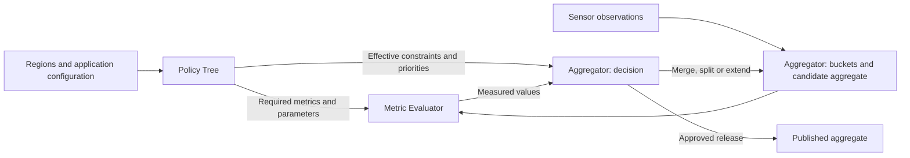

# Aggregation design review

Status: 2026-10-13. Planning document; no implementation is implied by the proposals below.
The user requests preservation of sensor modularity and existing performance work. The
current configuration and presentation are design inputs, not instructions to execute
every item in an old implementation plan.

The [bucket lifecycle and release protocol](BUCKET_LIFECYCLE.md) expands the October 13
discussion into a state diagram, data/storage contract, policy compilation rules,
sibling reservations, irreversible publication behavior and renderer acceptance cases.
Its Sections 6.1–6.3 also define selective suppression, separate allowed/reserved/prepared
extent, and the controlled full-versus-selective preparation study. It is the detailed
proposal for these topics; implementation remains pending.

## 1. Sources and verified baseline

Reviewed the supplied presentation, *Adaptive, Metric-Based and Privacy-Preserving Sharing
of Urban Mobility Data*, from the AutSys 2025 folder. PDF pages 6-8 contain the metric list;
pages 18-20 contain active/preemptive buckets and merge/split rules (printed slides 17-19).
These pages were read and the diagrams visually inspected. This is the supplied version;
the current-year submission may evolve from it.

Source PDF: `/Users/maxdemu/Documents/HAW Hamburg/Konferenzen und Workshops/2025/AutSys 2025/Vortrag/De Muirier AutSys 2025 Presentation.pdf`.

Code/configuration checked: `simulator/config.yaml`, `SharedBuffer.hpp/.tpp`, `Sensor.hpp`,
`AggregationManager.hpp/.cpp`, `Region.hpp/.cpp`, `Simulation.cpp`, `Quadtree.hpp/.cpp`,
and the AGBS/renderer update paths. The historical implementation plan is an alternative
design reference, not an accepted replacement for the presentation's bucket semantics.

### Configuration facts

| Sensor | Detection rectangle in metres | Sampling |
|---|---|---|
| ABS | x=[0,60), y=[0,80) | 10 Hz |
| GBS | x=[60,120), y=[0,80) | 10 Hz; 5-m cells |
| AGBS | x=[120,200), y=[0,80) | 10 Hz; cell_size=40; max_depth=6 |

The simulation uses 50-ms steps. The sensor areas are adjacent; their raw outputs do not
represent the same population. A controlled comparison needs the same area, observation
times and movement input. Proposed first evaluation rectangle: x=[0,80), y=[0,80) for all
three sensors. Its square shape is compatible with the existing AGBS extent of
2*cell_size=80. This is a proposed evaluation configuration, not a modification to the
user's current YAML. Preserve the separate-area configuration for demonstrations if useful.

`region_taxonomy` defines commercial, residential, traffic and common attributes, but
`regions` currently instantiates only one common rectangle: x=[0,80), y=[0,80). It therefore
does not intersect the current AGBS area. Its spatial limits are 10-100 m, temporal limits
0-10 s, and configured k/l minima are both 1. Those fields are loaded into Region instances,
but no policy lookup or enforcement consumes the regions in the active aggregation path.
The meaning of spatial bounds (side length versus area) and zero temporal lower bounds
must be explicit before policy validation is enabled.

### Existing transport and aggregation

- Simulation owns sensors and calls their updates synchronously before moving agents.
- The agent buffer contains timestamped agent-state snapshots for rendering/debugging.
- The sensor buffer contains timestamped sensor-ID -> cell-ID sets. It is a visualization
  snapshot, not a measurement batch with counts, identities, histories or metric inputs.
- SharedBuffer::read takes the front queue item and pops it. It is consumptive, not broadcast.
- AggregationManager owns a MongoDB collection reference and a bucket scaffold. Its only
  implemented action is a timestamp insertion test. Bucket flush is empty, and the bucket
  constructor does not initialize its cellId member from its argument.
- The spatial hierarchy supports nodes, parents, children and cell IDs. Current AGBS
  splitting follows positions at configured maxDepth, not policy/metric decisions.

### Paper and presentation cross-check (2026-10-13)

Also reviewed the newly supplied *An Adaptive Metric-Based Method for Privacy-Preserving
Sharing of Anonymized Urban Mobility Data* (10 PDF pages), stored as:
`/Users/maxdemu/Documents/HAW Hamburg/Konferenzen und Workshops/2024/AutSys 2024/Paper/AutSys_2024_paper_V2_Final.pdf`.
Relevant metric tables and the framework diagram were visually inspected.

- Presentation printed slide 13 is PDF page 14: the architecture already includes Regional
  Thresholds and Privacy/Usability Metrics feeding the aggregation control loop. It does
  not show an explicit policy tree, inheritance or policy conflict resolution.
- Printed slide 8 (PDF page 9) explains regional/context-dependent constraints. Printed
  slides 17–19 mention regional checks in the manager and merge/split rules. The topic is
  present; the implementation model and worked policy examples are missing.
- Paper Section 3.2 (page 4) explicitly discusses context-dependent metric thresholds.
  Table 4 on page 5 lists proposed threshold values; these need context-specific justification
  before becoming defaults. Sections 4.1/4.2 and 6 refer to functional zones and their effect
  on spatial/temporal aggregation. The paper does not specify an implemented policy tree.
- Paper Figure 1 (page 6) includes an interval tree; Section 4.2 (page 7) describes that
  temporal structure. Reconcile its role with active/preemptive buckets and retained history
  before selecting implementation data structures. Paper descriptions alone do not prove
  those structures exist in the current simulator.
- Table 5 (page 5) defines temporal consistency, temporal aggregation error, spatial drift,
  relative velocity error and average frame-processing time. This differs from the supplied
  presentation's utility table. Reconcile definitions rather than implementing both lists
  unchanged. Relative velocity error needs a zero-speed rule, and intentional adaptive
  timing must be distinguished from undesired timing jitter in temporal consistency.

## 2. Ownership and threading proposal

Keep sensor-specific capture behavior. Reuse an aggregation implementation through
composition where needed, with separate state for each sensor and application release
stream. Do not combine measurements from different sensors merely because their areas
overlap; sensor fusion would require its own identity and duplication semantics.

### AGBS first, reusable aggregation core

The first integration targets AdaptiveGridBasedSensor. It already sees observations and
the quadtree geometry required for the planned spatial decisions. Preserve ABS/GBS as
independent sensors and baseline representations. The reusable core must not depend on a
Sensor subclass or fetch data from the renderer or MongoDB to drive each decision.

Proposed boundary:

```text
AGBS capture -> small adapter/normalization -> observation batch
    -> AggregationManager [history, active/preemptive buckets, candidate orchestration]
       -> existing quadtree spatial operations
       -> MetricEvaluator: current candidate values
       -> PolicyTree: applicable requirements
       -> release/suppress/adapt decision
    -> output batch -> persistence / visualization
```

AGBS may own its AggregationManager instance by composition. Keep observation ingestion
and advancing time/closing windows distinct in the contract; neither needs a worker thread.
A direct function call is sufficient initially. An interface illustration is
`ingest(batch)`, `advance(now)` and retrieval/consumption of completed releases; exact C++
types remain to be decided from the agreed data contract.

Sensor-independent does not mean that the first spatial strategy is independent of a
quadtree, nor that every source supports every metric or refinement operation. An ABS
adapter can provide point observations later. A GBS adapter may provide cell summaries,
but cannot reconstruct internal identities or finer geometry that its input discarded.
Declare required inputs and unsupported operations rather than guessing missing values.
Build the real AGBS adapter first; defer unused adapter classes and abstraction hierarchies.

Initial call path in the simulation thread:

```text
sensor capture -> immutable observation batch -> that sensor's aggregation engine
    -> history/statistics -> candidate metrics -> effective policy -> release decision
    -> publication batch -> persistence / renderer snapshot
```

Pass a const batch/reference directly while lifetimes are synchronous. Retained history
must own its values/statistics; it must not hold Agent* pointers into the mutable simulation
vector. Define the internal batch before choosing its C++ representation. For contributor
metrics it needs stable internal identities, or an explicit unavailable-metric result when
the observation source cannot provide them. Count-only GBS records cannot recover distinct
contributors across time. Complete ABS output omits first observations; choose deliberately
between that stream and internal observations before the velocity-publication filter.

**Initial recommendation:** no aggregator access to the existing renderer buffers and no
extra aggregation thread. This preserves deterministic call order and avoids additional
copying/locking. It does not claim that one thread will meet every future load requirement.
Measure capture, mapping, history, metrics, decisions and DB transfer separately first.

If measured costs justify a worker later, enqueue immutable observation batches to a bounded
aggregation queue. Choose a lossless/backpressure policy for scientific processing. The
renderer may consume a separate latest-state stream if skipping display frames is allowed.
Never silently drop measurement batches to preserve frame rate.

### Why a fixed access count does not implement two readers

One write and two consumers are delivery/ownership requirements, not three reads. The
writer is not a read acknowledgement. A counter cannot ensure that two distinct consumers
each received a frame, prevent one consuming twice, or handle a stopped/slow consumer.
With the current pop-on-read queue, two readers would divide the work rather than each
receiving all frames. Its notify_one and shutdown predicate are also designed around the
present consumption pattern; appending a counter would not fix the protocol.

If both consumers need the same payload, use separate queues/subscriber cursors referring
to the same immutable batch, for example shared_ptr<const Batch>. Reference counting
reclaims the payload after the last owner releases it. Each consumer still needs explicit
delivery state, synchronization and backlog limits. Reference counting alone is neither
broadcast nor flow control. An aggregation history may retain statistics beyond transport
consumption; these lifetimes must remain separate.

## 3. Active and preemptive buckets

The presentation gives active buckets the current aggregation role and buffer buckets
the preemptive/retrospective reconstruction role. It does not fully define window ownership,
publication status or disposal. In particular, preemptive must not be silently interpreted
as merely the next chronological window.

Proposed logical roles:

| Role | Purpose | Can emit public output? |
|---|---|---|
| Active bucket | Current selected cell/window under evaluation | Only after decision and commit |
| Preemptive candidate | Alternative parent, child or temporal window prepared for a possible transition | No, until explicitly selected/promoted |
| Retained history | Observations/time bins sufficient to reconstruct permitted alternatives | No |
| Publication record | Committed release and its spatial/temporal coverage | Already externally visible |

Store one authoritative bounded history and reference it from logical buckets; cache
alternative sufficient statistics only when beneficial. Avoid copying full raw observations
to every node and every candidate window. A ring of observation-time bins is a candidate
implementation, subject to the required window boundaries and retention rule. Exact
distinct contributor counts require unions/reference counts or another exact structure;
adding child distinct counts is incorrect if an agent contributed to multiple children.
If approximation is later used, quantify its error before applying hard thresholds.

Proposed states: collecting -> ready for decision -> committed or suppressed. A waiting
decision remains pending until new evidence, a policy change or a deadline. Preemptive
candidates are invalidated or recomputed when their input/policy versions change. Final
discard and history reclamation are separate from publication state.

The detailed lifecycle distinguishes READY, SEALED/PENDING_OUTPUT, COMMITTED,
SUPERSEDED and SUPPRESSED, with temporal exhaustion as a separate property. Early
completion also requires publication coordination; a passing child may still be held.
Do not use one ambiguous `finished` flag for both a closed window and an external release.
Fix these semantics with hand-worked examples before implementation:

1. Exact [start,end) support for each bucket, including the final partial window.
2. Which events close, extend, promote, suppress or discard it.
3. Which candidates are prepared and to what spatial/temporal depth.
4. Latest deadline and behavior when no allowed release exists.
5. Maximum history horizon and the oldest still-referenced observation time.
6. Whether overlapping windows/publications are allowed and how their combined information
   affects evaluation. Default proposal: disjoint release coverage within one application
   stream; history may overlap internally.

## 4. Merge/split protocol from the slides

Printed slide 18: a sibling requests a merge after its privacy check fails; the manager
waits for aggregating siblings, checks the candidate parent, and grants/waits/denies.
Printed slide 19: a parent requests a split; the manager checks the parent's aggregation
status and parent/child constraints before granting the transition.

Retain that protocol and make its preconditions precise:

- All affected statistics must describe compatible observation intervals. Four siblings
  being idle/finished does not establish equal temporal support.
- Reconstruct and evaluate the parent or all required children before changing the active
  release selection. Combining passing child flags does not establish that a parent passes.
- Resolve every region intersected by the candidate geometry. A larger cell must not
  weaken a stricter regional constraint simply by acquiring a different centre point.
- Commit a parent or its selected children atomically for a defined handover interval;
  avoid unintended simultaneous parent/child release of the same contributions.
- Make irreversible external publication distinct from temporary internal DB storage.
  Removing an already visible DB record cannot erase information already read by a client.
- Reserve required sibling/ancestor support before competing child publication. Choose
  either a bounded coordination domain or early release that closes conflicting historical
  merges. Merely flagging a failing leaf is too late if its siblings were already published.
- Preserve original window start/deadline through merges. Reaching the maximum duration
  permits remaining legal spatial candidates or the final descendant fallback before
  suppressing unreleasable support; it does not reset time.
- A pending request must have a wake-up trigger/deadline; otherwise heterogeneous windows
  can cause repeated polling or indefinite waits.

Example: sibling A covers [0,100 ms), while B covers [0,300 ms). Both being finished does
not make their statistics directly mergeable. A [0,300 ms) parent requires complete coverage
for every child over that interval. If A's fine releases have already been published, a
new parent cannot retroactively anonymize those releases. Choose a future common handover
boundary, or defer publication until the competing candidate is decided, under a stated
latency bound. This trade-off belongs in the protocol, not just the database implementation.

A fixed maximum depth can remain the finest allowed resolution while selected release
depth changes. Reuse existing node geometry/IDs. Do not require a fully materialized tree
at every depth/application without measuring its memory cost; cached/lazy hierarchy use
is compatible with a changing release selection.

## 5. Region and policy-tree integration

Retain Region as the configured spatial object and reuse current YAML loading. The
present struct combines spatial region metadata, appearance and constraints; extract or
reference typed constraints incrementally rather than rewriting the whole taxonomy.

Proposed mapping:

```text
region_taxonomy defaults + configured Region instances + application policy
    -> effective policy lookup/tree -> candidate-cell constraints
```

Use one policy view/tree per application policy set, not one full quadtree for every
individual metric. A node can hold all applicable constraints or an inherited policy ID.
Share immutable geometry where helpful, while keeping data statistics and policy state
separate. A policy tree can refine at region boundaries independently of the data's release
depth. Start with one application; multiple simultaneously visible views require joint
privacy evaluation as well as separate release state.

Compile/cache effective policies for relevant cells at initialization. Invalidate on
configuration/policy version change or geometry refinement, not every simulation tick.
For intersecting regions, combine constraints by a declared rule. For compatible lower
bounds use the strongest lower bound, for upper bounds the tightest upper bound; reject
an empty feasible interval. Class/metric semantics and priorities still need explicit
definitions, so this numeric rule is not a universal conflict resolver. The October 13
requirement is strict inheritance: regional children may tighten compatible hard rules,
but must not silently relax them. Spatial-first/temporal-first are preferences with
explicit priority/tie rules, not numerically comparable privacy bounds. Start with aligned non-overlapping
regions, then test overlapping and cross-boundary cells before enabling them.

Missing region type references should be configuration errors. Current map indexing in
initializeRegions can default-insert unknown types; validate these lookups during policy
integration instead of silently obtaining unintended constraints.

### Metric requirements versus measured values

The policy tree is the source of effective *requirements*. It can select which metrics
matter, their parameters/reference definitions, thresholds, and preferences. It does not
produce current measured values merely by being queried for a region.

| Concept | Owner/source | Example |
|---|---|---|
| Metric definition | Evaluator implementation/specification | Count distinct contributors within the exact candidate support |
| Metric requirement | Application/region policy | Require contributor support >= 5 |
| Measured value | Evaluator from current bucket/history | Contributor support = 3 |
| Hard operational bound | Application/region policy | Maximum aggregation duration = 1 s |
| Current candidate property | Bucket time/geometry | Aggregation duration = 0.6 s |
| Decision | AggregationManager / decision function | Candidate fails support; consider permitted alternatives before deadline |

These are illustrative parameters, not empirically justified privacy thresholds. Maximum
aggregation duration is a constraint on a measurable property; it need not be presented as
a separate privacy metric. Similarly distinguish maximum release age, cell size bounds,
hard constraints and optimization preferences. A policy may request a metric configuration
from the evaluator; the evaluator returns a value or an explicit unavailable status.

Proposed architecture diagram for the presentation (pending slide editing):



This is a proposed refinement of printed slide 13: make regional requirements and measured
data separate inputs to the decision. It is not simply a policy-tree box inserted in a
serial chain through which all measured values must pass. The diagram's boxes are logical
responsibilities, not an instruction to create a thread or heavyweight service for each.
Existing Region geometry/configuration feeds the policy view rather than being replaced.

## 6. Metric definitions and evaluation schedule

Separate continuously maintained sufficient statistics, candidate metrics used for control,
and evaluation against GT/attacker outcomes. Keep their data requirements explicit.

| Quantity | Recommended update trigger |
|---|---|
| Current occupancy/class histogram | New sensor observation; detect departures and transition to empty |
| Window observation contributions | Each included observation and window expiration |
| Distinct contributors | Identity enters/leaves window support; exact union for merge candidates |
| Cell dimensions | Geometry creation/change; otherwise cached |
| Window duration / age / deadline | Time advance or scheduled decision, including no-arrival periods |
| Local histogram-based metric | Relevant statistic/window/policy changes |
| Metric using a global reference distribution | Also when that reference version changes |
| Candidate policy compliance | Before every release/merge/split using current metric versions |
| Empirical attack success and application query error | Evaluation on saved releases versus a declared reference |
| Processing latency / memory / throughput | Instrument actual execution separately from simulated time |

The current simulator advances at 20 Hz but sensors observe at 10 Hz. Aggregation must not
count an unchanged observation again on intervening simulation ticks. Time-dependent
conditions can still expire on those ticks. An active/dirty-cell list plus deadline events
avoids scanning every cell for every metric while preserving necessary updates. An empty
cell, an expired contribution or a changed global reference can require work without a new
agent observation. Every publication requires up-to-date checks.

### Review of the presentation's candidate metrics

- **k-anonymity / l-diversity:** the slides define equivalence groups and sensitive values.
  The implementation must specify quasi-identifiers and sensitive attributes. Distinct
  contributors per cell/window is useful operational support, but is not automatically
  the slide's k-anonymity model; agent type may be a quasi-identifier rather than sensitive.
- **delta-presence / t-closeness:** require a specified population/prior or reference
  distribution and appropriate attribute semantics; a local agent count alone is insufficient.
- **Classification accuracy:** copied GT labels provide no nontrivial classification-error
  experiment. Enable this metric when the sensor model actually produces classifications.
- **Temporal granularity S+A (printed slide 7):** S is defined as scans/time, A as an
  accumulated number of data points. Their sum has inconsistent units. Record sensor
  period, aggregation duration and release age separately before proposing a combined score.
- **Data Fidelity Accuracy (same slide):** lost counts divided by cell count is an average
  loss per cell, not a normalized accuracy. Specify a meaningful denominator and distinguish
  retention/coverage from error in an application query.
- **Localization accuracy:** the shown normalized distance sum changes with sample count
  and divides by cell size. Define aggregation/weighting explicitly; report a physical
  error in metres when evaluating spatial coarsening. A normalized version may be secondary.
- **Latency model alpha*batch_size + beta*agent_count:** an explanatory model requires
  measured coefficients/validation. Record measured latency and separate processing time
  from window-induced waiting. Do not use the expression as an already measured result.

These are definition checks against the supplied slide, not a final metric selection or
literature review. Choose the first application query and attacker model before making
scientific privacy/utility claims. Online policies may use measurable proxies while offline
evaluation tests whether those proxies actually improve the intended outcomes.

## 7. Performance and modularity acceptance criteria

- Preserve ABS, GBS and AGBS capture semantics and separate sensor state.
- Use a common area/input in the evaluation configuration, not implicit sensor fusion.
- Ingest each sensor observation once; avoid DB round-trips in every candidate decision.
- Bound history by permitted windows plus explicitly retained transition support.
- Cache geometry/policies and reuse sufficient statistics; prepare only useful alternative
  candidates instead of all nodes/all windows at every tick.
- Profile capture/mapping, history, metric checks, transitions, allocation, persistence and
  rendering separately. Define dataset size and sensor settings with each measurement.
- Only choose a worker thread, denser precomputation or a more complicated queue once a
  concrete bottleneck or execution requirement justifies it.

## 8. Decisions required before implementing the first path

1. Initial output query/count semantics: occupancy at a time, mean occupancy over a window,
   and/or distinct visitors; do not use one ambiguous totalAgents field for all three.
2. Authoritative internal observation stream and exact identity/attribute availability.
3. Active/preemptive states, interval ownership, release frontier and retention horizon.
4. One application's policy fields, units, inheritance and boundary behavior.
5. Minimal online metric definitions and the first offline utility/attacker evaluation.

Then verify hand-worked cases: the same person observed twice; a person crossing siblings;
siblings with different window end times; one strict regional boundary; no arrivals until
a deadline; a split with one failing child; a merge after one child was already published.
Those cases define the contract for the first implementation and its regression checks.
