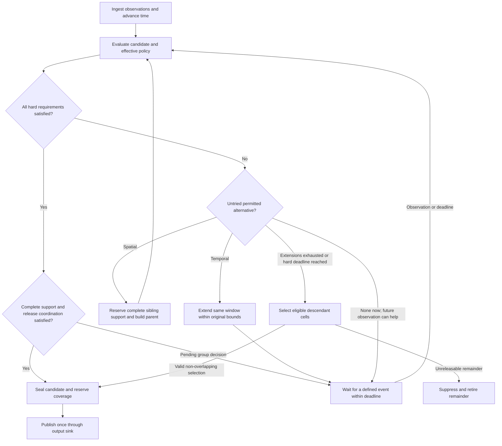

# Bucket lifecycle and release protocol

Status: 2026-10-13. Detailed design proposal, not implemented behavior. This document
refines [Aggregation design review](AGGREGATION_DESIGN.md); [TO-DO](../TO-DO.md)
remains the execution queue. Examples and numerical thresholds are illustrative.

## Project terminology decision (2026-10-13)

The user defines First by the dimension to preserve/prioritize, rather than by the first
aggregation operation. This definition governs current design, policy labels and results:

| Strategy label | Priority to preserve | First permitted adaptation | Subsequent alternative |
|---|---|---|---|
| Temporal First | Temporal resolution/freshness | Spatial aggregation | Temporal extension if still needed and allowed |
| Spatial First | Spatial resolution/detail | Temporal aggregation | Spatial coarsening if still needed and allowed |

Both strategies still enforce every hard constraint and may finish early. A priority is
not a guarantee of latency or resolution. Keep the selected preservation priority and its
derived action order explicit in configuration/output metadata; do not permit contradictory
independent settings. Possible internal identifiers are `preserve_temporal` and
`preserve_spatial`; final C++/YAML names remain an implementation decision.
The archived implementation plan uses the opposite, operation-order naming and is annotated
as historical. No implementation or migration of a running strategy is implied here.

## 1. Assessment and proposed first scope

Collecting fine observations in bounded leaf history and constructing coarser candidates
is a useful foundation. A failed candidate can be replaced by a parent or a longer window
and evaluated again. Leaf flags are scheduling hints; they do not establish complete
coverage, permission to merge, or permission to publish.

The first implementation should use one AGBS stream, one application, fixed observation
bins, aligned regions and fixed candidate windows. Add spatial merges next, then temporal
extension and a configurable preference order. Keep retained data fine enough for the
supported alternatives; changing publication resolution need not mutate capture resolution.
The algorithm is a bounded heuristic, not a proof of an optimal privacy/utility trade-off.

Key requirements from the discussion:

- Policies inherit and combine all applicable hard constraints; no child silently relaxes
  a parent or neighboring intersected region.
- A spatial parent covers all four child regions for the same interval. Known empty
  coverage is valid; an unavailable observation is not automatically a zero count.
- Already visible releases stay part of the observer's knowledge. Internal history cannot
  retroactively protect them.
- A passing privacy proxy alone does not establish release eligibility. Other hard bounds,
  data completeness and coordinated publication must also pass.
- Maximum window duration, successful release, suppression and replacement are separate
  concepts. Do not overload one `finished` flag.

## 2. Observation and output contract

The simulation orchestrator obtains each sensor's due observations and passes an owned
value batch through a small adapter to AggregationManager. First use synchronous calls;
the manager may remain a composed member of AGBS. Class separation is compatible with
sensor-local ownership. The core must not fetch mutable Agent pointers, renderer frames,
or MongoDB records for ordinary candidate evaluation.

Current code is only a scaffold: AGBS contains an AggregationManager member, whose
constructor holds references to a MongoDB collection and timestamp. Its bucket flush is
empty. Removing those dependencies belongs to A01; modular separation is not complete yet.

Proposed logical interfaces, not final C++ signatures:

```text
Sensor capture -> AGBS adapter -> manager.ingest(observationBatch)
Simulation time advance       -> manager.advance(now)
Manager completed decisions   -> publication sink
Manager debug snapshot        -> renderer
```

`ingest` delivers an observation exactly once. `advance` can expire deadlines even when
no measurement arrives. Empty observations, no measurement due and unavailable input are
different statuses. Authoritative time is simulation time, with a run-relative integer
tick/duration representation to be settled in D02; wall time is only for performance.

| Internal object | Required meaning |
|---|---|
| ObservationBatch | Run/stream/sensor ID, unique batch ID, observation time, coverage/status, records and input capabilities |
| Observation | Stable internal contributor ID when available, type/attributes and position or sufficiently fine base-cell support |
| BucketKey | Stream/application, stable cell key including depth, window start, candidate generation |
| CandidateBucket | Key, exclusive window end, policy version, role/state, statistics, history references and deadlines |
| Publication | Stable release ID, geometry, exact interval, defined counts, release time and approved public metric fields |
| DecisionTrace | Internal reasons, candidates considered, policy provenance and debug values |

Choose count semantics before implementing storage. Observation contributions, distinct
contributors and time-weighted occupancy are different outputs. For identity sets A and B,
distinct parent support is `size(A union B)`, not `size(A) + size(B)`. Occupancy integration
requires a stated observation-hold/interpolation model and time weights. Positions below
the retained base-cell resolution cannot be reconstructed from counts alone.

Public output excludes internal identities and fine debug statistics. Multiple sensor
streams remain separate; combining renderer contributions is not sensor fusion.

## 3. Storage and ownership

Proposed initial layout inside the manager:

```text
bounded time-bin history: ordered bins -> sparse base-cell observations/statistics
bucket table:             BucketKey -> active/preemptive candidate state
work scheduling:          dirty candidates + next deadline
policy view:              immutable effective policies, shared where useful
release ledger:           reserved/committed/retired spatial-temporal support
pending output:           sealed publications awaiting sink completion
```

Use stable cell keys, geometry and owned values across quadtree resets. Do not retain
Node* or Agent* whose lifetime depends on the live simulation tree/vector. Match IDs to
the existing quadtree's root/depth conventions; do not invent a second incompatible grid.

Active buckets select the current candidate. Preemptive buckets describe alternatives
over the same authoritative history, optionally caching sufficient statistics. They do
not require full payload copies at every ancestor, and never publish independently.
Reference counts used for contributor statistics are distinct from transport ownership.

Bound retention by allowed window duration plus explicitly bounded coordination/retry
needs. Every candidate reference must expire or be released. History reclamation must
respect live references, but those references must not extend memory use indefinitely.
Under pressure, use an explicit error/backpressure/suppression policy; never silently
drop observations while claiming complete support. Seal pending publications as owned
values so database retries need not pin all raw history.

## 4. Policy inheritance, conflicts and compilation

A policy quadtree is a suitable spatial lookup structure. It stores requirements, not
live measurement values, and need not have the same allocated nodes as the data tree.
Reuse Region geometry and taxonomy defaults. One application policy set may contain
requirements for several metrics; avoid one full tree per metric.

Interpret "stricter wins" as intersection of compatible hard requirements:

| Requirement | Combination rule |
|---|---|
| Minimum contributor support or minimum allowed side length | Maximum of lower bounds |
| Maximum risk/error, window duration, release age or cell side length | Minimum of upper bounds |
| Several independent mandatory metrics | Require every applicable metric |
| Allowed actions/categories | Intersection of allowed sets |
| Temporal First versus Spatial First | Preservation priority, with explicit priority/tie resolution |

Metrics must share definition, units, parameters and reference population before their
thresholds can be numerically combined. Incompatible definitions need separate checks
or a configuration error. A contradiction such as minimum side 20 m and maximum side
10 m has no feasible candidate; do not choose whichever rule was loaded last.

Use unambiguous bounds: `min_cell_side_m`, `max_cell_side_m`, `max_window_duration`,
`max_release_age` and a merge-depth cap if needed. Merging increases side length and
decreases depth. "Minimum resolution" is ambiguous without those conventions. Distinguish
window duration from the age of the oldest included observation at publication.

Compile static effective requirements during initialization for candidate geometries,
including ancestor cells crossing several regions. Checking only the cell center or
inheriting only the ancestor's own label can bypass a stricter intersected region.
For the initial aligned-region scope, reject unsupported boundary shapes explicitly.

Share identical policy records; refine at boundaries or cache reachable cells. A complete
depth-d quadtree contains `(4^(d+1)-1)/3` nodes when the root is depth 0, so full expansion
is a measured option rather than a default at arbitrary depths. Compile definitions and
overlaps once; runtime still evaluates changing data, time bounds and current candidates.
Policy/configuration changes invalidate the cache and need a defined boundary/version
rule for open windows. The first experiment should keep policies fixed during a run.

## 5. Candidate lifecycle and action order



The preservation preference orders *permitted* actions. Temporal First considers allowed
ancestors before waiting longer to preserve temporal detail. Spatial First extends time
while allowed before coarsening to preserve spatial detail.
Hard regional bounds always constrain both. Try available retained history immediately;
future observations require waiting, not an immediate loop over identical data.

Each spatial transformation must move to a new allowed ancestor. Track candidate/version
and tried actions so rechecking unchanged data cannot spin indefinitely. Do not alternate
split and merge for the same unresolved window; first support refinement at future common
boundaries, with a minimum dwell rule if later measurements show oscillation.

| State/property | Meaning |
|---|---|
| COLLECTING / WAITING | Candidate may receive data or await coordinated availability; wake-up and deadline exist |
| READY | All hard requirements pass; publication still needs complete support and coordination |
| SEALED / PENDING_OUTPUT | Final content and coverage reserved; retries preserve the release ID and content |
| COMMITTED | Externally visible release; no retrospective replacement for privacy |
| SUPERSEDED | Internal candidate replaced by another; shared history may remain needed |
| SUPPRESSED | No output for this retired support under the selected strategy and bounds |
| temporal_exhausted | Property: this window cannot grow further; spatial candidates may still be legal |

Early completion is possible at an observation/decision boundary when all hard requirements
and release coordination pass. Minimum duration/cadence and utility bounds still apply.
Temporal exhaustion alone is neither success nor a requirement to merge: merge if an
allowed candidate exists, otherwise resolve the final descendant fallback and suppress
the unreleasable remainder. The initial fixed-cell baseline may suppress the whole candidate.
A parent inherits the original window start;
merging does not reset its duration or release deadline. A newly intersected stricter
policy can make that parent immediately infeasible.

More aggregation is not assumed to monotonically improve every privacy or utility metric.
Distinct support cannot decrease under set union, but regional requirements may tighten,
other metric values may worsen, and repeated samples of one person add no new people.
Reevaluate the candidate; report unavailable mandatory metrics explicitly.

## 6. Siblings, ancestors and irreversible releases

A parent candidate must cover its entire area over one compatible interval. A failing
child therefore requests coordination of all siblings, including their descendants where
the selected cut is finer. They need not all independently fail privacy or enter an
identical waiting state. Known-empty siblings still participate through coverage metadata.

Do not automatically merge every ancestor to the depth cap. Evaluate one parent and
escalate only if necessary and permitted. For each escalation, account for the parent's
siblings as well. The depth cap limits the search; it is not the target output resolution.

Reservation must precede publication, not merely begin after the first failure. A sibling
that publishes before the merge request may already make that parent unavailable.
Two valid policies have different latency/coverage consequences:

1. **Reserve a coordination domain in advance.** Keep the affected area/interval unpublished
   until a consistent child/parent cut is chosen. To guarantee retrospective merging up to
   an ancestor, reserve that ancestor's potentially needed support. This can couple more
   cells and delay otherwise passing children.
2. **Allow early independent release.** Close off conflicting historical merge candidates.
   Subsequent coarsening starts at a future common boundary; the current failing candidate
   may need suppression. History alone cannot remove this restriction.

Recommended first spatial prototype: fixed aligned windows and a small configured
coordination domain with a modest merge-depth cap. Select one non-overlapping cut before
publishing any member for that interval. This makes sibling behavior testable without
an arbitrary global barrier. Size and release latency of that domain remain a decision
to settle from the first scenario. Temporal adaptation later needs an explicit common
handover boundary and reservations spanning every affected interval.

Use a release ledger to reject intersections with already committed or pending-output
support in the same application stream. Distinct people may legitimately reappear in
different non-overlapping intervals; geometric/time disjointness is not person disjointness
and does not establish privacy across a trajectory or multiple applications. The chosen
cell geometry, release timing and suppression pattern can themselves depend on private
data; include those observable decisions in E02 rather than evaluating released counts alone.

Example with additive counts over identical support: if child counts B=6, C=5, D=7 have
been published and the later parent count is 19, the remaining child count A=1 is revealed
by subtraction. This example applies to additive occupancy/count statistics; unique
visitor counts across moving cells require set unions and are not generally additive.
Deleting B/C/D from MongoDB after readers obtained them does not erase that knowledge.
Geographic differencing and assessment of past releases are described in the
[U.S. Census Bureau technical note, pages 2 and 4](https://www.census.gov/content/dam/Census/programs-surveys/international-programs/stic/geospatial-disclosure.pdf).
Our non-overlapping release rule is an engineering restriction, not a general privacy proof.

Private observation/GT storage or checkpoints may still be written during aggregation.
Only approved results enter the public release sink. Separation must be enforced by the
chosen access/publication boundary, not just collection names. Existing research GT/ABS/
GBS/AGBS collections must not silently be treated as privacy-controlled output. Public
failure traces, suppressed counts or debug overlays would also be disclosures.

Suppression retires the final suppressed support; a failed parent can first be replaced
by a valid descendant selection as described below. Do not repeatedly resurrect
the same failed interval under new windows. Internal candidates may be discarded earlier,
but shared history is reclaimed only once no allowed pending operation needs it. Old fine
publications remain old publications; change future release geometry instead of deleting
them as a supposed privacy repair.

### 6.1. Final fallback: valid subregions and selective suppression

Reaching the coarsest permitted cell alone does not exhaust adaptation: temporal extension
may still be legal. Conversely, changing geometry must not reset the original window start,
release deadline or retention budget. Once the selected search has no remaining permitted
extension, distinguish a failed candidate from an entirely unreleasable coordination domain.

Recommended extension after the basic whole-candidate suppression path: choose an eligible
non-overlapping set of descendant cells over the same unpublished interval, and suppress
only its uncovered remainder. Search the tree for valid release candidates, not for one
presumed "guilty" leaf. Group-level failure may have no single causal leaf.

Evaluate child/parent alternatives using complete history and their own effective policies.
Cached leaf results can be combined bottom-up into a candidate partition, but every selected
output still needs current metric checks and the joint publication check. A search from a
failed ancestor downwards is also possible; choose traversal for clear bounded behavior.
Hard minimum cell size or unsupported fine inputs can prohibit descending further.

Initial fallback rules:

1. Preserve already reserved interval/support while choosing the final set; publish nothing
   from that decision until the set and suppressed remainder are settled.
2. Release only whole cells that satisfy their own hard constraints, data completeness and
   publication-history requirements. Suppress an unresolved branch at its allowed fine bound.
3. If an ancestor is selected, select none of its descendants for the same interval. Its
   observations still represent its entire stated area, including any sensitive subregion.
4. Do not drop a failing leaf's agents and keep the original parent label/count semantics.
   An aggregate with a hole would need explicit support geometry, denominators, metric
   definitions and disclosure evaluation; exclude that representation from the first version.
5. Mark suppression as missing/unreleased support, never as zero occupancy. Retire only the
   final suppressed remainder; mark abandoned parent candidates SUPERSEDED instead of
   prematurely retiring all descendant support.
6. Do not publish a parent total or another overlapping view from which suppressed children
   can be recovered. Include suppression patterns and selection geometry in attack evaluation.

This is a pre-publication alternative over retained data, not a retroactive split of a
committed parent. Earlier non-overlapping release rules remain in force. Without an explicit
objective, call the result a valid partial release, not the optimal/minimal suppression set.
Initially use a deterministic traversal and tie rule; coverage versus detail preferences
must be specified before claiming that one feasible partition is better than another.

Two counterexamples define when this fallback helps:

- **Uniform support rule:** the coarsest cell contains four distinct contributors; every
  candidate requires at least five. Each descendant's contributor set is a subset, so no
  descendant can pass for that same interval. Prune the entire subtree for this reason.
  Such pruning needs a proven bound for the actual metric/policy; it is not valid in general.
- **Heterogeneous regional rules:** four aligned leaves contain 1, 2, 2 and 2 distinct,
  mutually disjoint contributors. Leaf A requires support 10; B/C/D require support 2.
  The parent inherits support 10 and has only 7, so it fails. B/C/D can be candidate
  releases while A is suppressed, provided no parent total/conflicting publication or
  other hard requirement prevents it. These values illustrate mechanics, not justified
  anonymity thresholds. A region's rule continues to apply to every output covering it.

Distinguish inherited configured defaults from effective requirements derived for one
candidate footprint. The parent in this example requires 10 because it covers region A;
that derived requirement is not a new global default propagated back into B/C/D. If 10
were an actual inherited default for the whole area, those children would also need 10
and this example would not permit their release.

### 6.2. Three different limits: allowed merging, reservation and preparation

| Limit | Purpose | Owner |
|---|---|---|
| Allowed merge extent | Coarsest permitted geometry and largest permitted temporal support | Effective policy plus representable source geometry |
| Reserved extent | Unpublished cell/interval support still available for coordinated alternatives | Release protocol and ledger |
| Precomputation extent | Which eligible candidate statistics are prepared in advance | Execution strategy and compute/memory budget |

The Policy Tree limits what may be released. It need not require every permitted ancestor
to be continuously calculated. An unprepared candidate can still be reconstructed on
demand if complete retained history and uncommitted support are available. Conversely,
having a cached candidate never authorizes a merge over committed support.

Use separate parameters such as coarsest allowed cell size/depth, coordination-domain
root, and `precompute_ancestor_levels`. The last counts steps above the current candidate;
it is not the absolute quadtree depth. Preparation never expands the legal release range.
Temporal preparation must likewise have an explicit finite set of window boundaries or
durations. "All" must mean all candidates in this declared universe, not unbounded windows.

Implementation starting point: retain sufficient bounded fine history and compute missing
ancestors on demand. Once correct, evaluate preparing the immediate parent (one level),
then two levels, then all eligible ancestors as controlled variants. These are experiment
settings, not an assertion that one or two levels are optimal. Do not keep every parent
copy of full records merely because it is a possible candidate.

A selective strategy can use recent request frequency, remaining threshold margin,
observed density changes and upcoming deadlines to decide where to spend a cache budget.
These are candidate heuristics to validate. Include selection/update/eviction costs and
ensure a heuristic miss does not make a policy-permitted candidate logically unavailable.
Data-dependent preparation decisions remain internal; public output still follows the
same decision procedure in the first comparison.

### 6.3. Study: full versus selective precomputation

Research question: under which spatial/temporal workloads does selective preparation reduce
total cost or memory while preserving release decisions and meeting the latency target?
Here "aggregate everything" means maintain internal candidate statistics. Always publishing
the coarsest aggregate would be a different release strategy and a separate comparison.

| Variant | Work performed before a candidate is requested |
|---|---|
| On demand | Fine history/basic statistics only; construct alternatives when requested |
| Fixed lookahead | Prepare all eligible ancestors within one or two levels |
| Full preparation | Maintain every eligible candidate in the declared spatial/window set |
| Selective preparation | Maintain a budgeted subset chosen by a declared heuristic |

Keep release policies, merge cap, reservation protocol, input history, candidate search,
suppression fallback, metric definitions and deterministic tie rules identical. In an
offline run without processing deadlines, compare canonical output geometry, intervals,
counts, reasons and simulation release times (with justified numerical tolerances).
Outputs should agree; otherwise the implementations are not merely different caches.
Wall-clock execution time is expected to differ. A later constrained-memory experiment
may vary retention deliberately, but must be identified as a different comparison.

Use saved observation replay because current movement still has wall-clock influences.
Start with sparse/dense uniform inputs and spatial mixtures, then add moving hotspots,
policy boundaries and abrupt density changes. Vary active leaf count, agent count/movement,
merge-request rate, legal depth, retained duration, selected window set and metric cost.
Crossing identities and expiry matter for exact distinct sets; counting only integer
occupancy updates would not represent their cost. Keep the first matrix small and expand
only where a crossover appears.

Record total processing time, per-update and candidate-request latency (p50/p95/p99),
throughput, peak memory including history/caches/ledger, constructed candidates, cache
hits, unused preparation, eviction/reconstruction and deadline misses. Separate setup,
warmup and steady operation; use repeated paired runs on the same inputs/hardware with
fixed DB/renderer settings and a documented memory budget.

Run a second experiment with an explicit wall-clock arrival rate and processing budget.
Report deadline misses, extra delay, missing/suppressed coverage and application error.
A performance shortfall never permits an unchecked release; distinguish computational
unavailability from a metric-based rejection. Assess empirical privacy on all observable
outputs rather than interpreting lower CPU cost as improved privacy.

Working hypotheses, not results: on-demand/selective work may win when few alternatives
are requested; maintaining all candidates may amortize when the same alternatives are
frequently used and inexpensive to update. Selective selection/eviction can itself cost
more than maintaining a small set of simple counters. Exact identity sets and many temporal
alternatives can shift the crossover substantially. Measure maintenance plus query cost,
not just the time of the final merge operation.

Selecting precomputed aggregates has established related work in materialized views; see
[Ullman, Efficient Implementation of Data Cubes Via Materialized Views, KDD 1996](https://cdn.aaai.org/KDD/1996/KDD96-074.pdf).
This is background for the cost/space trade-off, not evidence that its static model or
optimality results transfer to our stream. The study's specific contribution to investigate
is bounded preparation under regional policies, evolving mobility and release deadlines;
novelty requires a targeted literature review before a research claim.


### 6.4. Different sibling windows and interval-specific coordination

Different sibling durations and starts are allowed in the intended adaptive design. The
first fixed aligned-window prototype is a deliberate simplification, not a permanent
requirement that siblings always have identical buckets. A spatial parent still needs
complete contributions from every child area over one specified interval I=[s,e).
It cannot add arbitrary summaries for different intervals and call the result one window.

`childIsAggregating` or `childFinished` is therefore not a sufficient merge condition.
Query history and release/reservation state for I, not just the current child bucket.
If a child's current bucket crosses e, only its unpublished prefix in I is transferred
to the selected parent; keep later contributions separately. Minimum duration/cadence
rules for remaining pieces still require a valid handover. This must not duplicate or
discard observations, reset the oldest contribution's deadline, or require raw Agent pointers.

Example at simulation time 300 ms: sibling S2 needs a parent over [0,300), while S1 has
just opened [300,...). The same current-bucket state has several different meanings:

| S1 history/state for [0,300) | Parent decision |
|---|---|
| Complete and private; previous bucket only internally closed | Construct parent now if all siblings/policies qualify; do not wait for S1's new bucket |
| Some or all of that interval already externally released | Reject overlapping retrospective parent in the first protocol; a new S1 bucket does not undo prior release |
| Required observations genuinely missing/in flight | Wait only for a defined completion event within applicable bounds, otherwise reject/resolve fallback |
| Complete but owned by another pending publication | Resolve the existing reservation; do not consume the same support twice |

If S1 instead has an open [200,...) bucket and all earlier support is private, history
can supply [0,300) and ownership can be reassigned for that prefix. Its advertised maximum
end need not be reached first. If [0,200) was already public, the same retrospective parent
remains unavailable. Finishing S1 later does not repair that conflict.

A sibling extending its own temporal bucket does not automatically stop all neighbors.
Under independent release, other siblings may publish eligible windows, thereby closing
off overlapping future parent choices. Under a reserved coordination domain, siblings
continue capturing and updating history but hold competing publications for the reserved
interval. Spatial parent selection replaces those child outputs for that interval; it
does not require publishing each child separately as well. Outside that interval/domain,
unrelated eligible outputs can continue.

There is no unconditional combination of immediate independent child output, arbitrary
later replacement by parents, and forgetting information already seen by a recipient.
Choose and document the permitted trade-off. A small bounded coordination domain remains
the initial recommendation; independent release is a useful separate strategy comparison.

Before waiting or transferring support, check effective parent constraints across all
regions: window duration e-s, release age now-s (oldest included support), allowed spatial
extent, minimum duration/cadence, and any explicit coordination hold bound. A maximum
window duration alone does not bound how long a *closed* result may wait before release;
define maximum release age/delay separately. Never wait past the earliest applicable
hard deadline or silently relax one sibling's rule to satisfy another.

If policy forbids the required merge or wait, reject that action immediately. Evaluate a
currently legal alternative, a valid future handover, or partial/whole suppression. A future
parent applies only to its new interval; it does not rescue the failed older interval.
If policy also mandates output that cannot satisfy privacy within its bounds, report the
requirements as infeasible. Suppression is the no-disclosure outcome, not proof that the
availability requirement was satisfied.

### 6.5. Retrospective database updates and the publication boundary

Writing a MongoDB document is not intrinsically an external release. Two contracts are
possible. The user explicitly left the choice open on October 13 and requested a
comparison of benefits/costs; low latency for traffic applications may be a policy
requirement. Neither immediate external publication nor private-only storage is approved
as the sole application contract at this stage:

- **Private working store:** provisional aggregates can be rebuilt, merged, superseded
  or removed before any downstream recipient outside the trusted processor can read them.
  Retrospective updates can maintain a coherent final dataset, incorporate later input,
  support checkpoint/recovery and simplify a trusted renderer's current view. Keep source
  observations/configuration and versioned decision provenance sufficient for reproducibility.
- **Recipient-visible stream:** consumers may read/store every exposed version. Replacing
  or deleting database rows changes the current view but not their knowledge. Versioning
  and atomic replacement help consistency, not retroactive privacy. A "provisional" flag
  is not protection if the recipient could read the original data.

An offline experiment can assess the finalized dataset under a final-snapshot observer;
an online experiment must assess all versions that its observer could have seen. State
the access model and do not use a cleaned final MongoDB collection as evidence about the
privacy of a previously visible stream. GT/internal debugging can remain trusted research
storage, with a separately defined sink/view for released application data. Actual access
separation is required; collection names alone do not establish that boundary.

Comparison to settle before implementing the publication boundary:

| Model | Benefit | Cost / evaluation obligation |
|---|---|---|
| Private retrospective processing, final output later | Freely revise unpublished candidates and optimize the final representation | Longer/variable waiting; final-snapshot evaluation does not demonstrate live utility |
| Immediate release of individually approved results | Timely information and independent regional progress | Earlier releases close off later overlapping merges; evaluate the entire visible stream |
| Bounded hold before approved release | Preserves a limited opportunity for coordinated merges | Explicit latency cost; at the bound choose a legal release or missing output |
| Recipient-visible provisional results with revisions | Consumers can update their current application view | Every version is exposed and must already meet its disclosure contract; revisions do not repair prior disclosure |

Recommended common architecture for comparison: a mutable private working store plus an
explicit application release interface. The policy determines allowed window duration,
maximum release age and permitted geometry/strategy for that application. Delaying only
until requirements pass can reduce latency relative to always waiting for the maximum.
Strong privacy requirements can still conflict with short deadlines in sparse conditions;
record an infeasible/missing result, never bypass the privacy check to satisfy availability.

Separate these application quantities: aggregation duration e-s, age of oldest included
data at release t_release-s, post-window delay t_release-e, optional output cadence, and
wall-clock processing latency. Decide which are hard bounds versus preferences. A low
maximum release age may favor earlier permitted spatial coarsening, but utility constraints
can prohibit coarsening across relevant traffic features. This is a strategy to compare,
not an assumption that Temporal First always suits traffic better.

Evaluate application query error, coverage, freshness and attack outcomes together for
each publication model. Keep this release-model comparison separate from E05's first
cache-only comparison. If several applications receive different views, the attacker model
must include all views available to the same recipient.

#### Publication models as implemented policy choices

The user requests these models as dissertation research questions and potential selectable
parts of application policy. Preserve the distinction between deciding to support selection
and having implemented each model. Initially select one supported model per application
release stream; regional constraints inherit within its explicit visibility contract.

Separate publication model (when/what recipients may observe), preservation priority
(Temporal First or Spatial First), and hard bounds. A policy selects implemented behavior;
an enum/string alone does not create reservations, deadlines, revisions or access separation.
Provide capability validation and reject unsupported models/combinations without silent
fallback. Define each model's state transitions, sink behavior, revision/visibility rules,
termination and tests before marking it supported. Keep the first prototype narrow, then
add the other models as controlled experiment variants.

Publication models are not numerically ordered by strictness. Resolve incompatible inherited
mode requests explicitly or reject them. Changing a mode mid-run must not hide previous
releases or reset the observer history; initially keep it fixed for each run. Several
application streams require the joint-observer analysis already described above.

#### Recorded dissertation research questions

| Question | Controlled comparison | Evidence |
|---|---|---|
| RQ-PUB: How does the publication model change the privacy/utility/freshness trade-off? | Final-snapshot, immediate approved, bounded-hold and visible-revision modes | Attack outcomes under explicit observers, application error, coverage, delay and resource cost |
| RQ-ORDER: When does preserving temporal versus spatial detail perform better? | Temporal First versus Spatial First with identical input and hard constraints | Spatial/temporal resolution, application error, release age, suppression and attack outcomes |
| RQ-BOUNDS: Which regional bounds make useful releases feasible or infeasible? | Vary latency/window/geometry bounds and sibling coordination under heterogeneous density | Feasibility, waiting, partial suppression and coverage/detail effects |
| RQ-PREP: When is full preparation worth its maintenance cost? | On-demand, fixed lookahead, full and selective preparation over the same legal candidates | Equivalent outputs without processing deadlines; CPU, memory and deadline costs (E05) |

These are recorded questions, not demonstrated findings or novelty claims. E06 plans the
publication/priority experiments after A03/A04/A05 exist; E05 isolates computation strategy.
Use saved replay and fixed query/threat definitions. Vary one axis first, then deliberately
test model-by-priority interactions instead of mixing all differences in one comparison.
For final-snapshot mode the observer sees only approved final output; for online/revision
modes the observer sees every allowed version, geometry and timing event. Report these
different access assumptions explicitly rather than claiming equal attacker information.

### 6.6. Incremental windows and the meaning of precompute depth three

Recommended adaptive behavior: evaluate the initial eligible window, extend by a declared
base-bin increment or event boundary when needed, and stop at the earliest eligible release
under the selected policy. A maximum duration is a ceiling, not the default waiting time.
At 10-Hz observations, illustrative aligned candidates can have lengths 100, 200, 300 ms
and so on; actual start/capture alignment follows D02/D03. Checks can occur on new data,
changed requirements and deadlines rather than on every unchanged simulation frame.

Spatial First preserves spatial detail while allowed temporal extensions remain useful;
it can finish early when all release conditions pass. Temporal First tries permitted
spatial coarsening at the current interval before waiting longer to preserve temporal detail. Fixed maximum-size windows are
a separate baseline. Coordination may delay an otherwise passing candidate, but that
delay must respect its own bound and be measured separately from window duration.

Define precompute depth as *relative ancestor steps* from a specified same-resolution
base cell, not an ambiguous absolute tree depth. In a regular quadtree:

| Ancestor steps | Fine base cells covered by one ancestor | Side-length factor |
|---|---|---|
| 1 | 4 | 2 |
| 2 | 16 | 4 |
| 3 | 64 | 8 |
| 4 | 256 | 16 |

Thus three steps cover 64 equally fine base cells spatially. This does not mean 64 full
copies or 64 independent windows must be awaited. A path from one base cell has three
ancestor candidates; preparing *every* internal node of its three-level domain gives
1+4+16=21 internal summaries plus 64 leaf states, if fully materialized. Adaptive mixed-depth
leaves need not number 64, and empty cells may have implicit zero statistics with explicit
coverage. Counts of nodes do not measure the cost of contributor unions/time windows.

Current Quadtree construction stores four base nodes at depth 1; makeCell starts from an
implicit root code 3. Account for that convention in IDs and depth tests. Merging across
the four base nodes requires a defined root candidate; do not assume an allocated parent
already exists or introduce an untested off-by-one conversion.

If a candidate beyond three prepared levels is needed, compute it on demand when geometry,
complete retained history, reservation state and processing/release limits allow. Verify
all necessary sibling areas, not just the original path. For the next regular ancestor,
support expands to 256 base cells. Cache coverage is an execution choice, not a policy cap.
If the needed history was discarded or committed, do not fabricate missing detail; choose
another valid action or suppress. If three is also an explicit hard merge cap, it cannot
be exceeded regardless of available history. Include cache misses beyond the prepared
range and their deadline cost in E05.


## 7. Hand-worked cases before code

| Case | Expected result |
|---|---|
| Same person in ten time samples | Ten contributions, one distinct contributor |
| Child sets A={1,2}, B={2,3}, C={4}, D={5}, same interval | Parent has five unique contributors; summing child supports would give six |
| One child fails; complete siblings unpublished | Parent can be constructed if geometry/policy bounds allow; all checks rerun |
| One sibling has no observation coverage | Not a zero; candidate incomplete until a permitted completeness decision |
| A covers [100,200), B covers [100,300) | No direct merge of those summaries; reconstruct compatible intervals or reject |
| One required child interval already public | Reject historical parent under first release rule; consider a future transition |
| S1 starts [300,...), its complete [0,300) history is private, S2 requests that interval | Evaluate parent immediately; S1 current bucket need not finish |
| Same S1 current state, but [0,300) already public | Historical parent remains blocked; waiting for S1 cannot undo release |
| A child bucket crosses the requested parent end | Transfer only eligible unpublished prefix; preserve the suffix and exact ownership |
| Required wait exceeds a regional release-age bound | Reject wait; legal alternative/fallback or explicit infeasibility |
| Privacy passes before maximum window length | Early release when other hard bounds and coordination permit |
| Three prepared ancestor levels, permitted fourth level needed | Reconstruct from complete eligible history; preparation cap is not a merge cap |
| Allowed parent also fails | Try its parent only with complete available sibling support and allowed bounds |
| Maximum duration reached; parent passes | Release parent if its stricter policy and release age still permit it |
| Maximum duration and coarsening exhausted | Resolve eligible descendant selection, suppress the remainder; never reset start time |
| Uniform minimum support 5, largest cell has 4 distinct people | No descendant passes for the same interval; prune by this proven bound |
| Regional support requirements 10/2/2/2, leaf counts 1/2/2/2 | Parent fails; B/C/D can pass while A is suppressed, subject to all other checks |
| Failed leaf removed from a parent count but original geometry retained | Reject: output no longer describes its stated support |
| On-demand and full preparation on identical replay without deadlines | Equivalent release decisions; compare execution cost and memory |
| All hard checks pass early | Seal only after minimum bounds and group coordination; invalidate competing candidates |
| Strict and permissive regions intersect | Apply compatible hard constraint intersection; contradictory bounds are infeasible |
| Parent splits at a future boundary | Settle a valid child selection plus explicit suppressed remainder before any publication |
| No observations until deadline/end of run | Time advance terminates pending work with defined partial-window/suppression behavior |
| Ambiguous sink failure after sealing | Keep coverage reserved; retry same release idempotently or stop with explicit error |

These are proposed acceptance cases, not tests that have already passed.

## 8. Renderer synchronization and aggregation overlay

**Implementation update, 2026-10-13:** S04 and the renderer transport part of S01 are
implemented; [Sensor frames](SENSOR_FRAMES.md) is the maintained contract and validation record.
Simulation emits one combined immutable typed sensor frame on steps with measurements,
before exposing the matching agent snapshot. Missing IDs mean not due; present empty
payloads mean measured empty. Non-sampling steps emit no sensor frame. Receiving the agent
snapshot confirms that all sensor work for its timestamp is complete; the renderer can
resolve absence immediately. No sensor waits for another sensor's later sample.

The renderer consumes exact timestamps once, discards older frames, retains at most one
future frame and keeps a matching view for pause/redraw. Reads are nonblocking; frame queues
are bounded and end/stop wakes both readers and writers. Sensor IDs are assigned once and
each AGBS uses only its own payload. Duplicate/out-of-order frames are rejected. Multiple
samples per sensor within one step remain unsupported; preserve their real timestamps if
that capability is later introduced.

These changes fix the imported stale/local-frame/first-entry defects. They do not implement
aggregation state or publication rules. Transport/unit and sensor integration tests pass;
manual visual checks and long-run performance remain explicit validation tasks.

Proposed developer overlay: collecting cells, tentative parent outline, ready candidates,
committed releases and suppressed intervals, with interval/policy/reason on selection.
Keep measurement time, candidate interval and release time distinct. The current sensor
measurement payload cannot encode this; use a separate read-only aggregation debug snapshot.
Label the trusted GT/internal view separately from an application view that sees releases
only. Renderer controls observe the manager and do not decide aggregation.

## 9. Implementation order and verification

1. D02/D03/A01: settle bins/counts/IDs and direct AGBS input; own values and output records.
2. E04/A04: metric definitions, typed hard constraints, compiled aligned policy lookup.
3. A02: bounded history, exact statistics, active/preemptive roles and lifecycle tests.
4. A05: reservations, non-overlapping release ledger, sink boundary and fixed-window output.
5. A03/A07: small-domain spatial merge/split and descendant fallback, then bounded
   temporal extension and preferences; first baseline can suppress the whole failed candidate.
6. A06: use the implemented S04/S01 transport for aggregation overlays; perform the
   remaining manual live checks before treating a demo as evidence.
7. V01/B01/E01/E02: replay comparisons, runtime/memory, application error and joint-release
   attack evaluation; do not infer empirical privacy improvement from rule compliance.
8. E05: compare preparation strategies with equal outputs first, then under real-time
   budgets. Keep this study after the working lifecycle; do not block the first demo on it.
9. E06: implement/validate the selected publication-model variants and compare them with
   Temporal First/Spatial First using the adopted preservation-priority terminology.

Run meaningful correctness cases per slice. S04 transport is implemented and regression-
tested; manual visual verification remains separate from bucket correctness. No production simulator run, database cleanup,
source change or configuration change is authorized merely by this planning document.
