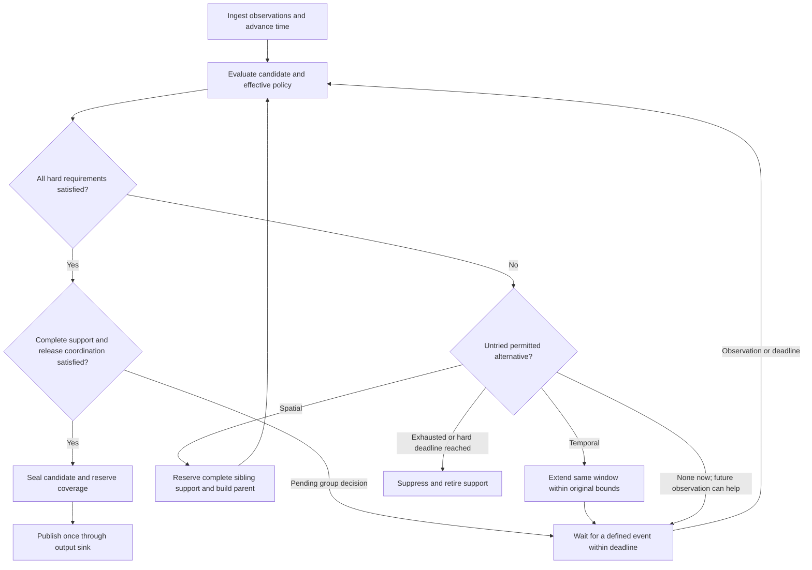

# Bucket lifecycle and release protocol

Status: 2026-10-13. Detailed design proposal, not implemented behavior. This document
refines [Aggregation design review](AGGREGATION_DESIGN.md); [TO-DO](../TO-DO.md)
remains the execution queue. Examples and numerical thresholds are illustrative.

## 1. Assessment and proposed first scope

Collecting fine observations in bounded leaf history and constructing coarser candidates
is a useful foundation. A failed candidate can be replaced by a parent or a longer window
and evaluated again. Leaf flags are scheduling hints; they do not establish complete
coverage, permission to merge, or permission to publish.

The first implementation should use one AGBS stream, one application, fixed observation
bins, aligned regions and fixed candidate windows. Add spatial merges next, then temporal
extension and a configurable preference order. Keep retained data fine enough for the
supported alternatives; changing publication resolution need not mutate capture resolution.
The algorithm is a bounded heuristic, not a proof of an optimal privacy/utility trade-off.

Key requirements from the discussion:

- Policies inherit and combine all applicable hard constraints; no child silently relaxes
  a parent or neighboring intersected region.
- A spatial parent covers all four child regions for the same interval. Known empty
  coverage is valid; an unavailable observation is not automatically a zero count.
- Already visible releases stay part of the observer's knowledge. Internal history cannot
  retroactively protect them.
- A passing privacy proxy alone does not establish release eligibility. Other hard bounds,
  data completeness and coordinated publication must also pass.
- Maximum window duration, successful release, suppression and replacement are separate
  concepts. Do not overload one `finished` flag.

## 2. Observation and output contract

The simulation orchestrator obtains each sensor's due observations and passes an owned
value batch through a small adapter to AggregationManager. First use synchronous calls;
the manager may remain a composed member of AGBS. Class separation is compatible with
sensor-local ownership. The core must not fetch mutable Agent pointers, renderer frames,
or MongoDB records for ordinary candidate evaluation.

Current code is only a scaffold: AGBS contains an AggregationManager member, whose
constructor holds references to a MongoDB collection and timestamp. Its bucket flush is
empty. Removing those dependencies belongs to A01; modular separation is not complete yet.

Proposed logical interfaces, not final C++ signatures:

```text
Sensor capture -> AGBS adapter -> manager.ingest(observationBatch)
Simulation time advance       -> manager.advance(now)
Manager completed decisions   -> publication sink
Manager debug snapshot        -> renderer
```

`ingest` delivers an observation exactly once. `advance` can expire deadlines even when
no measurement arrives. Empty observations, no measurement due and unavailable input are
different statuses. Authoritative time is simulation time, with a run-relative integer
tick/duration representation to be settled in D02; wall time is only for performance.

| Internal object | Required meaning |
|---|---|
| ObservationBatch | Run/stream/sensor ID, unique batch ID, observation time, coverage/status, records and input capabilities |
| Observation | Stable internal contributor ID when available, type/attributes and position or sufficiently fine base-cell support |
| BucketKey | Stream/application, stable cell key including depth, window start, candidate generation |
| CandidateBucket | Key, exclusive window end, policy version, role/state, statistics, history references and deadlines |
| Publication | Stable release ID, geometry, exact interval, defined counts, release time and approved public metric fields |
| DecisionTrace | Internal reasons, candidates considered, policy provenance and debug values |

Choose count semantics before implementing storage. Observation contributions, distinct
contributors and time-weighted occupancy are different outputs. For identity sets A and B,
distinct parent support is `size(A union B)`, not `size(A) + size(B)`. Occupancy integration
requires a stated observation-hold/interpolation model and time weights. Positions below
the retained base-cell resolution cannot be reconstructed from counts alone.

Public output excludes internal identities and fine debug statistics. Multiple sensor
streams remain separate; combining renderer contributions is not sensor fusion.

## 3. Storage and ownership

Proposed initial layout inside the manager:

```text
bounded time-bin history: ordered bins -> sparse base-cell observations/statistics
bucket table:             BucketKey -> active/preemptive candidate state
work scheduling:          dirty candidates + next deadline
policy view:              immutable effective policies, shared where useful
release ledger:           reserved/committed/retired spatial-temporal support
pending output:           sealed publications awaiting sink completion
```

Use stable cell keys, geometry and owned values across quadtree resets. Do not retain
Node* or Agent* whose lifetime depends on the live simulation tree/vector. Match IDs to
the existing quadtree's root/depth conventions; do not invent a second incompatible grid.

Active buckets select the current candidate. Preemptive buckets describe alternatives
over the same authoritative history, optionally caching sufficient statistics. They do
not require full payload copies at every ancestor, and never publish independently.
Reference counts used for contributor statistics are distinct from transport ownership.

Bound retention by allowed window duration plus explicitly bounded coordination/retry
needs. Every candidate reference must expire or be released. History reclamation must
respect live references, but those references must not extend memory use indefinitely.
Under pressure, use an explicit error/backpressure/suppression policy; never silently
drop observations while claiming complete support. Seal pending publications as owned
values so database retries need not pin all raw history.

## 4. Policy inheritance, conflicts and compilation

A policy quadtree is a suitable spatial lookup structure. It stores requirements, not
live measurement values, and need not have the same allocated nodes as the data tree.
Reuse Region geometry and taxonomy defaults. One application policy set may contain
requirements for several metrics; avoid one full tree per metric.

Interpret "stricter wins" as intersection of compatible hard requirements:

| Requirement | Combination rule |
|---|---|
| Minimum contributor support or minimum allowed side length | Maximum of lower bounds |
| Maximum risk/error, window duration, release age or cell side length | Minimum of upper bounds |
| Several independent mandatory metrics | Require every applicable metric |
| Allowed actions/categories | Intersection of allowed sets |
| Spatial-first versus temporal-first | Preference, with explicit priority/tie resolution |

Metrics must share definition, units, parameters and reference population before their
thresholds can be numerically combined. Incompatible definitions need separate checks
or a configuration error. A contradiction such as minimum side 20 m and maximum side
10 m has no feasible candidate; do not choose whichever rule was loaded last.

Use unambiguous bounds: `min_cell_side_m`, `max_cell_side_m`, `max_window_duration`,
`max_release_age` and a merge-depth cap if needed. Merging increases side length and
decreases depth. "Minimum resolution" is ambiguous without those conventions. Distinguish
window duration from the age of the oldest included observation at publication.

Compile static effective requirements during initialization for candidate geometries,
including ancestor cells crossing several regions. Checking only the cell center or
inheriting only the ancestor's own label can bypass a stricter intersected region.
For the initial aligned-region scope, reject unsupported boundary shapes explicitly.

Share identical policy records; refine at boundaries or cache reachable cells. A complete
depth-d quadtree contains `(4^(d+1)-1)/3` nodes when the root is depth 0, so full expansion
is a measured option rather than a default at arbitrary depths. Compile definitions and
overlaps once; runtime still evaluates changing data, time bounds and current candidates.
Policy/configuration changes invalidate the cache and need a defined boundary/version
rule for open windows. The first experiment should keep policies fixed during a run.

## 5. Candidate lifecycle and action order



The preference orders *permitted* actions. Spatial-first considers allowed ancestors
before waiting longer; temporal-first waits while allowed and then considers coarsening.
Hard regional bounds always constrain both. Try available retained history immediately;
future observations require waiting, not an immediate loop over identical data.

Each spatial transformation must move to a new allowed ancestor. Track candidate/version
and tried actions so rechecking unchanged data cannot spin indefinitely. Do not alternate
split and merge for the same unresolved window; first support refinement at future common
boundaries, with a minimum dwell rule if later measurements show oscillation.

| State/property | Meaning |
|---|---|
| COLLECTING / WAITING | Candidate may receive data or await coordinated availability; wake-up and deadline exist |
| READY | All hard requirements pass; publication still needs complete support and coordination |
| SEALED / PENDING_OUTPUT | Final content and coverage reserved; retries preserve the release ID and content |
| COMMITTED | Externally visible release; no retrospective replacement for privacy |
| SUPERSEDED | Internal candidate replaced by another; shared history may remain needed |
| SUPPRESSED | No output for this retired support under the selected strategy and bounds |
| temporal_exhausted | Property: this window cannot grow further; spatial candidates may still be legal |

Early completion is possible at an observation/decision boundary when all hard requirements
and release coordination pass. Minimum duration/cadence and utility bounds still apply.
Temporal exhaustion alone is neither success nor a requirement to merge: merge if an
allowed candidate exists, otherwise suppress. A parent inherits the original window start;
merging does not reset its duration or release deadline. A newly intersected stricter
policy can make that parent immediately infeasible.

More aggregation is not assumed to monotonically improve every privacy or utility metric.
Distinct support cannot decrease under set union, but regional requirements may tighten,
other metric values may worsen, and repeated samples of one person add no new people.
Reevaluate the candidate; report unavailable mandatory metrics explicitly.

## 6. Siblings, ancestors and irreversible releases

A parent candidate must cover its entire area over one compatible interval. A failing
child therefore requests coordination of all siblings, including their descendants where
the selected cut is finer. They need not all independently fail privacy or enter an
identical waiting state. Known-empty siblings still participate through coverage metadata.

Do not automatically merge every ancestor to the depth cap. Evaluate one parent and
escalate only if necessary and permitted. For each escalation, account for the parent's
siblings as well. The depth cap limits the search; it is not the target output resolution.

Reservation must precede publication, not merely begin after the first failure. A sibling
that publishes before the merge request may already make that parent unavailable.
Two valid policies have different latency/coverage consequences:

1. **Reserve a coordination domain in advance.** Keep the affected area/interval unpublished
   until a consistent child/parent cut is chosen. To guarantee retrospective merging up to
   an ancestor, reserve that ancestor's potentially needed support. This can couple more
   cells and delay otherwise passing children.
2. **Allow early independent release.** Close off conflicting historical merge candidates.
   Subsequent coarsening starts at a future common boundary; the current failing candidate
   may need suppression. History alone cannot remove this restriction.

Recommended first spatial prototype: fixed aligned windows and a small configured
coordination domain with a modest merge-depth cap. Select one non-overlapping cut before
publishing any member for that interval. This makes sibling behavior testable without
an arbitrary global barrier. Size and release latency of that domain remain a decision
to settle from the first scenario. Temporal adaptation later needs an explicit common
handover boundary and reservations spanning every affected interval.

Use a release ledger to reject intersections with already committed or pending-output
support in the same application stream. Distinct people may legitimately reappear in
different non-overlapping intervals; geometric/time disjointness is not person disjointness
and does not establish privacy across a trajectory or multiple applications. The chosen
cell geometry, release timing and suppression pattern can themselves depend on private
data; include those observable decisions in E02 rather than evaluating released counts alone.

Example with additive counts over identical support: if child counts B=6, C=5, D=7 have
been published and the later parent count is 19, the remaining child count A=1 is revealed
by subtraction. This example applies to additive occupancy/count statistics; unique
visitor counts across moving cells require set unions and are not generally additive.
Deleting B/C/D from MongoDB after readers obtained them does not erase that knowledge.
Geographic differencing and assessment of past releases are described in the
[U.S. Census Bureau technical note, pages 2 and 4](https://www.census.gov/content/dam/Census/programs-surveys/international-programs/stic/geospatial-disclosure.pdf).
Our non-overlapping release rule is an engineering restriction, not a general privacy proof.

Private observation/GT storage or checkpoints may still be written during aggregation.
Only approved results enter the public release sink. Separation must be enforced by the
chosen access/publication boundary, not just collection names. Existing research GT/ABS/
GBS/AGBS collections must not silently be treated as privacy-controlled output. Public
failure traces, suppressed counts or debug overlays would also be disclosures.

Suppression retires the selected support in the first design; do not repeatedly resurrect
the same failed interval under new windows. Internal candidates may be discarded earlier,
but shared history is reclaimed only once no allowed pending operation needs it. Old fine
publications remain old publications; change future release geometry instead of deleting
them as a supposed privacy repair.

## 7. Hand-worked cases before code

| Case | Expected result |
|---|---|
| Same person in ten time samples | Ten contributions, one distinct contributor |
| Child sets A={1,2}, B={2,3}, C={4}, D={5}, same interval | Parent has five unique contributors; summing child supports would give six |
| One child fails; complete siblings unpublished | Parent can be constructed if geometry/policy bounds allow; all checks rerun |
| One sibling has no observation coverage | Not a zero; candidate incomplete until a permitted completeness decision |
| A covers [100,200), B covers [100,300) | No direct merge of those summaries; reconstruct compatible intervals or reject |
| One required child interval already public | Reject historical parent under first release rule; consider a future transition |
| Allowed parent also fails | Try its parent only with complete available sibling support and allowed bounds |
| Maximum duration reached; parent passes | Release parent if its stricter policy and release age still permit it |
| Maximum duration and coarsening exhausted | Suppress with an internal reason; never reset start time to obtain more budget |
| All hard checks pass early | Seal only after minimum bounds and group coordination; invalidate competing candidates |
| Strict and permissive regions intersect | Apply compatible hard constraint intersection; contradictory bounds are infeasible |
| Parent splits at a future boundary | Validate complete child cut; no partial child publication before fallback choice is settled |
| No observations until deadline/end of run | Time advance terminates pending work with defined partial-window/suppression behavior |
| Ambiguous sink failure after sealing | Keep coverage reserved; retry same release idempotently or stop with explicit error |

These are proposed acceptance cases, not tests that have already passed.

## 8. Renderer synchronization and aggregation overlay

Source review confirms `readLocalSensorBufferFrame` returns a match without removing it
and does not clear `currentSensorFrame` when no match exists. `readSensorBufferFrame`
performs a blocking queue read before local matching. The AGBS drawing loop also has a
`break` after the first map entry and assigns that entry's ID to the current render sensor.
Removing only the break would route every entry into every AGBS instance; stable producer
sensor-ID to renderer-instance mapping is required. S04 tracks the correction with S01.

Contract: after all sensor update calls for simulation step t, combine the contributions
actually measured at t into one immutable frame. Non-due sensors contribute nothing and
do not wait for a later sample to complete t. A due sensor with an empty measurement can
have an empty cell set under its own sensor ID. Do not synthesize a measurement at t from
its older sample. Multiple actual samples within one step, if later supported, retain their
own observation times and need a separate contract; do not collapse them silently.

The renderer needs step-completeness information as well as a FIFO. An empty queue means
"not available yet" or "no frame exists"; `tryRead` alone cannot distinguish them. Proposed
contract: finalize agent/sensor rendering data together after capture, using one step packet
with an optional/empty sensor map. If separate queues are retained, attach a guaranteed
presence/completion marker to the step or use a watermark. Publish that metadata only after
the producer knows all contributions for that step. The current loop exposes the agent
frame before sensor capture, so this ordering must be addressed explicitly.

For chronological complete sensor frames: clear the current measurement view, discard
frames older than the agent time, pop one exact match once, and retain future frames.
Keep the matching view while redrawing/pausing the same agent frame. Perform matching
when the agent frame advances, not on every repaint. A future FIFO head can prove absence
at an earlier timestamp only if ordered, complete production is guaranteed. Reject or
explicitly handle duplicate/out-of-order frames; bound buffering when the renderer skips.

For steps known to have no measurement, show no current measurement. An optional last-known
display must explicitly retain its original observation time/age; it is not a new reading.
The UI/event loop must remain responsive while waiting for genuine in-flight work, and
shutdown must drain or terminate without the current empty-queue wait defect.

Proposed developer overlay: collecting cells, tentative parent outline, ready candidates,
committed releases and suppressed intervals, with interval/policy/reason on selection.
Keep measurement time, candidate interval and release time distinct. The current sensor
cell-ID set cannot encode this; use a separate read-only aggregation debug snapshot.
Label the trusted GT/internal view separately from an application view that sees releases
only. Renderer controls observe the manager and do not decide aggregation.

## 9. Implementation order and verification

1. D02/D03/A01: settle bins/counts/IDs and direct AGBS input; own values and output records.
2. E04/A04: metric definitions, typed hard constraints, compiled aligned policy lookup.
3. A02: bounded history, exact statistics, active/preemptive roles and lifecycle tests.
4. A05: reservations, non-overlapping release ledger, sink boundary and fixed-window output.
5. A03: small-domain spatial merge/split, then bounded temporal extension and preferences.
6. S04/S01 and A06: correct frame matching before trusting live aggregation overlays.
7. V01/B01/E01/E02: replay comparisons, runtime/memory, application error and joint-release
   attack evaluation; do not infer empirical privacy improvement from rule compliance.

Run meaningful correctness cases per slice. S04 is P0 for a trustworthy live demo, but
can proceed independently of bucket design. No production simulator run, database cleanup,
source change or configuration change is authorized merely by this planning document.
