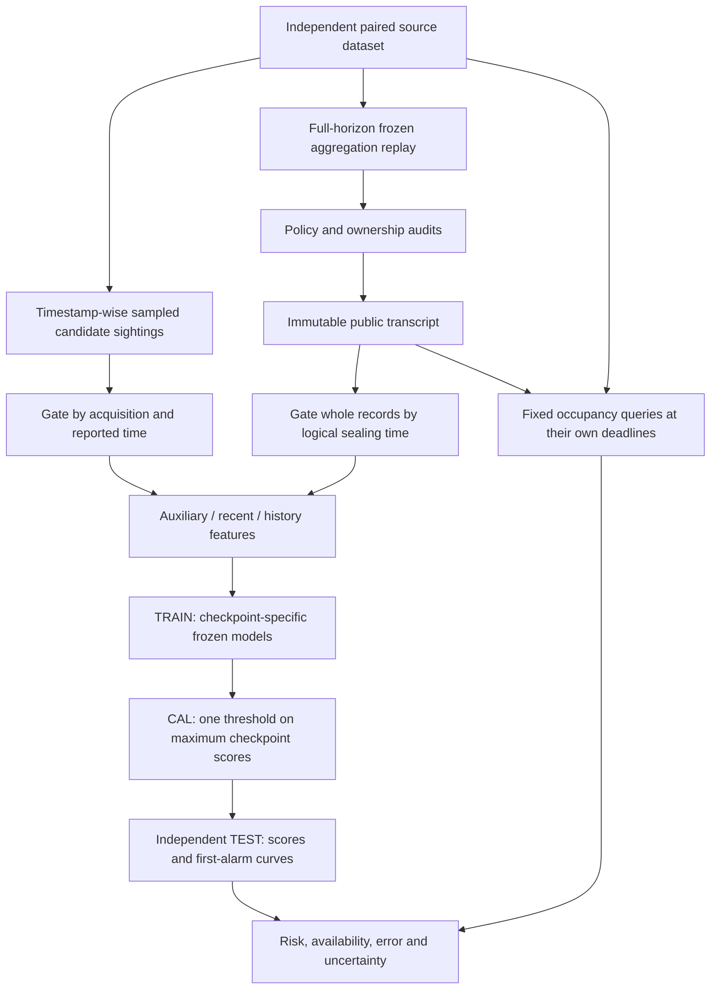

# Causal privacy evaluation and deadline-aware utility

Date: 2026-10-20. This extension evaluates the repaired aggregator's existing immutable
publication stream. It adds no sensor, policy field, runtime guard, controller action,
public data field, database migration or network service.

The [fixed protocol](CAUSAL_PRIVACY_PROTOCOL_2026-10-20.md) defines the research question
before the primary data are examined. Canonical equations are in
[notation section 23](TERMINOLOGY_AND_NOTATION.md#23-causal-public-views-repeated-alarms-and-deadline-utility).
The implementation keeps the whole-source membership secret. Earlier experiments already
attacked the complete final history; the new question concerns causal observation time,
stored release history and data that an application can actually use by a deadline.

The fresh primary run is complete. See the [results and figures](CAUSAL_PRIVACY_REPORT_2026-10-20.md),
[complete tables](CAUSAL_PRIVACY_TABLES_2026-10-20.md) and
[40-suite / 285-method test report](CAUSAL_PRIVACY_TEST_REPORT_2026-10-20.md).

## Data flow and observation boundary



Each data group supplies one IN and one OUT world with identical candidate auxiliary
knowledge. No private identifier, label, bucket state or suppression reason is a prediction
feature. The public algorithm, policy and fixed horizon are assumed known. All intermediate
evaluation artifacts, including source truth and CAL/TEST labels, remain private research
outputs under ignored `results/` directories.

One complete replay is crucial: truncating the input at each checkpoint would trigger
EOF and could create releases that were unavailable in the continuing stream. Instead,
`public_view` filters whole records using `sealed_at_ms`. It preserves source intervals,
counts and the public horizon, and canonicalizes retained aliases. Recent memory uses
arrival time, not the released interval's start. A recently arriving aggregate may therefore
contain older source observations. History retains every earlier received aggregate.

## Modules and responsibilities

| Module | Responsibility |
|---|---|
| `tools/evaluation/causal_privacy.py` | Independent Bernoulli sighting selection, acquisition-aware noisy arrival, causal deduplication, immutable recipient views and nested 9/40/71 features |
| `tools/evaluation/online_occupancy.py` | Complete-support query readiness, own-deadline scoring, fixed interior cohort, EOF censoring, compact sufficient statistics and matched-query comparisons |
| `tools/evaluation/run_privacy_prefix_study.py` | Provenance-checked completed-bundle consumption, TRAIN fits, repeated-look CAL thresholds, saved score paths, grouped TEST uncertainty and final manifests |
| Existing `run_privacy_robustness.py` | Full-horizon source-bundle generation with unchanged aggregation mechanisms and independent release audits |
| Existing `robustness_attacks.py` | Fixed logistic/HGB parameters, TRAIN-only fitting and controlled persistence of freshly created models |

The prefix runner consumes public transcripts and source truth for independent evaluation;
it does not execute the simulator, access MongoDB or load an old serialized model. It
rejects incomplete/mismatched bundles and verifies consumed hashes before and after the
analysis. Source code, the fixed protocol, model metadata, CAL and TEST scores and result
hashes are saved. Existing output directories are never overwritten; failed new runs keep
a failed manifest and diagnostic instead of presenting partial data as complete.

## Causal knowledge

Timestamp-wise Bernoulli selection means extending a trajectory within its declared
horizon cannot change earlier selected sightings. Exact and noisy profiles share selection.
Noisy coordinates and reported times are generated once per sighting with independent
per-timestamp random streams; bounds are explicit. Arrival is the maximum of actual
acquisition and reported time. Negative jitter cannot reveal a future physical sighting.
Deduplication occurs after the arrival gate and strips acquisition provenance before
features are calculated.

This is a conservative delayed observation model. Exact/noisy comparisons combine
precision and possible delay effects. It also differs from the older whole-trace fixed-size
sample, so old final AUC values are not a controlled memory-effect baseline.

Auxiliary-only features remain identical across IN/OUT. Both public arms receive the same
entire causally acquired knowledge. History features include the recent representation
plus cumulative features; weaker performance by a fitted history model does not mean
that erasing an attacker's memory increases its optimal information. The classifier sees
31 cumulative summaries, not an unrestricted raw-sequence model. At the first 1000-ms
checkpoint, recent and cumulative records coincide: history duplicates the recent block.
For logistic regression this can change effective L2 regularization even though the
available information is identical. Thus this is a bounded representation/model contrast,
not an isolated causal estimate of memory's information value. A dimension/regularization-
matched redundant-block control is an explicitly separate follow-up, not an unreported
fit or post-hoc correction to this fixed study.

## Repeated decisions and auditing

Each checkpoint model is fitted only to TRAIN. CAL supplies complete score paths; their
maximum selects one threshold for the whole fixed sequence. TEST is then assessed without
refitting or changing that threshold, including under the independent population-count
shift. A high late score and a high early score count as one ever-positive decision for
that candidate, not independent test observations. First alarm means the first crossing
at one of the six fixed checkpoints, not the true earliest inferable instant. Every
interior alarm curve uses the threshold calibrated over all six CAL looks, including EOF;
it is not a separately optimized five-look interior attack.

Persisted CAL score rows permit threshold reconstruction for both logistic regression
and HGB without deserializing old models. Public-view controls and auxiliary-only paths
use the same complete procedure. Bootstrap resampling keeps each independent group's
paired worlds and contrasted methods together. It conditions on the frozen models and
thresholds; it does not quantify training uncertainty or simultaneously cover every
reported comparison.

The six checkpoint fits comprise one bounded attack trajectory. There is no online
risk-budget mechanism and no guarantee against an attacker choosing among families,
features or checkpoints not included in its calibrated sequence.

## Application deadlines and memory use

A 10 m/1 s occupancy query needs a complete public spatial cover at every scheduled
sample. Readiness is the latest seal needed for that support. Nonoverlap and immutable
releases make this equivalent to recomputing from the available transcript at the
query's deadline. Unknown or absent support cannot become a zero; an explicitly measured
zero is valid. The first interval has nine scheduled samples because t=0 is initialization.

All four deadline lags use the same primary query set, ending from 1 through 14 seconds.
Their latest deadlines are strictly before EOF. Boundary queries are separate; deadlines
after the observed horizon are censored. The tested `summarize_at_checkpoint` helper excludes
not-yet-due queries at an arbitrary checkpoint; the default study reports per-lag interior
and boundary summaries, not additional utility checkpoint curves. A missed deadline is
not retrospectively repaired when
its result arrives later. Relaxing an application deadline changes how usefulness is scored;
it does not change the published stream or the attacker's access. These lag curves do not
establish a causal privacy-versus-latency mechanism frontier.

Batch feature extraction validates each complete transcript once, then reuses validated
whole-record subsets across checkpoints/profiles. The public single-view entry points
remain strict. The legacy arithmetic is factored unchanged into a private helper; exact
batch/reference equivalence is tested. The measured speed improvement concerns offline
feature extraction, not simulator throughput or recipient latency.

Only held-out worlds require utility evaluation. Full per-query rows live temporarily for
one world's seven streams. The runner computes matched common/local errors and then keeps
compact exact counts and error sums. Pooling uses those sufficient statistics, not means
of ratios. Saved source and public transcripts support independent reconstruction of every
query; the study does not retain millions of duplicate per-lag query dictionaries.

## Reproduction

Use the pinned optional environment described in
[the robustness test report](PRIVACY_ROBUSTNESS_TEST_REPORT_2026-10-19.md). The following
commands assume that environment is active and the existing `AggregationReplay` is built.
All output paths must be new; the dataset and two bundles must be separate directories.

```sh
python tools/evaluation/privacy_dataset.py --robustness --seed 20261023 \
  --output results/evaluation/2026-10-20/privacy-prefix-dataset-20261023 \
  --train-groups 48 --calibration-groups 32 --test-groups 64 \
  --shifted-test-groups 64 --end-ms 16000

python tools/evaluation/run_privacy_robustness.py \
  --dataset results/evaluation/2026-10-20/privacy-prefix-dataset-20261023 \
  --output results/evaluation/2026-10-20/privacy-prefix-source-study-20261023-v1

python tools/evaluation/run_privacy_prefix_study.py \
  --dataset results/evaluation/2026-10-20/privacy-prefix-dataset-20261023 \
  --source-study results/evaluation/2026-10-20/privacy-prefix-source-study-20261023-v1 \
  --output results/evaluation/2026-10-20/privacy-prefix-study-20261023-v1
```

The first study's legacy full-history analyses are ancillary. They must not select or tune
the new prefix protocol. No result requires launching the default live simulator or
clearing its database.

## Limits and subsequent decisions

This remains a synthetic, single-application, fixed-horizon, offline replay assessment of
logical-time availability. It does not measure client receipt, queue tails, live throughput,
real map semantics, visit secrets, trajectory linkage, formal k/l anonymity or differential
privacy. A high simulation speedup cannot establish any of these properties.

Interpret findings before choosing the next mechanism change. If membership exposure is
not reduced, report that result. Semantic-visit inference requires a separate protected
fact, entry/dwell ground truth, allowed auxiliary observations and independent data; real
city import is not a prerequisite. A live application separately requires instrumented
capture, queue, processing and receipt timestamps. Policies can only select such models
once their mechanisms and enforcement contracts actually exist.
