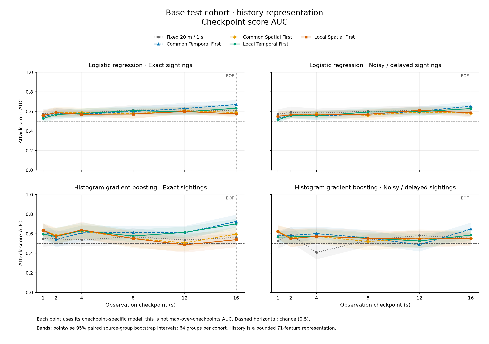
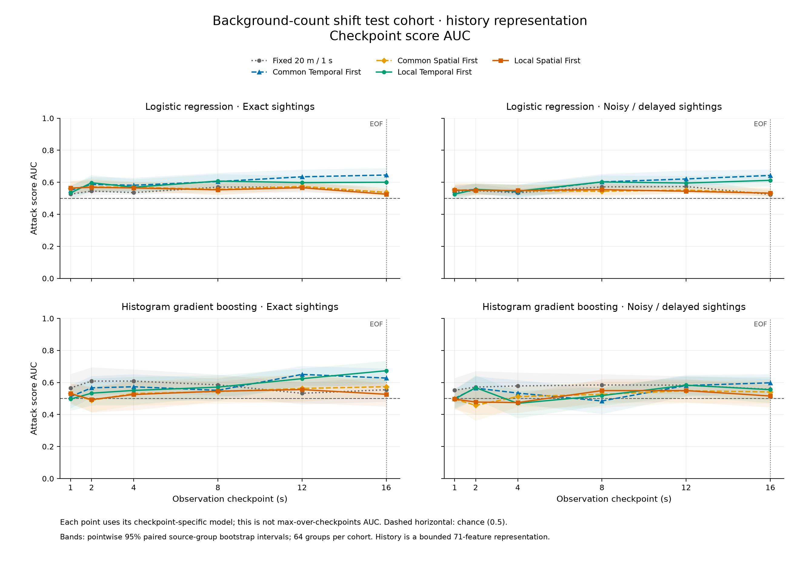
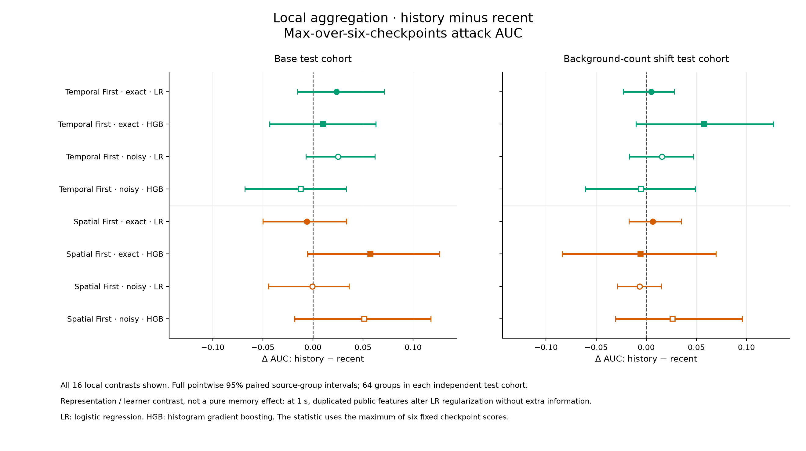
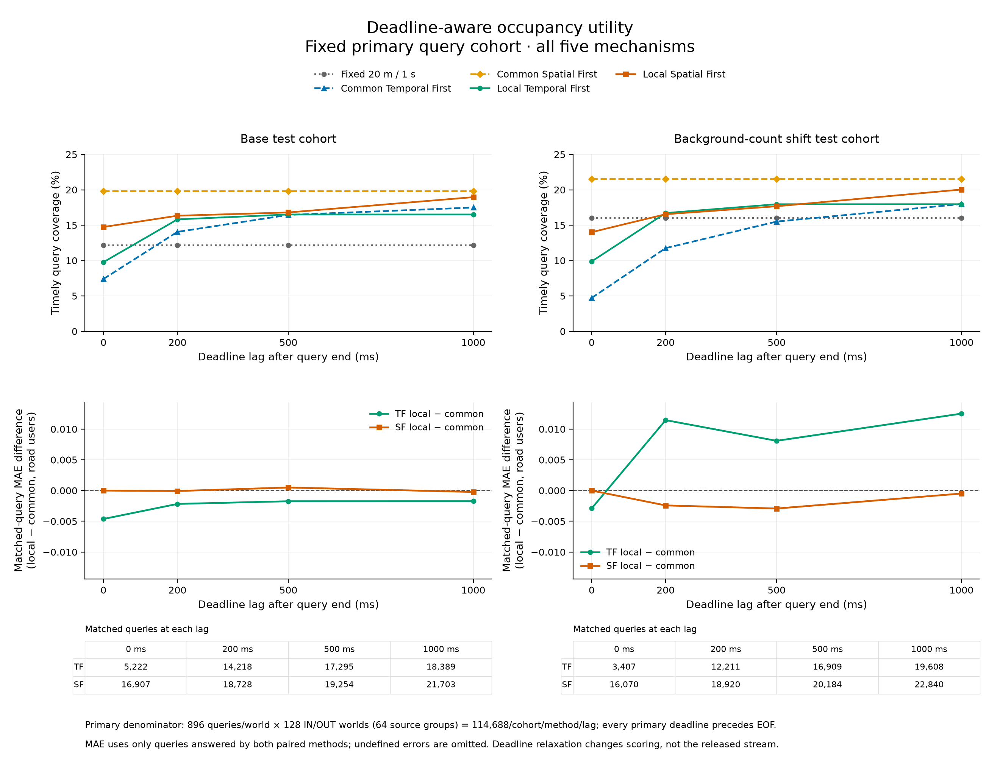

# Causal membership and deadline utility: results

Date: 2026-10-20. Status: implemented, complete and independently verified. The fresh
seed20261023 study extends evaluation of the unchanged repaired aggregation controller.
All results use the [predeclared protocol](CAUSAL_PRIVACY_PROTOCOL_2026-10-20.md).
The seed is an identifier, not the execution date.

The measured benefit is application-dependent timeliness: cell-local Temporal First
answers more fixed occupancy queries by strict deadlines than common Temporal First.
At a one-second deadline lag, this advantage disappears. Local Spatial First answers
fewer queries than common Spatial First at every tested lag. The privacy study establishes
neither a general local privacy improvement nor an isolated benefit from retaining public
history in the tested attack representation. Residual membership signal and calibration
transfer failures remain observable.

This is useful evidence for the dissertation: a verified controller can satisfy its
operational release policy while still allowing empirical membership inference. Policy
compliance, application utility and resistance to a specified attack are distinct results.
The support threshold is not a formal k-anonymity or differential-privacy guarantee.

## What changed

The implementation adds causal recipient views, causally arriving auxiliary knowledge,
checkpoint-specific attacks, one calibration threshold across repeated decisions,
auxiliary/recent/history controls, and deadline-aware occupancy evaluation. Saved CAL
score rows now permit independent threshold verification for both classifier families.
The evaluator uses recorded complete-run releases; it does not truncate the simulation
or create an early end-of-run flush. See the [implementation guide](CAUSAL_PRIVACY_IMPLEMENTATION.md)
and [test report](CAUSAL_PRIVACY_TEST_REPORT_2026-10-20.md).

The C++ coordinator, simulator behavior and policy configurations were not changed for
this study. The earlier handoff repair remains the production algorithm under evaluation.
This is an offline computation of logical online observations. A wall-clock recipient
service, queue measurements and a runtime privacy gate are not implemented by this work.

## Question, design and protected fact

The protected fact remains whether a candidate's complete recorded contribution over
16 seconds is included in the input. Each independent source group yields a matched
IN/OUT pair with identical background observations and candidate auxiliary knowledge.
OUT does not remove the person from the physical world. It removes the candidate's
source contribution. This is not person identification, physical-presence protection
or inference of a sensitive visit. Earlier attacks already consumed the full final
publication history; this study adds timing and representation comparisons.

| Design item | Completed scope |
|---|---|
| Independent source groups | 208: 48 base TRAIN, 32 base CAL, 64 base TEST, 64 count-shift TEST |
| Source worlds | 416 matched IN/OUT worlds; 256 held out for utility and privacy assessment |
| Source horizon/cadence | 16 s / 100 ms; controlled synthetic corridor paths |
| Space/policy | 80 m square, observation depth 6; support 3; permitted cell sides 1.25–40 m; maximum window/age 1 s |
| Mechanisms | Fixed 20 m / 1 s; common TF, common SF, repaired local TF, repaired local SF |
| Controls | Exact count, no output, auxiliary-only attack |
| Causal checkpoints | 1, 2, 4, 8, 12, 16 s; 16 s includes actual EOF effects |
| Recent public view | Complete records received in the last 1 s |
| Knowledge | Causal Bernoulli 25% sightings; exact or noisy/delayed |
| Learners | Fixed logistic regression (LR), histogram gradient boosting (HGB) |
| Model and assessment counts | 360 checkpoint models, 60 attack strategies, 120 cohort assessments, 720 checkpoint assessments |
| Uncertainty | 400 scenario-stratified paired source-group bootstrap resamples; pointwise 95% intervals |

TF preserves temporal detail by trying spatial aggregation first. SF preserves spatial
detail by trying temporal aggregation first. These are the project's adopted definitions.

The source bundle contains 2,080 audited mechanism executions and four deterministic
repeats. A separate ancillary final-history analysis has 28 fitted models; those models
are not the 360 new checkpoint models and did not select the causal protocol. No shared
pair or background fingerprints were found with the two previous primary datasets.
Models fit only TRAIN. One CAL threshold per strategy is frozen for both TEST cohorts.
There was no TEST-driven seed, feature, checkpoint, threshold or model selection.

This is not a three-road-user experiment. Each TEST cohort contains 16 independent groups
per scenario. Recorded distinct road users in the IN worlds are summarized below; counts
are source-horizon totals, not simultaneous occupancy.

| Scenario | Base min / mean / max | Shift min / mean / max |
|---|---:|---:|
| Sparse | 2 / 4.875 / 7 | 3 / 6.938 / 10 |
| Dense | 29 / 42.438 / 55 | 39 / 63.562 / 84 |
| Handover | 34 / 106.812 / 231 | 80 / 178.438 / 281 |
| Heterogeneous | 9 / 16.688 / 30 | 16 / 26.000 / 45 |

Handover deliberately replaces road users: its mean simultaneous sampled population is
approximately 5.22 base and 7.97 shifted, despite the larger distinct-user totals. Sparse,
dense and handover use pedestrians; heterogeneous uses pedestrian/bicycle/car labels.
These type labels are private generator context, not public type-conditioned release
features. Paths use ideal reversing legs without a street map or realistic turning
model. The reference population is the sampled source, not an unobserved physical GT.

## Causal inference and repeated decisions

Public records enter a prefix only when their sealing time is at or before the observation
time. Complete records are retained with fixed public horizon normalization. Auxiliary
sightings arrive no earlier than their actual acquisition or reported timestamp; private
acquisition metadata is removed from features. The noisy profile therefore changes both
precision and sometimes arrival time. Negative timestamp jitter cannot expose the future.

Auxiliary, recent and history vectors have 9, 40 and 71 features respectively. History
contains the recent vector plus 31 cumulative summaries. It does not expose an unrestricted
sequence model over every publication. The canonical formulas are in
[notation section 23](TERMINOLOGY_AND_NOTATION.md#23-causal-public-views-repeated-alarms-and-deadline-utility).

For each strategy, calibration uses the maximum of six checkpoint scores. One threshold
maximizes CAL detection subject to empirical ever-alarm FPR at most 0.10. The maximum
observed CAL FPR is 0.09375, or 3/32 negative groups. The alarm may first occur only at one
of the six declared checkpoints. Interior alarms use this same all-six-checkpoint
threshold, including EOF in calibration; they are not separately optimized interior tests.

Raw checkpoint AUC, maximum-score AUC and cumulative alarm TPR/FPR answer different
questions. Taking a subject's maximum score can change the ranking of both IN and OUT
subjects, so its AUC is not an upper bound on each checkpoint AUC. AUC below 0.5 is retained
without selecting a TEST-based inversion. The balanced evaluation prior also does not
represent the real-world prevalence of source membership.

### All local history outcomes

The table preserves both priorities, knowledge profiles, classifier families and TEST
cohorts. The [complete aggregate appendix](CAUSAL_PRIVACY_TABLES_2026-10-20.md) includes all
120 assessments with intervals, all 56 history-minus-recent contrasts, all 112 contrasts
against auxiliary-only inference, and utility/matched/boundary results. Private JSON
artifacts preserve all checkpoint scores and cumulative first-alarm summaries.

| Cohort | Priority | Knowledge | Learner | AUC at 1 s | AUC at 12 s | AUC at 16 s (EOF) | Max-score AUC | Ever TPR | Ever FPR |
|---|---|---|---|---:|---:|---:|---:|---:|---:|
| base | L-SF | exact | LR | 0.5591 | 0.5988 | 0.5743 | 0.5743 | 0.2500 | 0.1875 |
| shift | L-SF | exact | LR | 0.5642 | 0.5662 | 0.5258 | 0.5662 | 0.2812 | 0.2031 |
| base | L-SF | exact | HGB | 0.6356 | 0.4860 | 0.5387 | 0.6416 | 0.2500 | 0.1719 |
| shift | L-SF | exact | HGB | 0.5310 | 0.5554 | 0.5264 | 0.5760 | 0.2188 | 0.1719 |
| base | L-SF | noisy | LR | 0.5496 | 0.6106 | 0.5854 | 0.5798 | 0.2031 | 0.1250 |
| shift | L-SF | noisy | LR | 0.5505 | 0.5442 | 0.5320 | 0.5591 | 0.2656 | 0.1562 |
| base | L-SF | noisy | HGB | 0.6210 | 0.5466 | 0.5485 | 0.6202 | 0.3438 | 0.2188 |
| shift | L-SF | noisy | HGB | 0.4965 | 0.5492 | 0.5155 | 0.5298 | 0.3438 | 0.3750 |
| base | L-TF | exact | LR | 0.5278 | 0.5951 | 0.6324 | 0.5831 | 0.0469 | 0.0469 |
| shift | L-TF | exact | LR | 0.5334 | 0.5984 | 0.6002 | 0.5756 | 0.1094 | 0.0938 |
| base | L-TF | exact | HGB | 0.5958 | 0.6134 | 0.7004 | 0.6682 | 0.2812 | 0.1094 |
| shift | L-TF | exact | HGB | 0.4962 | 0.6238 | 0.6733 | 0.6117 | 0.2656 | 0.1562 |
| base | L-TF | noisy | LR | 0.5132 | 0.5967 | 0.6287 | 0.5969 | 0.0938 | 0.0781 |
| shift | L-TF | noisy | LR | 0.5256 | 0.5955 | 0.6123 | 0.5688 | 0.0938 | 0.0625 |
| base | L-TF | noisy | HGB | 0.5651 | 0.5251 | 0.5858 | 0.6217 | 0.2031 | 0.1094 |
| shift | L-TF | noisy | HGB | 0.4963 | 0.5831 | 0.5551 | 0.5531 | 0.4375 | 0.4062 |

Across all five actual mechanisms and both public views, maximum-score AUC ranges from
0.5034 to 0.6682. This describes these fixed finite attacks, not an upper bound on privacy
risk. The auxiliary-only and no-output controls all have AUC 0.5 and equal TPR/FPR (both
zero at the calibrated operating points), as required by their label-invariant inputs.

TEST ever-alarm FPR across actual mechanisms ranges from 0.0156 to 0.4063 even though every
CAL strategy satisfies its empirical 0.10 cap. For example, shifted local TF with noisy
knowledge and HGB history has TPR 0.4375 and FPR 0.4063: frequent alarms provide little
advantage (0.03125). Small CAL samples and population transfer make the operating point
unstable. The study must not be described as achieving a held-out 10% false-positive
bound or as a jointly calibrated observer choosing among all 60 strategies.

The figures show all five actual mechanisms with pointwise intervals. Values are
checkpoint-specific scores; the dashed EOF marker distinguishes the final flush from
interior observations. Lines connect the six measured checkpoints and do not estimate
continuous attack behavior between them. No single checkpoint is selected as the winner.

### History versus recent: interpretation limit

All 16 local history-minus-recent maximum-score AUC intervals contain zero. The estimates
range from approximately -0.0121 to +0.0577; the intervals still permit practically relevant
effects. This is inconclusive evidence, not equivalence or proof that history is harmless.
Across all 56 contrasts, 55 intervals include zero. The one positive interval belongs to
the exact-count control with exact knowledge and HGB under shift: +0.0651, interval
[0.0093, 0.1166]. These are pointwise comparisons without a simultaneous multiplicity claim.

A further limitation prevents a pure information-effect interpretation: at 1 s the recent
and cumulative public views are identical. History still duplicates the 31 public features.
For L2-regularized logistic regression, splitting a combined public coefficient over two
identical blocks halves its effective penalty. The information and linear function class
are unchanged, but the fitted optimization differs. HGB also sees a different representation.
At later checkpoints the extra summaries contain older records, while model dimension and
finite estimation remain different. The frozen study is therefore a comparison of declared
representations and learners, not an isolated causal effect of memory. An unrestricted
attacker could ignore extra information; lower fitted history AUC does not demonstrate
that remembering data improves privacy. A matched-representation/regularization control
belongs in a new predeclared assessment, not a rewrite of these results.

No new paired local-versus-common privacy test was predeclared for this prefix study.
The full mechanism outcomes are shown, but their ordering is not a newly established
significant local privacy advantage. The prior independent handoff study remains the
source for that separately declared comparison.

## Deadline-aware occupancy: a concrete conditional benefit

The application asks for mean sampled occupancy on a fixed 10 m grid over 1-second query
intervals. Each query may use only complete public support available by its own end plus
0, 200, 500 or 1,000 ms. Uniform spatial allocation and constant occupancy within an
aggregate interval are reconstruction assumptions. Missing or partially covered queries
remain unknown; an explicit measured zero is a valid answer.

The primary cohort is fixed for every lag: query end plus the maximum lag must be
**strictly before** 16 s. It contains 14 intervals × 64 cells = 896 queries per world,
or 114,688 queries per TEST cohort, mechanism and lag. Queries ending at 15/16 s are
reported separately. A deadline at EOF may use EOF releases; a deadline after EOF is
censored, not counted as a failed answer. This prevents relaxed deadlines from silently
changing the primary denominator or receiving an end-flush advantage.

The main common/local comparison is timely query coverage (percent). Differences are
local minus common in percentage points. These are descriptive pooled results; queries
from one source group are not independent statistical replications.

| Cohort | Priority | Lag (ms) | Common coverage (%) | Local coverage (%) | Difference (pp) |
|---|---|---:|---:|---:|---:|
| base | TF | 0 | 7.4009 | 9.7796 | +2.3786 |
| base | TF | 200 | 14.0538 | 15.8194 | +1.7657 |
| base | TF | 500 | 16.4481 | 16.5083 | +0.0602 |
| base | TF | 1000 | 17.4927 | 16.5091 | -0.9835 |
| base | SF | 0 | 19.7937 | 14.7417 | -5.0520 |
| base | SF | 200 | 19.7937 | 16.3365 | -3.4572 |
| base | SF | 500 | 19.7937 | 16.7969 | -2.9968 |
| base | SF | 1000 | 19.7937 | 18.9584 | -0.8353 |
| shift | TF | 0 | 4.7198 | 9.8746 | +5.1549 |
| shift | TF | 200 | 11.7571 | 16.7140 | +4.9569 |
| shift | TF | 500 | 15.5073 | 17.9583 | +2.4510 |
| shift | TF | 1000 | 17.9844 | 17.9618 | -0.0227 |
| shift | SF | 0 | 21.5498 | 14.0119 | -7.5378 |
| shift | SF | 200 | 21.5498 | 16.5475 | -5.0023 |
| shift | SF | 500 | 21.5498 | 17.6705 | -3.8792 |
| shift | SF | 1000 | 21.5498 | 20.0370 | -1.5128 |

Local TF improves zero-lag coverage by 2.38 percentage points in the base cohort and
5.15 points in the shifted cohort. At 200 ms the gains are 1.77 and 4.96 points. Common TF
catches up as the deadline relaxes; at 1,000 ms local TF is slightly lower in both cohorts.
Local SF stays below common SF at every lag. Fixed 20 m / 1 s coverage is 12.19% base and
16.03% shifted at all lags, with much larger answered-only MAE (2.066 and 2.522 road users).
The exact-count control answers 100% with zero error; no output answers 0% with undefined
MAE. All five mechanisms are plotted below, without selecting a favorable baseline.

Full-grid coverage is low partly because empty/suppressed regions lack complete explicit
public support. It is not the fraction of source observations retained or the fraction
of all ground-truth information preserved. A high observation-retention rate can coexist
with low full-grid query coverage. Query alignment also matters: the 1-second application
intervals align with common SF windows in this setup. A different application needs its
own predeclared query grid and cadence, rather than post-hoc adjustment to favor a method.

Conditional MAEs on each method's answered set cannot by themselves establish better
accuracy. On matched answered queries, TF's local-minus-common MAE at zero lag is -0.00463
base and -0.00291 shifted road users (5,222 and 3,407 matched queries). At a 1-second lag,
it is -0.00174 base and +0.01251 shifted (18,389 and 19,608 matched queries). SF differences
have absolute magnitude at most 0.00293. The matched support changes with lag, so both its
size and total-domain coverage accompany each comparison in the appendix and figure.

Relaxing the application's scoring deadline does not change publication or attacker
access in this experiment. These curves are therefore not a causal privacy–latency
frontier or an experiment comparing different privacy-aware release delays. Logical
availability assumes immediate delivery at sealing time; measured networking/processing
latency remains a separate implementation task.

## What this supports in the presentation and dissertation

A defensible research question is: **Under which regional policy and application-deadline
conditions does cell-local adaptive aggregation improve timely occupancy utility, and
what membership evidence remains in the resulting publication stream?** The answer for
this controlled study is conditional: local TF helps under strict deadlines, while its
advantage disappears with additional waiting; SF does not show the same coverage benefit.
The tested publication policies still permit membership inference, and empirical alarm
calibration does not reliably transfer to new groups or the population-count shift.

Present the application, protected fact, policy constraints and evaluation units before
the implementation. Use the deadline figure for the observed utility trade-off, the paired
forest for uncertainty, and the calibration-transfer example for the remaining privacy
problem. Put the 16-second synthetic scope and logical-time assumption on the same slide
as the result. Cite source-group counts, not millions of correlated query rows, as the
independent statistical sample. The simulator is the controlled proof-of-concept instrument.
The mathematical definitions and independently audited outcomes carry the research claim.

The next work is ordered as follows:

1. Freeze the presentation's protection objective and accepted failure criteria. Do not
   translate the support threshold into a formal privacy claim or change the protected
   secret merely to obtain a positive result.
2. Predeclare a representation/regularization-matched memory control and a better-powered
   calibration experiment, using new groups and adequate independent negatives. Report
   uncertainty in transferred operating points; preserve these completed TEST sets.
3. If a visit secret is scientifically justified, define entry/dwell/access-path ground
   truth and keep source inclusion fixed across visit worlds. Sensitive-attribute inference
   is a new contract, not the current membership experiment with renamed labels.
4. Add wall-clock queue/receipt instrumentation for a live application if required. Use
   those measurements before making real-time claims or changing coordinator scheduling.

No new general coordinator optimization follows automatically from a non-positive privacy
result. A mechanism change should target an explicit threat or measured utility limitation
and be compared under a fresh, fixed protocol. Maps, routing and collision avoidance remain
useful realism extensions, not prerequisites for interpreting this completed comparison.

## Verification and reproducibility

All 40 CTest suites and 285 pinned-environment Python test methods pass, including 49 new
methods. All 180 LR fits converge. Independent implementations verify 2,080 source/public
pairs, 4,407,823 public cells including controls, 7,340,032 deadline-query projections,
2,097,152 matched-query projections, all 57,600 LR CAL/TEST probabilities and the saved
score-based metrics, calibration thresholds and bootstrap intervals. HGB inference was
not independently rerun; its hashes, metadata and persisted-score calculations were
checked. Details and numerical limitations are in the [test report](CAUSAL_PRIVACY_TEST_REPORT_2026-10-20.md).

Private bundles, excluded from ordinary Git publication, are under
`results/evaluation/2026-10-20/`:

- `privacy-prefix-dataset-20261023`: immutable source population and paired worlds.
- `privacy-prefix-source-study-20261023-v1`: complete audited mechanism outputs.
- `privacy-prefix-study-20261023-v1`: causal protocol, models, CAL/TEST paths and results.
- `privacy-prefix-verification-v1`: independent scripts, reports, logs and plotting provenance.

The protocol document was copied and hashed before the fresh primary run. Completed
bundles were not modified by verification or plotting. Figures are available as both PNG
and SVG in `docs/figures`; the exact plotting script and version-2 layout evidence are
archived separately. Aggregate report tables contain no private road-user identities.

| Artifact | SHA-256 |
|---|---|
| Predeclared research protocol | `bfcd391bb06f6c2400b469b8e60d7b6de9638efe9a0a1fee2a95bcdf6136a2d0` |
| Dataset manifest | `33127e8edc8766c19ea39316282c06b04f1459558b0ffabd2dd292e2bb7b94ae` |
| Frozen replay binary | `2f6d69edb2627829e12f99811eb128b4047e6f56178bece7dd50544ce5e2bc00` |
| Source study protocol | `5a47157b0d3524b82caa9464138da36cc4a0ef68f991653a5a4499c9e2682944` |
| Source study report | `f5b6251e56561cce2e94030daeefe3e1a91f6080fa5d34156b5cee7ded40d2a2` |
| Causal study protocol | `b1cf178166e1fa636ace79c6a50d6931966da308c1ccde887731c41411871e1c` |
| Causal study report | `3c325fd6b6a86f5a67a474fc4ca1e331a1bbe9b4ee5c4030188bb3cd20807816` |

Reproduction commands are in the implementation guide. Use new output directories;
completed scientific bundles must remain immutable. No default simulator run or MongoDB
write was needed for this evaluation. The documented total study runtimes measure offline
replay/analysis overhead and cannot be interpreted as per-timestep controller latency.
