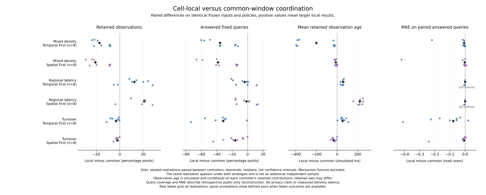

# Common-window versus cell-local coordination study

Date: 2026-10-19. Scope: utility, retention, policy compliance and coordination
weaknesses on identical frozen observations. This is an aggregation experiment;
it does not modify the controller, motion model, live renderer or publication model.

## Question and fixed protocol

Under which observation and regional-policy conditions do independent cell windows
improve or worsen useful, policy-compliant output compared with a common window?
The source observations, numerical policy, resource budgets and utility query stay
constant within each case. Only action order and coordination mode change.

The dedicated runner `tools/evaluation/run_coordination_study.py` reuses the replay
and integrity helpers from the existing seven-mode comparison. That older CLI and
its results remain unchanged. Nine configurations are evaluated:

- Fixed 10-m / 20-m cells, each with 400-ms / 1000-ms windows.
- Spatial-only selection with common windows.
- Common-window Temporal First and Spatial First.
- Cell-local Temporal First and Spatial First.

Temporal First preserves temporal resolution and tries spatial coarsening first.
Spatial First preserves spatial resolution and tries temporal extension first.
The fixed and spatial references explicitly use common-window configuration. Each
adaptive configuration explicitly sets its coordination and policy strategy.

Six analytical cases explain mechanisms: a homogeneous dense control, a blocked
branch, heterogeneous sibling deadlines, identity turnover, a potential publication
barrier, and an infeasible parent with feasible children. Expected metadata records
hand-checkable conditions rather than an asserted winner. In particular, the
publication-barrier case describes a counterfactual early publication; the implemented
hold may avoid that barrier. It is not a measured publication-loss oracle.

Three exploratory families (`mixed_density`, `regional_latency`, `turnover`) use
independent complete realizations with the predeclared seeds 19 through 26. Positions,
paths, populations and turnover schedules are frozen before evaluating any method.
These are analytical synthetic populations, not calibrated real traffic. Six small
cases use depth 3 / 4 seconds; 24 replicas use depth 4 / 8 seconds. Every source has an
80-m square, complete 100-ms cadence and an initialization-only t=0. The exclusive
endpoint has no measurement. Short horizons test mechanisms rather than endurance;
the separate long-run and coordination reports cover sustained execution. These depth-3/4
experiments do not establish scaling behavior for the depth-6 live demo.

The immutable machine-readable `protocol.json` is written before the first replay.
The executable and source snapshot are copied and hashed. Runs execute serially with
a cyclic case-index rotation of the nine configurations. Both priorities in both
coordination models are repeated, comparing all scientific fields and excluding
runtime only. Each primary replay is independently checked against its effective
policy, raw counts, support, coverage, retirement and nonoverlap rules. A failed
check leaves a failure artifact and prevents a completed study manifest.

## Measurements and mathematical meaning

The canonical symbols and reusable LaTeX are in [notation Section 20](TERMINOLOGY_AND_NOTATION.md#20-contribution-retention-exact-age-and-paired-evaluation).

Let O be source observation contributions (road-user/sample pairs), and O_R the subset
whose point and timestamp belong to a released cell/window. Exact retention is

    r_obs = |O_R| / |O|.

This is a private-source diagnostic, independent of public query answerability. It is
not a fraction of distinct people and does not establish privacy. Regional retention
uses actual private coordinates; a parent's count is never allocated by area to
estimate how much source data from each reporting region survived.

For retained contribution o, exact simulated age is

    A_obs(o) = sealed_at(release(o)) - observed_at(o).

Report contribution-weighted mean and nearest cumulative-weight p50/p95/p99. Ages
are conditional on retained data, so interpret them with retention. They are simulated
time differences, not processing time, transmission latency or an online guarantee.
Public-only timing separately reports the contribution-weighted interval duration,
sealed-at minus interval-start upper bound, and sealed-at minus interval-end delay.
These quantities are invariant to batching the same cells into more release documents.
The historical unweighted mean release age remains in the legacy summary for
compatibility and is not the primary age metric here.

The primary occupancy query stays at 10 m / 1000 ms. A predeclared sensitivity uses
5 m / 200 ms (finer than the depth-3 source, equal to the depth-4 source). Reconstruction
uses only published mean occupancy, uniform spatial allocation and constant values
over each release window. Suppression/absence is unknown, never zero. A fixed query
is answered only with complete space-time support. Report full-domain answered/scored
coverage, conditional MAE and matched-support MAE for each common/local pair. A smaller
MAE on a different answered subset cannot alone establish an improvement.

For S = queries scored by both methods, the paired accuracy comparison is

    MAE_j(S) = sum(q in S, |estimate_j(q) - reference(q)|) / |S|.

Undefined MAE remains null, including empty S. Four fixed disjoint 40-m quadrants
provide regional query and exact source-retention diagnostics. Only fully contained
query footprints enter a region's query summary; boundary exclusions are explicit.
Full horizon, including EOF finalization, is primary. A supplementary analysis uses
only query intervals contained in [1000 ms, end - 1000 ms), identically for both methods.
This interior filter removes boundary queries; encompassing releases may still include
observations outside that interior. It is not a separately truncated replay.
Utility is retrospective: later releases can answer an earlier query. Age is reported
separately; this evaluation does not claim that those answers existed at query time.

For each complete realization and strategy, report

    delta_m = metric_m(local) - metric_m(common).

Replicate summaries report n, mean, median, minimum and maximum of these paired
differences within each family and strategy. Query samples, road users, windows,
strategies and repeated deterministic executions are not additional independent
replicates. Undefined pair metrics reduce their own n explicitly. No significance,
population generalization, global dominance or optimality claim follows from eight
synthetic realizations. Core processing elapsed time is a single descriptive measure,
includes core finalization/in-memory result work, and excludes input/file I/O. It is
not a CPU-time measurement or controlled hardware benchmark.

Private terminal reasons and result byte size characterize diagnostic load. Recorded
attempt lineages are not a count of all metric checks. Generic `coordination_handoff`
labels cannot identify a merge blocked solely by an earlier public release. Candidate
publication-opportunity loss remains unmeasured: it needs distinct causal rejection
evidence plus a nonoverlapping counterfactual schedule/reference. Suppression and
private retirement must not be counted as public disclosure.

## Reproduction

Build the current replay target using the README instructions, then run from the
repository root with a new output directory:

```sh
python3 -B tools/evaluation/run_coordination_study.py \
  --output results/evaluation/2026-10-19/coordination-study-NEW_ID
python3 -B tools/evaluation/plot_coordination_study.py \
  --input results/evaluation/2026-10-19/coordination-study-NEW_ID/summary.json \
  --output /private/tmp/coordination-study-NEW_ID
```

The study contains a frozen executable/source snapshot, protocol, observations,
original and effective policies, complete replay evidence, independent audits, public
query reconstructions, region metrics, exact source retention, paired CSV and final
hash manifest. All artifacts are private. Existing output directories are rejected.
A selected `--scenarios homogeneous_dense_control --seeds 19` run is a useful smoke
check but is not the full predeclared matrix. No MongoDB or graphical simulator is used.


## Measured study

Completed private bundle: `results/evaluation/2026-10-19/coordination-study-19-26-v1`.

The fixed protocol was written at 17:52:00 UTC; completion was recorded at 17:53:20 UTC. All 30 cases completed: **270 independently audited primary replays, 120 exact scientific repeats, 24,028 released cells and 57,905 checked terminal windows**. All audits passed. The executable SHA-256 is `7236b204ec311c4a5c407c53e89daac73f28d87b9711cd9cd806b753bd04b574`. Source hashes stayed unchanged throughout the study.

### Analytical cases

Counts below are released / input observation contributions. TF and SF are shown separately where they differ. These are explanatory cases, not independent statistical replications.

| Case | Common TF | Local TF | Common SF | Local SF |
|---|---:|---:|---:|---:|
| homogeneous dense control | 468/468 | 468/468 | 468/468 | 468/468 |
| blocked branch | 234/273 | 234/273 | 234/273 | 234/273 |
| heterogeneous sibling deadlines | 0/234 | 234/234 | 0/234 | 234/234 |
| identity turnover | 76/78 | 76/78 | 78/78 | 78/78 |
| publication barrier | 156/156 | 156/156 | 156/156 | 156/156 |
| parent infeasible valid children | 78/195 | 156/195 | 78/195 | 156/195 |

The blocked branch isolates a useful effect: the independent valid cells retain the same 234/273 contributions and answer the same queries with the same error, while exact mean age falls from 538.46 to 148.72 ms (p95: 1000 to 200 ms). The homogeneous control gives identical scientific utility/retention/age outcomes under all four adaptive configurations.

The heterogeneous-deadline case improves from 0 to 234 retained contributions in the current local implementation. This does **not** prove that every common-window controller must fail: the existing common selector lacks complete partial-child rescue and can discard a valid child when promoting an invalid sibling group. The parent-infeasible case separately exposes that A07 gap (40% versus 80% retention). These results compare complete implemented controllers, including their retirement/fallback behavior, rather than an isolated theoretical scheduling variable.

The parent-infeasible case also identifies avoidable waiting: a passing child next to a singleton waits to 1000 ms even though the parent violates a 10-m size cap. Another valid base region publishes at 200 ms. A hold intended to prepare that illegal parent cannot rescue it. The current broad ancestor-group hold therefore deserves a concrete, policy-feasible merge test before imposing delay.

The publication-barrier case retains all contributions under both models; current holds avoid its hypothetical early-publication barrier. It supplies no measured publication-loss value. The identity-turnover case has identical common/local outcomes. Its TF/SF retention difference (76 versus 78 contributions) comes entirely from forced EOF finalization; it is not evidence of a sustained retention advantage.

### Independent seeded realizations

The table reports per-family means over eight paired complete realizations. Age differences concern each method's retained subset. Coverage is the primary 10-m / 1000-ms retrospective query. Percentage-point differences are local minus common.

| Family | Strategy | Common retention | Local retention | Coverage difference (pp) | Mean-age difference (ms) |
|---|---|---:|---:|---:|---:|
| mixed density | SF | 97.38% | 79.29% | -35.47 | -11.44 |
| mixed density | TF | 97.33% | 81.43% | -35.03 | -206.65 |
| regional latency | SF | 51.71% | 68.91% | -2.61 | +221.09 |
| regional latency | TF | 51.71% | 64.02% | -6.20 | +53.56 |
| turnover | SF | 100.00% | 97.72% | -17.58 | -30.15 |
| turnover | TF | 100.00% | 95.76% | -36.52 | +58.07 |

In mixed density, local retention is lower in **all eight** realizations for both priorities: TF differences range from -23.67 to -8.05 pp; SF from -28.93 to -8.15 pp. The current controller is therefore not a universal improvement. The causes of the total gap have not been isolated; generic terminal labels cannot establish public-overlap loss. A separate post-study witness below verifies one concrete publication barrier without attributing every loss to it.

Regional latency yields mean retention gains of 12.31 pp (TF) and 17.20 pp (SF), with negative cases as well. Mean age rises by 53.56 / 221.09 ms because additional retained observations can be older. The primary query coverage falls even while retention rises: strict 10-m support can be missing when only occupied 5-m leaves are published and neighboring empty leaves are omitted. In the predeclared 5-m / 200-ms sensitivity, regional coverage instead rises from 47.94% to 54.64% (TF) / 58.32% (SF). This dependence on the application query is substantive, not a denominator to replace after seeing results.

Matched primary MAE differences (local minus common) average -0.0330/-0.0545 road users for mixed-density TF/SF, -0.0010/-0.0010 for regional latency, and -0.1280/-0.0344 for turnover. Regional primary matched MAE exists for only six of eight realizations; the other two have no shared answered queries. A small matched MAE improvement must be read beside the full-domain coverage losses and the answered subset. The fine query does not reproduce every primary-MAE advantage. No single strategy wins all objectives.



Publication exports: [PNG](figures/coordination-study-2026-10-19.png), [SVG](figures/coordination-study-2026-10-19.svg). Dots are paired realizations and diamonds are medians; the same realization appearing under both strategies is not another independent sample. Null pair metrics are excluded and their panel count is explicit.

### All nine configurations

These descriptive means retain every reference configuration. Conditional MAE is averaged only across cases where defined; it is not a matched-support comparison across all nine methods. The n column shows its number of defined realizations. Compare coverage beside MAE.


Mixed Density (eight realizations):

| Configuration | Retention (%) | Answered queries (%) | Conditional MAE | MAE n | Mean retained age (ms) |
|---|---:|---:|---:|---:|---:|
| fixed_10m_400ms | 31.53 | 4.22 | 0.0135 | 8 | 249.15 |
| fixed_10m_1000ms | 33.04 | 5.54 | 0.0000 | 8 | 547.86 |
| fixed_20m_400ms | 68.35 | 30.57 | 0.8975 | 8 | 249.19 |
| fixed_20m_1000ms | 68.99 | 33.79 | 0.8683 | 8 | 547.38 |
| spatial | 97.22 | 77.37 | 0.6998 | 8 | 149.55 |
| common_temporal_first | 97.33 | 78.86 | 0.6956 | 8 | 364.75 |
| common_spatial_first | 97.38 | 81.37 | 0.6880 | 8 | 547.39 |
| local_temporal_first | 81.43 | 43.82 | 0.6517 | 8 | 158.09 |
| local_spatial_first | 79.29 | 45.90 | 0.6027 | 8 | 535.95 |

Regional Latency (eight realizations):

| Configuration | Retention (%) | Answered queries (%) | Conditional MAE | MAE n | Mean retained age (ms) |
|---|---:|---:|---:|---:|---:|
| fixed_10m_400ms | 9.08 | 1.46 | 0.0204 | 7 | 247.25 |
| fixed_10m_1000ms | 9.68 | 1.83 | 0.0000 | 7 | 535.76 |
| fixed_20m_400ms | 28.84 | 16.11 | 0.7997 | 8 | 248.01 |
| fixed_20m_1000ms | 29.91 | 18.75 | 0.7637 | 8 | 542.43 |
| spatial | 51.71 | 47.51 | 0.6581 | 8 | 149.36 |
| common_temporal_first | 51.71 | 47.51 | 0.6581 | 8 | 149.36 |
| common_spatial_first | 51.71 | 47.51 | 0.6581 | 8 | 149.36 |
| local_temporal_first | 64.02 | 41.31 | 0.6049 | 8 | 202.92 |
| local_spatial_first | 68.91 | 44.90 | 0.6097 | 8 | 370.45 |

Turnover (eight realizations):

| Configuration | Retention (%) | Answered queries (%) | Conditional MAE | MAE n | Mean retained age (ms) |
|---|---:|---:|---:|---:|---:|
| fixed_10m_400ms | 44.38 | 8.08 | 0.0000 | 8 | 248.73 |
| fixed_10m_1000ms | 85.90 | 27.17 | 0.0000 | 8 | 542.77 |
| fixed_20m_400ms | 79.49 | 45.70 | 0.7165 | 8 | 248.23 |
| fixed_20m_1000ms | 94.90 | 73.63 | 0.6078 | 8 | 542.49 |
| spatial | 100.00 | 92.26 | 0.5772 | 8 | 149.36 |
| common_temporal_first | 100.00 | 92.26 | 0.5772 | 8 | 149.36 |
| common_spatial_first | 100.00 | 45.29 | 0.5224 | 8 | 542.26 |
| local_temporal_first | 95.76 | 55.74 | 0.4919 | 8 | 207.43 |
| local_spatial_first | 97.72 | 27.71 | 0.5165 | 8 | 512.10 |

Core elapsed measurements range from 0.208 to 87.422 ms for an entire replay, not per simulated step. Local-minus-common mean differences range from +44.66 to +58.53 ms across the six family/priority groups. Single executions are descriptive and do not isolate diagnostic serialization from control work. At completion, the main private study bundle occupied 959,205,519 bytes (about 915 MiB), including source/executable snapshots, full diagnostics, independent audits and two full query grids per replay. This storage footprint is not the online controller's RAM footprint.

## Verified publication-overlap witness

A post-study diagnostic in `publication-overlap-witness.json` identifies a concrete
case in `mixed_density-seed-19/local_temporal_first`. Finest cell 934 (depth 4)
is suppressed over [0,1000), losing nine contributions. Independent raw recomputation
shows that its parent 14 (depth 1) passes all effective policy bounds over that interval:
123 contributions, 15 distinct identities, 40-m side and 1000-ms duration/age.
However, descendant 56 was already publicly released over [0,200), sealed at 200 ms;
a retrospective release of parent 14 over [0,1000) would overlap that immutable output.

The broader candidate was not merely feasible with later hindsight: parent 14 already
passed over [0,200) with nine contributions and nine identities, and common Temporal
First actually released it at that endpoint. This is a witness that selecting one
valid smaller merge can close a broader valid option at the same endpoint. It does
not compute the utility of every subsequent alternative schedule, show an asynchronous
optimum, or justify retracting an earlier disclosure. The diagnostic was selected
after the study and is an explanatory counterexample, not a predeclared aggregate metric.

## Interpretation and next steps

The supported answer is conditional: independent cell windows can remove unrelated waiting and rescue data under heterogeneous policies, but the present local controller loses retained support and query coverage in other tested populations. Effective-policy compliance is necessary and was verified; it does not imply good availability, optimal scheduling or stronger privacy.

1. Add focused counterexamples and causal diagnostics for the current retention gaps, keeping actual public overlap separate from private retirement, history limits, deadlines and policy infeasibility. Count distinct candidates without summing overlapping ancestor opportunities.
2. Restrict sibling holds to concrete feasible merge opportunities; use the illegal-parent case above as a regression. Compare the revised controller against this frozen baseline before accepting it.
3. Resolve application-level empty/missing support semantics explicitly; keep both predeclared query scales and the conservative current denominator.
4. Reduce no-output handoff/diagnostic churn with output-equivalence checks. Evaluate precomputed ancestor statistics separately under E05.
5. Only then broaden policy/budget sweeps, longer sustained-density runs and attack-based privacy evaluation. Publication opportunity regret needs a justified asynchronous counterfactual and remains open.

No empirical privacy experiment, new anonymity mechanism, publication revision model, rich urban map, motion-planning change or formal optimality proof was added in this milestone.

Verification and changed-file contracts are recorded in [the study test report](COORDINATION_STUDY_TEST_REPORT_2026-10-19.md).
