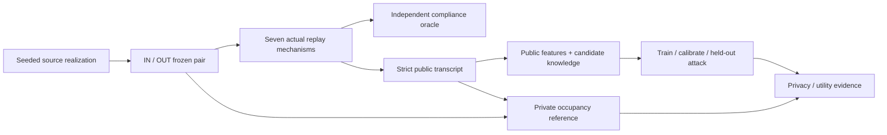

# Independent validation and empirical membership evaluation

Implemented: 2026-10-19. This is the first complete **controlled synthetic evaluation
path**, not a formal privacy guarantee or a validated real-world traffic model.
The [test report](TEST_REPORT_2026-10-19.md) records actual verification and pilot results.

**Coordination extension:** the opt-in `--coordination-study` now compares nine explicit
common/local configurations plus two controls, with a frozen executable/protocol and
same-priority paired attack/utility contrasts. Local transcript feature extraction
requires both spatial and temporal containment. The [predeclared 184-realization study](PRIVACY_COORDINATION_STUDY_2026-10-19.md)
records scope, actual execution and results separately from the original seven-mode pilot.

## What the implementation delivers

1. An independent oracle recomputes release correctness from raw frozen observations.
2. A bounded tiny-tree reference separates impossible retention from coordination-model loss.
3. A seeded generator creates independent source realizations with exact IN/OUT neighbours.
4. A strict exporter restricts the attack to recipient-visible fields and declared constants.
5. A deterministic classifier is fitted on training groups, calibrated on separate groups,
   and evaluated once on held-out groups, alongside unchanged occupancy utility.
6. Versioned private bundles preserve inputs, hashes, commands, models, predictions,
   independent audits and machine-readable results. Existing output paths are never reused.



## Scope and protected secret

A physical candidate road user exists in both worlds. The data source includes its entire
recorded contribution in IN and excludes exactly that contribution in OUT. This is a
controlled **source-contribution membership** experiment. It is not a claim about physical
absence, indoor visibility, identification, or sensitive visits. The live simulator's ideal
sensor is unchanged; source participation is a separate experimental adapter.

The observer knows the mechanism/policies and exact sampled candidate space/time points.
Background traces are uncertain; the attacker learns their population from independent
training realizations. The evaluator's scenario/seed, IDs, true source population counts,
labels and private diagnostics are not attack features. The game is balanced, with prior
0.5. Candidate knowledge is identical across both labels and every compared mechanism.
No coordinate/time noise or zero-knowledge attacker is implicitly claimed.

Occupancy utility measures the **included source population**, not the entire physical
population. A sensor-selection/physical-occupancy study would require another reference.

## Code and contracts

| File | Responsibility |
|---|---|
| `tools/evaluation/oracle.py` | Independent input/policy/geometry/coverage/count checks and tiny feasible-cut reference |
| `tools/evaluation/run_oracle.py` | JSON-only private audit CLI; optional bounded small-case comparison |
| `tools/evaluation/privacy_dataset.py` | Seeded population/path generation, neighbours, candidate knowledge and grouped split/provenance validation |
| `tools/evaluation/empirical_privacy.py` | Public allowlist, features, classifier, calibration and attack metrics |
| `tools/evaluation/run_privacy_study.py` | Actual replay orchestration, audits, controls, held-out analysis and private evidence bundle |

The dataset schema is `ump.privacy-dataset.v1`. Every case names one unique source group,
one split, paired replay paths and a candidate-trace path. SHA256 hashes and normalized
identity-independent trajectory fingerprints detect changed inputs and renamed clones.
All paired worlds, windows and mechanism outputs remain in one split. Every source group
contains one candidate; the first study tests generalization to independent candidate and
background realizations from the same declared scenario generator.

The generator supplies sparse, dense, handover and heterogeneous cases. It varies source
population size, starts, position, speed, pauses and capture turnover using local seeded
random generators. Prescribed horizontal modal corridors and a pedestrian corner path
provide controlled motion. There are no imported buildings, obstacles or collision rules.
Capture handovers are analytical schedules, not simulated doorway crossings. The current
policy fixture uses the existing rectangular regional compiler; it is not the full planned
street/shop regional-policy study or a regional query-mask implementation.

### Independent validation and bounded feasibility

The oracle imports no production selection/evaluation implementation. It independently
reconstructs quadtree footprints, expected/measured observations, exact ID unions,
contributions, sample means and effective intersected policy bounds. It detects malformed
or overlapping publication support and tampered scalar values. Unsupported policy metrics
fail explicitly. A no-release case can be compliant but has no passing release fraction;
it never establishes utility or privacy.

`reference_interval` and `enumerate_endpoints` evaluate declared small fixed-start candidate
intervals under explicit node budgets. Whole-sibling coordination and relaxed partial-child
rescue are distinct model classes. `analyze_windows` compares actual retired intervals;
it does not assume future observations were available online. The reference is not an
optimality proof over arbitrary streams, history budgets, local windows or retractions.
Full depth-6 compliance audits do not automatically trigger feasible-cut enumeration.

### Public transcript and attack features

The exported schema `ump.public-transcript.v1` contains exactly schema, coverage,
sampling period, end time and approved releases. Release IDs are normalized. Unknown
public fields, malformed geometry and overlapping cells are rejected. The exporter never
copies source IDs, private windows, input totals, runtime or journal/debug records.
The research bundle itself remains private, including any artifact filenames and labels.
Collection separation in MongoDB is not access enforcement; this offline protocol does
not certify permissions of a live external application.

A fixed coordinate system yields 18 count/availability features and 31 features with
explicit geometry/timing. Features summarize the permitted history and candidate-point
matches under half-open space/time containment. Missing matches and unknown means have
separate masks. Numerical placeholders for empty feature summaries are never interpreted
as certified zero occupancy. Per-cell support sums are not a whole-history unique count.
The smaller ablation still includes public release/cell availability; it is not a pure
causal isolation of counts from every geometric side effect.

### Fitting, calibration and uncertainty

The classifier is deterministic L2-regularized logistic regression, with training-only
means/scales and an unpenalized intercept. Default L2 is 0.1, maximum iterations 500,
tolerance 1e-8. Serialized models include convergence, objective and scaling parameters.
Each mechanism/knowledge/feature combination is fitted independently with equal budgets.
No test-based score inversion, threshold tuning or model selection is performed.

The threshold maximizes calibration TPR subject to the declared empirical calibration
FPR cap, with conservative tie handling. The held-out FPR is reported independently;
the cap is not a guarantee about unseen samples. Report ROC-AUC, TPR/FPR, balanced
accuracy and threshold advantage TPR minus FPR. Undefined denominators remain explicit.
AUC below 0.5 is retained, not inverted after inspecting test labels.

Bootstrap intervals resample independent source groups within each predeclared scenario,
keeping both labels together. Paired mechanism differences use the same resampled groups.
Models and thresholds remain frozen, so these intervals omit training-set uncertainty and
do not establish a universal privacy bound. Scenario-specific outcomes remain available.
The fixed 10-m/1-s occupancy query, conditional error, coverage, common support, retention
and logical sealing age accompany the privacy outcomes; suppressed public support stays
unknown. Utility rollups pool declared numerators/denominators, not undefined MAEs as zeros.

Controls: prior-only constant scores; constant no-output transcript; unprotected complete
10-m/100-ms exact-count grid with explicit zeros. Only that unprotected control supplies
zero certificates and bypasses policy. It answers the fixed utility query exactly. It
must not be confused with the sparse policy-controlled publication format.

## Reproduction

Run from the repository root. Python standard-library dependencies suffice; the replay
binary requires the existing CMake build dependencies. New experiments never open MongoDB. The full CTest configuration below additionally
enables owned-database MongoDB regressions and needs a local MongoDB server.

```bash
cmake -S simulator -B simulator/build -DCMAKE_BUILD_TYPE=Release \
  -DUMP_BUILD_SENSOR_REGRESSION_TESTS=ON -DUMP_BUILD_PUBLICATION_STORE_TESTS=ON
cmake --build simulator/build -j 4
ctest --test-dir simulator/build --output-on-failure -j 4
PYTHONDONTWRITEBYTECODE=1 python3 -B -m unittest discover -s tools/evaluation -p 'test_*.py' -v

python3 -B tools/evaluation/privacy_dataset.py \
  --output results/my-membership-dataset --seed 20261019 \
  --train-groups 32 --calibration-groups 16 --test-groups 32 \
  --end-ms 4000 --support-threshold 3
python3 -B tools/evaluation/run_privacy_study.py \
  --dataset results/my-membership-dataset --output results/my-membership-study \
  --knowledge-fractions 0.25 1.0 --target-fpr 0.1 --bootstrap-repeats 200

python3 -B tools/evaluation/run_oracle.py \
  --input observations.json --config policy.json --result replay-result.json \
  --output new-independent-audit.json
```

Use new output paths. The oracle CLI exits 0 for valid compliance, 1 for violations,
and 2 for malformed/unsupported input, enumeration budget or output errors. Add
`--analyze-small --max-nodes 1024` only for a suitably bounded tree. Replay policies here
are JSON; this independent tool does not silently depend on a YAML parser.

A study `manifest.json` starts as `running` and becomes `complete` only after all final
artifacts exist. A failed/interrupted directory is not a completed experiment and is never
overwritten by a retry. Inputs and provenance hashes are validated before output creation.
Only running manifests created by that execution are finalized. Read `report.json` for
scientific results and `attack-summary.csv` for the flat attack table.

## Remaining boundaries and next work

Common-window coordination remains the default. Independent cell-local clocks and
bounded partial rescue are now implemented and compared in the opt-in nine-configuration
study; they are not an asynchronous optimality reference. Multiple visible application
views, proactive caches, physical sensor uncertainty and richer publication models remain
separate extensions. The tiny oracle can demonstrate a coordination
loss without classifying it as a defect against the current model.

The empirical attacker is transparent and bounded; stronger attacks may succeed. Sensitive
visit/attribute/linking studies, formal k/l/t mappings and any DP release mechanism require
additional contracts. Offline attack success is not automatically an online bucket metric.
Real maps, shop demand and global/local collision-aware routing remain lower-priority
simulation work. No formal privacy, real-world effectiveness or overall algorithm-optimality
claim follows from completing this implementation.
