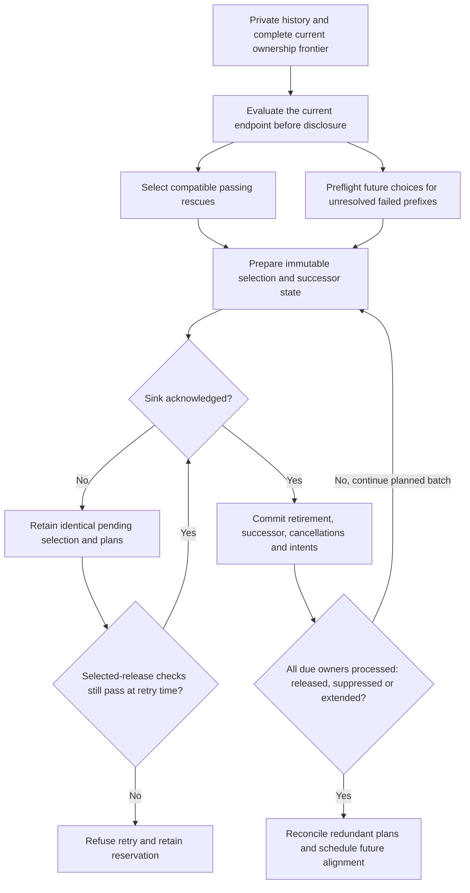
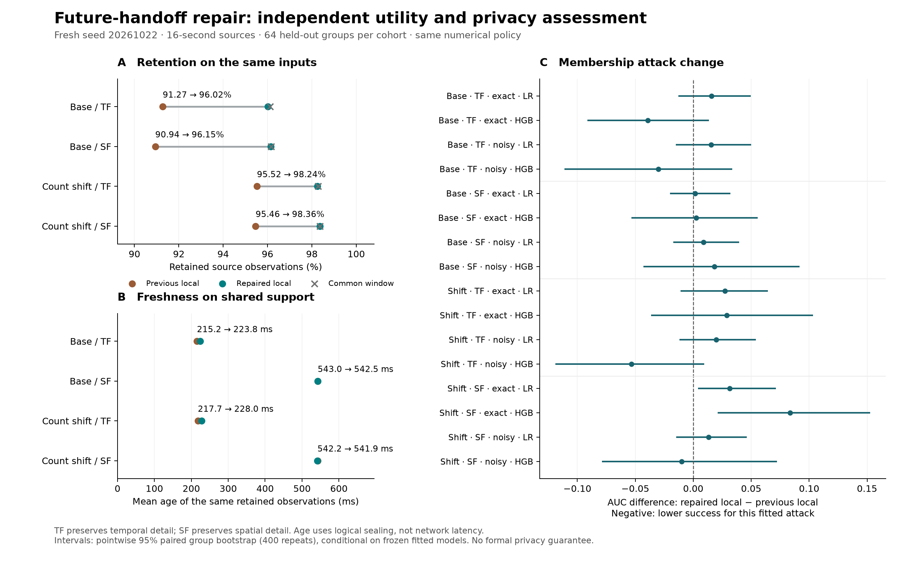

# Future-handoff repair and independent effectiveness assessment

Date: 2026-10-19. Repository: `/Users/maxdemu/Developer/UMP-Simulator`.
Implementation and testing follow the predeclared [repair protocol](HANDOFF_REPAIR_PROTOCOL_2026-10-19.md).
The source changes address A03/A05 coordination; no new privacy metric, suppression
method, motion model or city-map component is introduced.

## Defect and correction

The previous controller could create a future handoff while processing one terminal
owner, before its siblings reached their successor states. This mixed endpoint state
could reserve a future boundary that subsequently blocked a fully private, passing
ancestor. The old blanket overlap rule treated a provisional internal plan like an
irrevocable disclosure. These are different constraints.

The corrected controller first validates current rescues and future policy-feasible
ancestor choices before any sink call. A failed prefix can commit a deferred intent
with its acknowledgement. Scheduling waits until the complete endpoint frontier is
available. A passing ancestor may replace fully contained internal plans atomically.
Nonredundant strict enclosing and unrelated plans remain protected; no retired support is reused.
A plan initially needed to align different starts becomes redundant if those starts
already converge before its boundary. Removing the plan preserves window progress and
absolute deadlines. Explicit already-aligned requests retain their intended guard.

Sink failure retains exactly the pending proposal, successor state, plan cancellations
and deferred intents. Acknowledgement commits the prepared state. A later retry rechecks
time-sensitive requirements; an expired selected recipient release is refused on a later
delivery attempt and cannot be silently replaced. Private empty/suppressed completion
is not itself a recipient release.
The implementation is in `CellLocalAggregation.cpp/.hpp` and its targeted regression suite.

Passing-owner and measured-empty holds remain enabled. Earlier ablations showed that
removing them indiscriminately can sharply reduce retention. Certificates allowing later
reuse of an already retired empty prefix would require a separate ledger/oracle contract.
The present correction does not implement that extension or globally optimal scheduling.

## Why the correction preserves the coordination contract

The ownership frontier is a spatial partition. Refinement replaces one owner by all four
children with the same original start. A parent takeover consumes a complete descendant
partition with a common start and one checked end; it installs a successor at that end.
Every transition preserves a complete ownership frontier, and acknowledged terminal
decisions advance retirement without creating a hole or reusing an earlier interval.
Refinement and plan reconciliation do not themselves advance retirement. Changing an advisory plan does not change
which observations exist or which support has already retired.

A nonredundant contained plan is superseded only when the accepted parent covers its
whole domain. A nonredundant strict enclosing plan still excludes a narrower takeover
because that would alter only part of the planned domain. Redundant plans can also be
removed during reconciliation or with an overlapping retirement acknowledgement; they
no longer impose an alignment requirement. Source coverage, distinct-support union, geometry, all mandatory
metric bounds and the immutable recipient reservation are checked independently of plan
status. Cancelling a plan therefore cannot turn a failing candidate into a passing one.

Preparation happens before sink invocation. The pending object retains the same selection,
preallocated successor nodes, cancellations and future intents until acknowledgement.
After a successful ACK, these prepared objects transfer into the live state. A failed or
ambiguous delivery cannot switch the controller to an alternative candidate; delivery
itself may already have occurred, which is why the identical reservation is retained. Same-logical-time retries are
tested for identical continuation; later retries remain subject to actual age limits.

This is an argument for the maintained invariants under the documented sink/history
contract, supported by independent tests. It is not a machine-checked proof, a proof of
optimality, or a privacy guarantee. The canonical temporal/spatial notation and policy
intersection remain in [the terminology reference](TERMINOLOGY_AND_NOTATION.md).



## Concrete regression witness

A deterministic depth-six, 80-m-square fixture contains 42 source observations from
three synthetic road users. Samples arrive every 100 ms; base checks are 400 ms, with
100-ms extensions and 1000-ms duration/age maxima. Required distinct support is three;
permitted cell sides are 1.25–40 m. This is a minimal correctness witness, not the
population used to claim effectiveness.

The previous executable releases zero observations. The repaired controller releases
33 and suppresses nine. Its first accepted parent is cell 13 over [1800,2200) ms,
containing nine observations from three road users. The earlier nine observations
contain only one road user and remain correctly suppressed. The 2200-ms check follows
the normal 400-ms schedule; this does not claim the earliest mathematically possible
release at every arbitrary timestamp. Exact same-time sink failure/retry produces the
same subsequent scientific output as uninterrupted execution.

## Independent before/after assessment

The predeclared seed20261022 study completed **2912 independently audited mechanism executions**,
**six deterministic repeats**, **three unchanged common/fixed controls**, and **36 separately
fitted attacks / 72 cohort assessments**. The audits cover 264236 released cells. Source code,
binaries, policy, dataset and result hashes remain fixed. No seed, threshold, model or scenario
was selected after inspecting the new test outcomes. Independent verification confirms the results.

There are 48 TRAIN, 32 CAL, 64 base TEST and 64 count-shift TEST source groups. Each group
has an IN and OUT world sharing the same background. Each test table therefore pools 128
worlds but has 64 independent source groups, not 128 independent replications. The protected
secret is inclusion of the candidate's recorded 16-second source contribution. A source
membership result is not a physical-presence, identity, destination or sensitive-visit result.

Policies require distinct support >=3, cell side 1.25–40 m and duration/age <=1000 ms.
Sampling is 100 ms, initial windows 400 ms, extensions 100 ms. All old/new numerical bounds
are identical. These support checks do not establish formal k-anonymity or differential privacy.



[Vector figure](figures/handoff-repair-2026-10-19.svg). TF preserves temporal detail by trying
spatial adaptation first; SF preserves spatial detail by trying temporal adaptation first.

### Retention and availability

Percentages below refer to retained source observations and completely answerable fixed
10-m / 1-s occupancy queries. They are not percentages of distinct people or of all ground-truth
information. Unreported query support remains unknown, not zero. Values are pooled descriptive
estimates across the declared test groups; these utility columns are not confidence intervals.

| Cohort | Priority | Previous retention | Repaired retention | Change (pp) | Common retention | Query coverage, previous → repaired |
|---|---|---:|---:|---:|---:|---:|
| Base | TF | 91.2734% | 96.0170% | +4.7436 | 96.1205% | 15.4869% → 17.9375% |
| Base | SF | 90.9366% | 96.1494% | +5.2128 | 96.1695% | 17.3409% → 19.9402% |
| Count shift | TF | 95.5235% | 98.2445% | +2.7210 | 98.2833% | 15.7166% → 17.7414% |
| Count shift | SF | 95.4625% | 98.3569% | +2.8944 | 98.3571% | 17.8261% → 19.9196% |

The repaired local controller nearly reaches common-window retention under this uniform
numerical policy. Common query coverage remains higher (base TF/SF 18.3823/21.0922%,
shift 17.9596/21.4470%). These results do not establish a universal local advantage or
solve every irreversible publication conflict. The earlier regional-deadline matrix remains
a separate demonstration of benefits under heterogeneous temporal requirements.

| Cohort | Priority | Newly retained / lost observations | Worlds with net retention loss / 128 | Mean age on identical retained observations (ms) | Matched-query MAE, previous → repaired |
|---|---|---:|---:|---:|---:|
| Base | TF | 16147 / 63 | 2 | 215.235 → 223.778 | 0.829967 → 0.830642 |
| Base | SF | 17777 / 102 | 2 | 542.986 → 542.530 | 0.785818 → 0.786247 |
| Count shift | TF | 14861 / 142 | 7 | 217.671 → 227.953 | 1.114124 → 1.115956 |
| Count shift | SF | 15797 / 140 | 7 | 542.183 → 541.869 | 1.024357 → 1.026821 |

The retention gain has costs: TF shared-source mean age increases by 8.54 ms in base and
10.28 ms under shift; SF improves by less than 0.5 ms. Shared-source p95 stays at 400 ms
for TF and 1000 ms for SF. Matched-query error rises slightly in all four pooled comparisons.
The nonzero lost observations and worse individual worlds remain reported. This is not
Pareto dominance. Age uses logical sealing; no network or end-to-end real-time claim follows.

### All predeclared membership contrasts

LR is fixed logistic regression; HGB is pinned histogram gradient boosting. Knowledge
contains 25% candidate points, either exact or with the declared position/time uncertainty.
All models fit TRAIN only; operating thresholds use CAL only and remain frozen across both
cohorts. Intervals use 400 paired scenario-stratified group bootstrap repeats, conditional
on the fitted models. They are pointwise, not multiplicity-corrected or training-uncertainty
intervals. AUC measures this attack's ranking success; lower is better for this threat model.

**No general privacy improvement is established.** Fourteen of 16 repaired-versus-previous
intervals include zero. Two indicate higher attack success for SF / exact knowledge under
count shift: LR +0.03149 [0.00414, 0.07136], HGB +0.08350 [0.02112, 0.15267]. None of the
16 intervals excludes zero in favor of lower attack AUC. All 16 repaired-local versus
common-window intervals include zero; this does not prove equivalence or noninferiority.

**Base test cohort**

| Priority / knowledge / attack | Previous local AUC | Repaired AUC | Common AUC | Repaired − previous [95% interval] | Repaired − common [95% interval] |
|---|---:|---:|---:|---:|---:|
| TF / exact / LR | 0.60034 | 0.61621 | 0.60828 | +0.01587 [-0.01295, +0.04960] | +0.00793 [-0.01969, +0.03589] |
| TF / exact / HGB | 0.68347 | 0.64429 | 0.63257 | -0.03918 [-0.09145, +0.01344] | +0.01172 [-0.04053, +0.06277] |
| TF / uncertain / LR | 0.58521 | 0.60059 | 0.58899 | +0.01538 [-0.01492, +0.05006] | +0.01160 [-0.01002, +0.03493] |
| TF / uncertain / HGB | 0.61365 | 0.58350 | 0.63098 | -0.03015 [-0.11121, +0.03369] | -0.04749 [-0.09803, +0.00721] |
| SF / exact / LR | 0.58704 | 0.58875 | 0.59583 | +0.00171 [-0.02003, +0.03203] | -0.00708 [-0.02026, +0.00367] |
| SF / exact / HGB | 0.70801 | 0.71045 | 0.71216 | +0.00244 [-0.05347, +0.05567] | -0.00171 [-0.04713, +0.04260] |
| SF / uncertain / LR | 0.57190 | 0.58069 | 0.58435 | +0.00879 [-0.01734, +0.03955] | -0.00366 [-0.01589, +0.00611] |
| SF / uncertain / HGB | 0.63538 | 0.65369 | 0.65576 | +0.01831 [-0.04285, +0.09186] | -0.00208 [-0.04248, +0.04370] |

**Count shift test cohort**

| Priority / knowledge / attack | Previous local AUC | Repaired AUC | Common AUC | Repaired − previous [95% interval] | Repaired − common [95% interval] |
|---|---:|---:|---:|---:|---:|
| TF / exact / LR | 0.64136 | 0.66870 | 0.67236 | +0.02734 [-0.01099, +0.06448] | -0.00366 [-0.03492, +0.02542] |
| TF / exact / HGB | 0.68762 | 0.71667 | 0.74768 | +0.02905 [-0.03649, +0.10320] | -0.03101 [-0.09448, +0.02479] |
| TF / uncertain / LR | 0.61572 | 0.63550 | 0.62793 | +0.01978 [-0.01198, +0.05400] | +0.00757 [-0.01544, +0.03834] |
| TF / uncertain / HGB | 0.57886 | 0.52551 | 0.56787 | -0.05334 [-0.11890, +0.00945] | -0.04236 [-0.11634, +0.02430] |
| SF / exact / LR | 0.61060 | 0.64209 | 0.63672 | +0.03149 [+0.00414, +0.07136] | +0.00537 [-0.00781, +0.01929] |
| SF / exact / HGB | 0.60803 | 0.69153 | 0.69641 | +0.08350 [+0.02112, +0.15267] | -0.00488 [-0.05557, +0.05286] |
| SF / uncertain / LR | 0.58569 | 0.59888 | 0.60791 | +0.01318 [-0.01465, +0.04615] | -0.00903 [-0.02540, +0.00416] |
| SF / uncertain / HGB | 0.61377 | 0.60376 | 0.61755 | -0.01001 [-0.07886, +0.07228] | -0.01379 [-0.06168, +0.03443] |

The no-output control has AUC 0.5 and zero false positives throughout. The exact-count
control has AUC 0.5803–0.7666 and is not a universal upper bound on inference risk. Repaired
local test FPR ranges from 0.03125 to 0.203125 despite the CAL target <=0.1. Finite calibration
and distribution shift matter. All 18 LR fits converge; the 18 HGB fits use the fixed budget.

## Research conclusion and next work

The correction removes a concrete implementation-induced retention barrier. On new data,
it recovers 2.72–5.21 percentage points of source observations at unchanged numerical
policy bounds. It also exposes the research limit clearly: more support-compatible output
is not automatically more private. This controller chooses feasible aggregates; its support
proxy does not constrain cumulative membership leakage across the recipient history.

The next scientific work should keep this tested controller as a fixed baseline and define
a privacy objective tied to a protected secret and observer. The already documented
[semantic-visit and online contracts](PRIVACY_ATTRIBUTE_AND_ONLINE_CONTRACT.md) are the next
priority: minimal entry/dwell ground truth and knowledge-only controls, then causal recipient
prefixes and deadline utility. Sensitive attributes, additional anonymization methods and
release-composition/privacy budgets need their own explicit contracts and experiments.
Further coordinator changes should follow measured counterexamples. Formal guarantees,
city realism, online network latency and globally optimal coordination remain unproved.

## Reproduction and evidence

Run from the repository root; existing evidence directories are immutable, so choose a new
output name for a repeat. The actual completed invocation was:

```sh
LOKY_MAX_CPU_COUNT=1 MPLCONFIGDIR=/private/tmp/ump-robustness-mpl \
  /private/tmp/ump-privacy-robustness-venv/bin/python -B \
  tools/evaluation/run_privacy_robustness.py \
  --dataset results/evaluation/2026-10-19/privacy-handoff-repair-dataset-20261022 \
  --output results/evaluation/2026-10-19/privacy-handoff-repair-study-20261022-v1 \
  --binary simulator/build/AggregationReplay \
  --reference-study results/evaluation/2026-10-19/privacy-robustness-study-20261021-v1 \
  --bootstrap-repeats 400
```

The optional `--reference-study` validates and freezes the old executable/source/metadata.
It refits attacks on fresh TRAIN/CAL data and does not load the previous learned models.
Omitting it preserves the original five-mechanism robustness path. Raw/private evidence
remains Git-ignored. Figure code and independent verifiers are in
`results/evaluation/2026-10-19/handoff-repair-verification-v1/`.

| Artifact | SHA-256 |
|---|---|
| Repaired executable | `2f6d69edb2627829e12f99811eb128b4047e6f56178bece7dd50544ce5e2bc00` |
| Study protocol | `5320154e4b627d758603c0136edd5e2d5407aa2d0f0664031c3689432705c517` |
| Dataset manifest | `2cb4686d7b9bd64865885417b04fb763130af30d19493cd6fe810922fa2f84d7` |
| Completed report | `19077cfeef9df72d4021b7c2a9eb0ec5dd5a413e994d81937464dda5d2287496` |

Full verification scope and limitations are in the [test report](HANDOFF_REPAIR_TEST_REPORT_2026-10-19.md).
