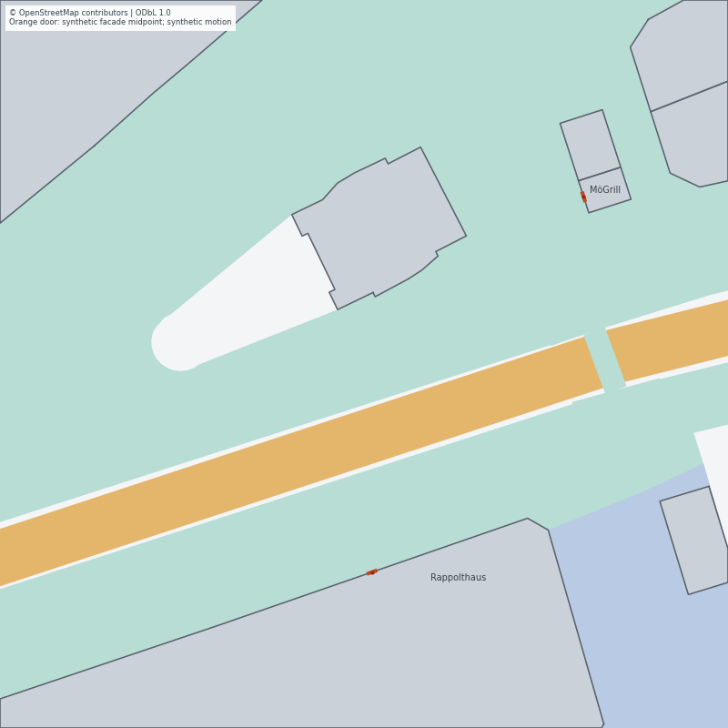

# Multi-building access test report — 2026-10-24

## Outcome

The requested building/entrance slice is implemented and verified. Eight cached
OSM footprints are drawn separately; two modeled destinations use exact original
facade midpoints. In the actual 180-s native capture, 64 people produce all 96
visible episodes, with 16 complete entry/return visits at each building. No
scheduled episodes remain active or pending. The replay at
http://127.0.0.1:8786/ includes boundary/entrance highlights and a building inventory.
See the [implementation contract](MULTI_BUILDING_ACCESS_2026-10-24.md),
[acceptance protocol](MULTI_BUILDING_ACCESS_PROTOCOL_2026-10-24.md) and
[compact evidence](MULTI_BUILDING_ACCESS_RESULTS_2026-10-24.json).

## Implementation checks

The generator keeps individual original OSM wall segments and clipped display
polygons distinct. Doors are synthetic, width 1.2 m, and exactly centered on
original Rappolthaus/MöGrill facades. Full centerline and 0.55-m swept-body audits
cover walking geometry, building interiors and access/through separation, with
only the declared 0.85-m final facade transition exception and domain clipping.
The exception is not an entry trigger. Invented clip-border walls, off-midpoint
endpoints and routes borrowing another portal exception are rejected.

Native validation checks strict portal fields, geometry, positive fitting width,
body diameter, consistent route endpoints and same-building relative returns.
Door admission uses body and incident-route angle; visible entry still occurs
only at the exact route endpoint. Indoor return timing uses realized arrival and
fresh visible IDs. Legacy no-portal scenes retain their existing branch.

The public geometry has a closed bounded schema. Native export checks the actual
configuration's full portal declarations and scene bounds against the geometry,
plus generated config/image/geometry digests. Deliberately changed public doors
or private fields are rejected before a verified-looking bundle is created.
Comparison export preserves the geometry/hash without serving private schedules.

## Regression and sanitizer results

- Full configured build succeeds; **83/83 CTest suites pass**, 43.03 s.
- The generator suite executes **20 methods**, including two optional native
  building-drain cases enabled by CMake. They cover 64/128 people, two seeds,
  repeatable generation, exact doors, separate buildings, malformed routes,
  clipped-wall rejection and the formerly conflicting through/access crossing.
- Five independent capture-audit methods reject early disappearance, misplaced
  exit, unrealized indoor gaps, off-route positions, overlap and merely configured
  but unvisited targets.
- **16 native mapped-core cases pass ASan/UBSan**, with no diagnostics. New cases
  include exact facade arrival/reentry, independent nearby doors/passers,
  opposing acute doorway approaches and invalid portal configurations.
- Viewer/export/comparison regressions run in the full suite. Standalone checks
  also passed 56 Python viewer cases, 65 Node model cases and 51 mapped
  export/comparison cases. Legacy bundles without geometry remain accepted.

## Actual native capture and independent position audit

The normal launcher generated a fresh source under
`results/building-access-2026-10-24-64/scene` and kept its three fresh owned MongoDB
namespaces. Normal export verifies the complete source, lifecycle, GT/AGBS sample
matching, counts, semantic bins, regional constraints, ownership and immutable
recipient/journal content. Results:

| Quantity | Result |
|---|---:|
| Source horizon / step / sensor cadence | 180 s / 50 ms / 100 ms |
| Planned people / visible episodes | 64 / 96 |
| Realized starts / ends | 96 / 96 |
| Building entries / returns | 32 / 32 |
| Visits per building | 16 / 16 |
| Last episode end | 157.400 s |
| Remaining active / pending / stalled tracks | 0 / 0 / 0 |
| Reported body-overlap violations | 0 |
| Maximum consecutive visible stop | 2.600 s |
| GT position rows / sensor batches | 92,026 / 1,799 |
| Measured-empty batches | 226 |
| Input observation contributions | 46,009 |
| Recipient cell-windows / distinct spatial IDs | 376 / 20 |
| Private retirements / empty retirements | 47,637 / 47,261 |

The independent audit checks **1,873,571 body pairs** across every stored native
source frame, rather than trusting only the source counters. Position-to-route
error is at most 5.01e-6 m. The smallest configured-clearance margin is -3.33e-6 m
from float serialization, within the declared 1e-4-m tolerance; bodies themselves
remain separated. Door exit coordinates differ from the exact targets by at most
1.99e-6 m. The last outdoor position before entry is at most 0.0702 m from the door,
consistent with one 50-ms step; there is no disappearance several metres away.
Realized hidden gaps are at least 8,000 ms. Both buildings have actual entry and
return events; the independent acceptance gate rejects an unvisited configuration.

Native process wall was 28.281 s, including startup, source, aggregation and DB I/O,
excluding export. This is integration timing on a changed source, not a before/
after optimization comparison or a per-step/end-to-end realtime guarantee.

## Dense finite-source and legacy compatibility checks

The pure native 128-person case uses seed 20261024 and 500-ms source requests.
All **192 episodes** start and finish; last end is **164.150 s**, maximum visible
stop **5.200 s**, and final active/pending/stalled/overlap counts are zero by the
600-s audit horizon. This pure model check writes no sampled movement and does
not exercise MongoDB or publication. The main actual capture above is the 64 case.

A fresh actual 180-s historical corridor run is compared to the retained previous
native source. All **95,605 GT/metadata/lifecycle documents**, **42,852 sensor
documents**, **509 recipient releases** and **47,106 private journal documents**
match. Only fresh raw BSON IDs, run UUID and cursor row order are normalized.
Timestamps, trajectories, visible identities, counts, semantics and final journal
states remain checked. Historical generated integration/corridor configurations
and background PNGs also remain identical to the previous revision.

## Failures found before acceptance

The first multi-building geometry was individually walkable but crossed a
through-flow lane near the western Rappolthaus approach. A 600-s pure run ended
with 92 starts, 79 ends, 13 stalled active tracks and four pending tracks. No body
overlap occurred: the conservative stop rule prevented collisions but did not
resolve the route conflict. Merely extending the run did not solve the deadlock.

Access routing now excludes the full through-flow envelope, including bounded
seed/path variation, and a regression checks the former shallow crossing.
Independently, an acute doorway regression exposed an insufficient diameter-only
throat; the angle-aware closest-approach bound fixes that separate case. Both
final sources drain. This is evidence for the declared fixtures, not a general
arbitrary-route deadlock proof.

Review also caught that public geometry could be structurally valid while differing
from executed door settings, and that an independent audit could pass with no
realized visits. Native/artifact equality and two-actually-visited-building checks
now close those gaps and have mutation tests.

## Visual acceptance and limits

Chrome inspection verifies separate contours and exact synthetic-door diamonds
in all three map panels, geometry/policy toggles and the building/door inventory.
At 60 s the reference panel shows 57 track IDs at 57 distinct coordinates on
separate northern/southern walking paths; both comparison panels use the same map
alignment. The local screenshot is `/private/tmp/ump-building-replay-20261024.jpg`.
The verified tab remains open. Full movement/replay files stay local and ignored;
only code, tests, English documentation, a 64-KiB public map and compact results
enter Git.

The new source still uses explicit polylines, synthetic visit choices and a
conservative center-target doorway model. Overtaking, calibrated shopping behavior,
indoor navigation and general dynamic crossing resolution remain future work.
Door widths/points are modeled, not verified real-world access. Policies and
semantic categories are unchanged, and the old entrance policy patch is not
automatically attached to every new door. No measured privacy improvement or
baseline superiority is claimed by this implementation gate.
