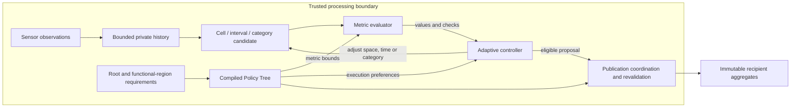

# Presentation structure and evidence gate

Date: 2026-10-23. Target: 20 minutes, with 18 minutes of planned speech and two minutes for transitions. This is a slide-content plan, not a new slide deck or a result from the three proposed street scenarios. It supersedes stale common-window-only wording in the October 21 narrative; historical experiment descriptions remain unchanged.

## Main question and answer

**Research question:** Under which local policy requirements and traffic conditions can online spatial, temporal and semantic adaptation release useful urban mobility aggregates, and what are the costs in coverage, detail and delay?

**Answer supported today:** The implemented mechanism enforces the audited regional constraints on its released space-time support. Cell-local timing removes specific unnecessary dependencies between unrelated areas. Benefits depend on the recipient task and the traffic distribution: on the current uniform moving trace, a strong fixed grid matches or exceeds several exact-query outcomes. A privacy improvement over fixed release has not yet been established for the current semantic/regional mechanism.

**Hypothesis to test next:** Heterogeneous functional areas with different density, type composition and freshness requirements create conditions where adaptation preserves more useful information at matched policy requirements and measured privacy risk than a single fixed grid/window. A static region-specific comparator must also be included so the benefit of knowing the map is separated from the benefit of reacting to data.

A useful result may be a conditional advantage or a measured limit. Neither the scenario design nor the presentation should assume that the adaptive method must win every scenario.

## The argument in 11 slides

| Slide | Speech | Title | Content and evidence |
| --- | ---: | --- | --- |
| 1 | 1:00 | Regional adaptation of mobility aggregates | Research question and the conditional answer above. Establish the contribution as a release mechanism, with the simulator serving as its proof of concept. |
| 2 | 1:10 | Different local requirements | One schematic streetscape with an entrance, shop window and crossing. Explain sparse/dense traffic and conflicting detail/freshness needs. Clearly label this as a scenario design; no values presented as measured results. |
| 3 | 1:20 | Observation and release boundary | Trusted sensor-side observations and identities; recipient sees approved counts, category labels, geometry, intervals and release timing. Distinguish GT, observed data, candidates and immutable releases. Distinct support is a release condition, not an automatic identification-risk guarantee. |
| 4 | 2:00 | Policy Tree and feasibility | Root → functional-region type → region instance, with strict intersection of metric bounds. A cell remains a quadtree square even across a semantic boundary. The tree supplies bounds; the evaluator computes candidate metric values. Show one coarse candidate crossing a strict small region. |
| 5 | 1:40 | Spatial, temporal and semantic actions | Coarsen to a parent, collect a longer interval, generalize to a truthful ancestor category, retain eligible subareas or suppress unresolved support. Preserve user terminology: Temporal First retains temporal accuracy, Spatial First retains spatial accuracy, Semantic First retains semantic accuracy. Immediate policy eligibility is the default; priorities do not weaken hard constraints. |
| 6 | 1:30 | Online coordination | One time axis: sample → private evidence → candidate checks → coordinated release. Explain same-start unpublished support for a parent, future handoffs for incompatible starts, and no reuse of published support. Independent cell windows do not imply one window per functional region. Avoid class diagrams and bucket inventories. |
| 7 | 2:00 | A local constraint can change its neighbourhood | Use the verified 20-identity analytical fixture, including intermediate Pedestrian/Cyclist categories and the empty guard region. Label it analytical. Regional common/local both retain 75%; control cells release at 400 ms locally instead of the first common 600-ms endpoint. Fine regional-query availability is 81/720 locally versus 0/720 common in the declared interior task bank. This compares coordination modes, not a fixed baseline or measured privacy risk. |
| 8 | 2:20 | A strong fixed baseline remains competitive | Show the verified same-input N=500 moving comparison. Fixed 10 m/400 ms retains 92.8192%; local retains 93.2832%. Yet exact total-Road-User 10 m/400 ms query coverage is 79.22% fixed versus 68.32% local. Explain boundary alignment, public unknown areas and semantic loss rather than attributing all differences to a scheduler defect. Show at least the fixed frontier in backup. |
| 9 | 1:30 | Quantifying privacy effectiveness | Distinguish audited support constraints from measured attack risk. Define the protected unit as one passage and the secret as inclusion of its contribution stream in the source, with fixed physical background, recipient transcript and external knowledge. The planned comparison asks for more deadline-aware utility at comparable measured risk, or less attack success at matched utility. Existing historical attacks are not evidence for the current regional semantic mechanism. Show the proposed test, with no invented outcome. |
| 10 | 2:10 | Three decisive street scenarios | Residential entrances; shopfront dwell; time-critical crossing. Give each its local requirements, fixed recipient task and paired comparator. Present the next hypotheses and acceptance criteria from THREE_SCENARIO_PLAN_2026-10-23.md. Replace this slide with measured results only after those runs pass their gate. |
| 11 | 1:20 | Findings and next test | Three points: audited compliance; conditional utility and coordination gains with strong counterexamples; measured privacy effectiveness remains a separate evaluation. End with the exact test that could confirm or reject the adaptive advantage. |
| Total | **18:00** | | Two minutes remain for transitions and a short replay or recorded fallback. |

## Editable architecture for slides 4--6

The tree supplies requirements; the evaluator computes metric values from observed
support. Finest input depth is fixed in this experiment; the published spatial cut
and cell-local time intervals adapt. The diagram omits simulator/rendering classes
and private diagnostic files so the presentation stays about the mechanism.

## Three mathematical displays for the main deck

Reuse the established symbols from TERMINOLOGY_AND_NOTATION.md. Do not introduce a new generic weighted optimizer to describe the current bounded heuristic.

**1. Distinct support, not sample count.** For complete measured support:

\[
\mathcal U(C,I)=\bigcup_{o\in\mathcal O(C,I)}\{\operatorname{uid}(o)\},\qquad
n(C,I)=|\mathcal U(C,I)|,\qquad
n_{\mathrm{cat,min}}(C,I,K)=\min_{v\in K}|\mathcal U_v(C,I)|.
\]

Ten samples of one person contribute support one. Missing measurement evidence is not zero occupancy and cannot pass as complete support. The positive category cut K contains truthful, disjoint taxonomy groups.

**2. Regional feasibility is a conjunction.** For candidate b=(C_b,I_b):

\[
\operatorname{Admissible}_a(b;t)=\operatorname{Complete}(I_b)\land
\bigwedge_{m\in\mathcal M_a(C_b)}
\left[v_m(b;t)\ne\bot\land
\underline\theta_m^{(a)}(C_b)\le v_m(b;t)\le\overline\theta_m^{(a)}(C_b)\right].
\]

The effective lower bound is the maximum applicable lower bound; the upper bound is the minimum applicable upper bound. Positive-area intersection applies even to an empty portion of a parent. Passing this check precedes publication coordination; it is not itself a release.

**3. Utility requires availability and error together.** On a fixed task bank Q:

\[
c_{\mathrm{ans}}=|\mathcal Q_{\mathrm{ans}}|/|\mathcal Q|,\qquad
\operatorname{MAE}_{\mathrm{occ}}=
\frac{1}{|\mathcal Q_{\mathrm{score}}|}\sum_{i\in\mathcal Q_{\mathrm{score}}}|\widehat y_i-y_i|.
\]

Retain a fixed denominator and deadline. Exact answers and explicitly estimated answers are separate. Conditional error is unavailable when no tasks can be scored. A perfectly accurate answer to almost no tasks is not high overall utility.

## Evidence that is ready versus still planned

| Statement | Status and correct presentation |
| --- | --- |
| Every inspected released block satisfies its effective local bounds | Supported within independently audited test/study domains. This is not a completeness or global-optimality theorem. |
| Local clocks can protect an unrelated region's timing | Supported by analytical regional fixtures, with explicit duration-minimum caveats in the original study. |
| Adaptive release always improves utility versus fixed grids | Contradicted as a general claim by the moving scoped pilot. Show this limit. |
| A policy support threshold of five is k-anonymity | Unsupported without the protected record, QI equivalence and transcript contract. Call it distinct support five. |
| Semantic loss 0.5 means 50% privacy improvement | Incorrect. It is a configured category-abstraction cost. |
| Current mechanism yields lower membership/visit attack risk than the matched fixed baseline | Not established. Historical privacy studies use different contracts/data and are not transferable. |
| Three realistic functional-region scenarios are implemented and evaluated | Planned. The existing street mockups are qualitative; the 20-ID fixture is analytical; random straight-line motion is not a validated street scene. |
| 100-ms hard real-time operation is established | Unsupported: one ordinary 60-s replay service takes 119.06 ms; live costs are still being isolated. |

## Visuals and rehearsal gate

Keep one shared colour legend across the main deck: public eligible release, pending private candidate, suppressed private diagnostic and local constraint. Explicitly label historical interval support; it is not instantaneous occupancy. Use the measured asynchronous mosaic for a local-window replay, not a fabricated global frame. The source layer, if shown, is privileged research evidence.

Prepare one frozen replay state and one static screenshot fallback. The replay should support cell inspection showing the actual released category counts, effective bounds, interval and failed checks; display raw identities only in a clearly private diagnostic view.

Before slide freeze, verify every displayed number against its dated report, label the denominator and measurement unit, preserve the negative baseline result, keep historical cohorts separate, and read the complete main story aloud within 18 minutes. Put taxonomy details, publication protocol, algorithms, test inventories, runtime breakdowns, old metric catalogues and ALOQ discussion in backup. A runtime backup may use the approved 60-s replay: 599 measurements, service p95 76.22 ms, maximum 119.06 ms, one service over the 100-ms cadence and recovered backlog without overflow. The latest diagnostic-cost study belongs beside it; distinguish service, queue wait, logical aggregation age, MongoDB acknowledgement and renderer presentation. Do not describe the diagnostic toggle as a measured privacy or algorithmic improvement.

## Sources and edits to the previous presentation

The supplied 32-page presentation was read for this structure. PDF page 3 states the broad research question. Page 14 shows the original architecture. Pages 27 and 28 show the residential and shopfront mockups. Their captions contain illustrative average local k-anonymity values; replace them with actual support/utility labels before reuse. They are not evaluated policy compliance or privacy evidence. The 2024 paper provides the same architectural motivation; its implementation and metric descriptions must not override the current tested repository contract.

Update the architecture with the Policy Tree, separate metric evaluator, semantic action and recipient boundary. Keep policy requirements distinct from measured metric values. Replace retroactive database-merging explanations with the implemented immutable release rule. Do not promise safety by deleting already received records.

Current evidence sources:

- SEMANTIC_CELL_LOCAL_CONTRACT_2026-10-22.md and SEMANTIC_CELL_LOCAL_TEST_REPORT_2026-10-22.md.
- SCOPED_SEMANTIC_UTILITY_TEST_REPORT_2026-10-22.md.
- MOVING_SCOPED_COMPARISON_REPORT_2026-10-22.md.
- PACED_60S_FOLLOWUP_2026-10-23.md.
- POLICY_TREE.md, METRICS.md and TERMINOLOGY_AND_NOTATION.md, read with later dated integration corrections.

## Current diagnostic-cost checkpoint for backup

The [diagnostic cost report](DIAGNOSTIC_COST_TEST_REPORT_2026-10-23.md) records
74 passing CTest suites and a paired 13.09% processing reduction when private
file diagnostics are explicitly off. Policy metrics, immutable recipient storage
and the live aggregation/progress display remain active. The full mode remains
the default. Treat this as implementation validation in backup, not evidence of
privacy improvement or general real-time capacity.
