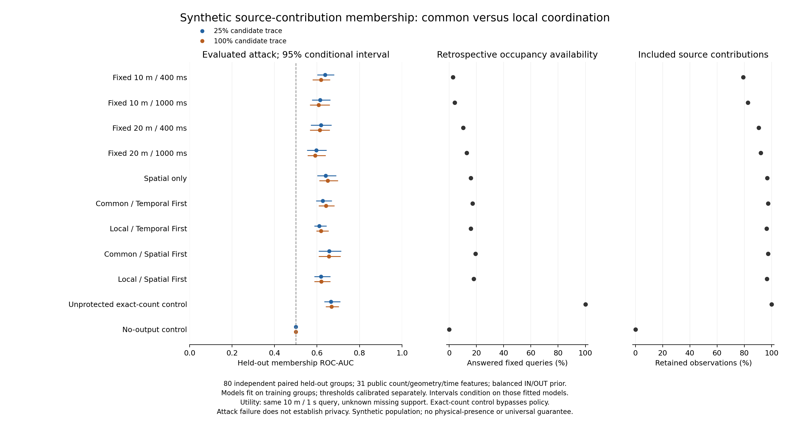

# Empirical privacy: common and cell-local coordination

Date: 2026-10-19. The user selected privacy as the next focus after correcting and
re-evaluating the proven coordination weaknesses. This extends the existing
[empirical membership path](EMPIRICAL_PRIVACY_IMPLEMENTATION.md), with the revised
controller and explicit common/local configurations. It does not invent sensitive
attributes or equate local support with formal k-anonymity.

## Protected unit, secret and observer

The protected unit is one candidate road user's entire recorded contribution over
four seconds. IN includes that contribution in the source; OUT removes exactly it.
The physical candidate exists in both worlds. Background observations, sampling
opportunities and all other source fields remain identical. This is **source-contribution
membership**, not physical-presence protection, reidentification or a sensitive visit.

The recipient knows the aggregation mechanisms and policies plus either 25% or 100%
of the candidate's exact sampled coordinates/times. Knowledge is selected before any
mechanism output and is identical for both labels and all configurations. Background
trajectories are uncertain and learned from independent realizations of the declared
synthetic population. Their identities, scenario labels, seeds, GT counts, private
candidate decisions and suppression/debug/journal information are not attack features.

The attack sees the full final recipient transcript over the horizon: public counts,
cell geometry and logical interval/sealing times. It is an offline full-history attack,
not an online-prefix game. Runtime, network/packet timing, uncertain candidate knowledge,
joint views from multiple applications and real-world trajectory distributions remain
outside this first comparison.

A local transcript can have several disjoint spatial release scopes overlapping in
time. The public feature extractor now continues its search until it finds the
candidate's spatial **and** temporal support. The previous unconditional first-time-match
break was valid only for common windows and would silently undercount local matches.
A minimal disjoint-scope regression reproduces that error; the new evaluation uses the fix.

## Predeclared protocol

The following choices were fixed before examining held-out outcomes:

| Choice | Value |
|---|---|
| Dataset seed | 20261020 |
| Independent realizations | 184 total: 64 training, 40 calibration, 80 held-out test |
| Scenario strata | Sparse, dense, handover, heterogeneous; equally cycled within each split |
| Per-scenario test groups | 20; each contains an IN and OUT world |
| Source | 80-m square, depth 6, 100-ms cadence, 4000-ms exclusive endpoint |
| Operational support threshold | Minimum 3 distinct observed road users; identical numeric policy across mechanisms |
| Mechanisms | Four fixed references, spatial-only, common/local Temporal First and Spatial First |
| Controls | Unprotected full exact-count grid with zeros; constant no-output transcript |
| Candidate knowledge | Exact random sampled 25% and full 100% candidate trace |
| Feature projections | 18 public count/availability features; 31 including geometry/timing |
| Attack | Separately fitted deterministic L2 logistic classifier for each mechanism/projection/knowledge level |
| Training | Training-only scaling and fitting; L2 0.1, 500 iterations, tolerance 1e-8 |
| Threshold | Maximize calibration TPR subject to empirical calibration FPR <= 0.1 |
| Uncertainty | 400 scenario-stratified paired source-group bootstrap resamples, frozen models/thresholds |
| Primary mechanism contrast | Local minus common ROC-AUC within the same preservation priority |
| Utility | Unchanged public-only 10-m / 1-s occupancy reconstruction, coverage, retention, conditional/matched MAE |

There are 3312 independently audited mechanism executions (184 groups × 2 worlds ×
9 mechanisms), plus four adaptive scientific repeats on the first IN world. Controls
bypass the core and are labelled separately. All worlds and mechanism outputs from
one realization remain in the same split. Source participation labels, training,
calibration and testing are balanced within each declared scenario. Cloned background/
paired traces are rejected using identity-normalized fingerprints, not just random IDs.

The immutable protocol is saved before the first replay; the executable is copied
and hashed, effective policies and dataset provenance are recorded, and raw/public/
model/prediction evidence remains private. A complete manifest is written only after
all audits, fitting, calibration, held-out analysis and final provenance checks.
The prior coordination study's snapshot links the same executable hash to frozen
algorithm source. Existing paths are rejected rather than overwritten.

## Metrics and interpretation

For a calibrated threshold tau and score s, report empirical held-out

    TPR = #{IN scores >= tau} / N_IN
    FPR = #{OUT scores >= tau} / N_OUT
    advantage = TPR - FPR
    balanced_accuracy = (TPR + 1 - FPR) / 2.

ROC-AUC measures ranking over held-out positive/negative scores, including half credit
for ties. Score direction, model hyperparameters and thresholds are not chosen from
test outcomes. AUC below 0.5 stays below 0.5; it is never inverted after looking at labels.
The nominal calibration cap is not a held-out FPR guarantee. Overall test FPR has
resolution 1/80 = 1.25 percentage points; per-scenario FPR resolution is 1/20 = 5 points.
Calibration FPR has resolution 1/40 = 2.5 points. This cannot establish extreme low-FPR
protection. Bootstrap intervals condition on fitted models and omit training uncertainty.

For fixed knowledge/projection, the paired AUC difference is AUC_local - AUC_common,
using the same resampled source groups for both. A negative difference means lower
success of this evaluated attack under this population/knowledge; it is not a bound
on other attacks. Geometry/timing ablations indicate feature sensitivity, not additive
causal leakage contributions. Report scenario-specific outcomes as well as pooled ones.

The no-output control has AUC 0.5 and zero answered-query coverage. The exact-count
control is deliberately unprotected and publishes zero certificates; it bypasses
policy. Neither is a valid adaptive release candidate. Privacy comparisons are shown
with full-domain coverage, retained source contributions and conditional accuracy.
Pair-specific MAE uses only queries scored by both coordination models, with its support
count. All-mechanism shared support may be empty. Omitted/suppressed support is unknown.
Utility concerns the included source population, not every physically present road user.
The legacy per-release unweighted age fields are not used to compare local freshness.

No sensitive-attribute mapping or formal l-diversity/t-closeness claim follows from
this membership task. Differential privacy would require a separate mechanism,
contribution bounds and repeated-release accounting, including adaptive geometry/timing.
Poor attack performance alone never supplies that guarantee.

## Reproduction

```sh
python3 -B tools/evaluation/privacy_dataset.py \
  --output results/evaluation/2026-10-19/privacy-coordination-dataset-20261020 \
  --seed 20261020 --train-groups 64 --calibration-groups 40 --test-groups 80 \
  --end-ms 4000 --support-threshold 3
python3 -B tools/evaluation/run_privacy_study.py \
  --dataset results/evaluation/2026-10-19/privacy-coordination-dataset-20261020 \
  --output results/evaluation/2026-10-19/privacy-coordination-study-20261020-v1 \
  --coordination-study --knowledge-fractions 0.25 1.0 \
  --target-fpr 0.1 --bootstrap-repeats 400
python3 -B tools/evaluation/plot_privacy_coordination.py \
  --report results/evaluation/2026-10-19/privacy-coordination-study-20261020-v1/report.json \
  --output docs/figures/privacy-coordination-2026-10-19
```

Run from the repository root, using new output paths. The completed results below preserve the predeclared scope and report improvements and failures.

## Actual held-out findings

The fixed run completed **3312 independently audited mechanism executions**, four exact adaptive repeats and 44 fitted attack comparisons. All audits passed for 63,227 released cells; 206 mechanism/world cases had no output. All 44 models converged in 1–79 iterations. No classifier, threshold, knowledge level or protocol choice was changed after examining test results.

Private evidence: `results/evaluation/2026-10-19/privacy-coordination-study-20261020-v1`. Its frozen executable hash matches the refined coordination matrix. Protocol SHA-256: `8f9264163571ad60d19293e12438bc8da86951fe1b83b8453653432adb8d9b89`; report SHA-256: `bfc3d066d2367929ae014aec7f4b42d9fc750924af95175c49e568f702af01e6`. Dataset SHA-256: `5f653f1ed5886d351a5ca02d8e01d6bcfa90a67c847511d72fc8d380cecba282`. The main study evidence at completion occupies 778,581,938 bytes (about 742.5 MiB); this is disk storage, not online RAM.

### Complete-trace / 31-feature comparison

This table uses the full candidate trace and the predeclared public count/geometry/time projection. AUC intervals are the conditional, scenario-stratified paired-source bootstrap intervals. Retention and coverage pool their declared contribution/query denominators across both worlds of 80 test groups. Conditional MAE uses each mechanism's own answered subset and cannot alone compare accuracy across methods.

| Mechanism | AUC | 95% conditional interval | TPR | FPR | Retention (%) | Answered queries (%) | Conditional MAE |
|---|---:|---|---:|---:|---:|---:|---:|
| fixed_10m_400ms | 0.6191 | [0.5786, 0.6618] | 0.3500 | 0.1500 | 79.29 | 2.66 | 0.0401 |
| fixed_10m_1000ms | 0.6075 | [0.5668, 0.6599] | 0.1000 | 0.0250 | 82.74 | 3.98 | 0.0000 |
| fixed_20m_400ms | 0.6130 | [0.5660, 0.6598] | 0.1250 | 0.0875 | 90.57 | 10.34 | 2.4830 |
| fixed_20m_1000ms | 0.5915 | [0.5556, 0.6402] | 0.1250 | 0.1000 | 92.13 | 12.75 | 2.1252 |
| spatial | 0.6502 | [0.6108, 0.6990] | 0.2875 | 0.1375 | 96.92 | 15.94 | 0.7445 |
| common_temporal_first | 0.6422 | [0.6071, 0.6823] | 0.3625 | 0.2125 | 97.44 | 17.02 | 0.7137 |
| local_temporal_first | 0.6187 | [0.5967, 0.6540] | 0.2125 | 0.1375 | 96.31 | 15.89 | 0.7496 |
| common_spatial_first | 0.6561 | [0.6082, 0.7106] | 0.1250 | 0.0625 | 97.48 | 19.31 | 0.6500 |
| local_spatial_first | 0.6197 | [0.5869, 0.6633] | 0.1125 | 0.0625 | 96.52 | 17.95 | 0.6777 |
| control_exact_count | 0.6684 | [0.6406, 0.7034] | 0.1375 | 0.1125 | 100.00 | 100.00 | 0.0000 |
| control_no_output | 0.5000 | [0.5000, 0.5000] | 0.0000 | 0.0000 | 0.00 | 0.00 | undefined |

### Paired local minus common attack differences

All rows use the same 80 independent paired test groups. These intervals are conditional, unadjusted for multiple comparisons and exploratory. The predeclared full geometry/time projection is shown; both knowledge levels were fixed in advance.

| Priority | Known candidate trace | AUC difference | 95% paired interval |
|---|---:|---:|---|
| TF | 25% | -0.01633 | [-0.05184, +0.02227] |
| TF | 100% | -0.02352 | [-0.05668, +0.00470] |
| SF | 25% | -0.03844 | [-0.06626, -0.01217] |
| SF | 100% | -0.03641 | [-0.06126, -0.01061] |

For SF, the full-trace AUC falls from 0.65609 to 0.61969 (paired difference -0.03641, interval [-0.06126,-0.01061]). For TF it falls from 0.64219 to 0.61867 (difference -0.02352, interval [-0.05668,+0.00470]); this interval includes zero. These are outcomes of the declared classifier and synthetic population, not a general privacy bound.

Both local variants still expose membership signal to this attack (AUC about 0.62 rather than the no-output control's 0.5). The local algorithms also retain slightly less and answer fewer queries on this separate depth-six population: TF retention/coverage changes are -1.13/-1.13 pp; SF -0.95/-1.36 pp. A lower attack score is therefore not an availability-free privacy gain or proof that the coordinator itself is the only cause. The revised local controller's strong depth-four regional result cannot be substituted for utility on this privacy dataset.

On matched common/local primary support, TF MAE is 0.74746 common versus 0.75427 local across 6369 scored queries; SF is 0.67786 versus 0.67772 across 7354. Those support counts preserve the shared denominator, while full-domain coverage remains separately reported.

The 20-m / 1000-ms fixed baseline has lower point AUC (0.59148) than either local variant, with less answered coverage (12.75% versus 15.89%/17.95%). The full exact-count control has AUC 0.66844 and 100% coverage under this bounded attack; its AUC below one is not proof that unprotected exact data are private. The no-output control has AUC 0.5 and zero availability. No configuration establishes universal dominance across privacy, coverage and accuracy.



Publication exports: [PNG](figures/privacy-coordination-2026-10-19.png) / [SVG](figures/privacy-coordination-2026-10-19.svg).

### Scenario and feature sensitivity

Per-scenario AUC for full candidate knowledge / 31 features uses 20 independent groups per scenario. The classifier and threshold were fitted/calibrated on pooled groups; these are stratified test results, not scenario-tuned attacks.

| Mechanism | Sparse | Dense | Handover | Heterogeneous |
|---|---:|---:|---:|---:|
| common_temporal_first | 0.7913 | 0.6150 | 0.6475 | 0.6088 |
| local_temporal_first | 0.7837 | 0.5475 | 0.6375 | 0.5800 |
| common_spatial_first | 0.7775 | 0.5725 | 0.6425 | 0.6525 |
| local_spatial_first | 0.7350 | 0.5650 | 0.6550 | 0.5825 |
| control_exact_count | 0.8500 | 0.5800 | 0.9450 | 0.6675 |

The pooled SF reduction is not universal: handover AUC rises from 0.6425 to 0.6550 locally. Sparse scenarios remain relatively exposed. AUC cannot be inferred from the selected TPR alone: the exact-count handover control has AUC 0.945 but TPR/FPR 0/0 at the globally calibrated threshold. Its scores are below that cutoff, not devoid of ranking information. Context-aware calibration/attacks need a newly declared experiment.

The calibration target FPR 0.1 does not transfer exactly: full-trace common TF has held-out FPR 0.2125, and local TF 0.1375. SF has 0.0625 for both models. TPR comparisons at those unequal realized FPRs do not describe equal-operating-point performance; the primary AUC contrast avoids pretending they do.

With the smaller 18-feature count/availability projection and full trace, local-minus-common AUC is -0.02961 for TF (interval [-0.06680,+0.00229]) and -0.00797 for SF ([-0.02986,+0.01266]); both include zero. This suggests projection sensitivity but is not an additive decomposition of geometric leakage. The smaller projection still aligns observations using known geometry/time. More candidate knowledge does not improve every fitted point result monotonically: a bounded summary/classifier may fail to exploit extra information; this is not evidence that an optimal attacker becomes weaker when given more knowledge.

## Privacy priorities after this fixed assessment

This milestone supplies a concrete answer under an explicit model: the tested local SF pipeline reduces this classifier's pooled membership ranking relative to common SF, with a small availability/retention cost; TF is less resolved. Residual signal and scenario dependence remain. The result is not formal k-anonymity, DP, or a privacy guarantee for all observers. Online policy checks still enforce numeric support/geometry/time requirements; an offline attack AUC is not automatically a calibrated per-cell metric for a Policy Tree.

1. Preserve this held-out set and report as assessment evidence. Predeclare a new independently generated evaluation before changing attack/model/feature choices.
2. Extend the horizon and candidate-knowledge noise, and test background distribution shift. The current four-second, exact-point, same-generator setting cannot answer long-term linking or realistic auxiliary-knowledge questions.
3. Add a stronger public-only attack family and observable-context-aware calibration, trained and calibrated without private scenario labels at prediction time. The handover ranking/cutoff example is a concrete motivating weakness of the present attack.
4. Compare support/time/spatial policy sweeps with the same paired-input rules and both privacy/utility outcomes; evaluate combined application views only under a declared joint observer.
5. Introduce sensitive attributes, QI equivalence classes and l/t metrics only for a separately defined inference secret and justified attributes. A formal DP mechanism requires its own sensitivity/contribution/composition design, including adaptive selection.

All protocol choices, metrics, controls, fitted models and per-scenario outcomes remain available privately. Verification is summarized in [the implementation/test report](REFINEMENT_PRIVACY_TEST_REPORT_2026-10-19.md).
