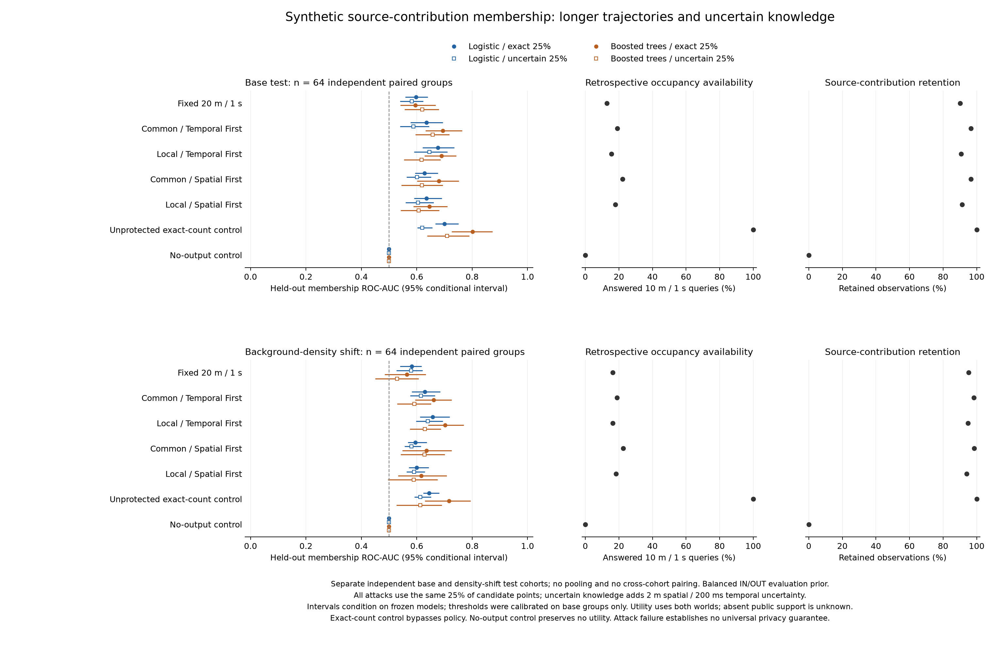

# Privacy robustness: longer histories, uncertain knowledge and background shift

Protocol date: 2026-10-19. This is a new, independently generated assessment after
[the four-second coordination comparison](PRIVACY_COORDINATION_STUDY_2026-10-19.md).
The following protocol was fixed before examining the new held-out outcomes. Results
and actual verification from the completed run are recorded below. Private source samples,
transcripts, model artifacts and scores remain under ignored `results/` directories.

## Scientific contract

The protected unit is one road user's entire recorded source contribution over a
16-second horizon. IN includes that contribution; OUT removes exactly it while
preserving every background observation and sampling opportunity. The physical
candidate exists in both worlds. The secret is source inclusion, not identity,
physical presence or a sensitive destination. A longer horizon changes the protected
unit; comparing these AUC values with the old four-second study is not a controlled
estimate of a horizon effect.

The recipient observes final public counts, geometry and logical time information.
The attack is retrospective and uses the complete released transcript; it does not
measure an online client's knowledge at an earlier wall-clock deadline. IDs, hidden
labels, GT, scenario/distribution metadata, private suppression decisions and runtime
are excluded from prediction features. The same 31 public count/geometry/time features
are used by both attack families. A second family probes nonlinear interactions within
these features; it is not an upper bound on all possible attackers.

## Fixed design

| Choice | Predeclared value |
|---|---|
| New generator / seed | `long_corridors_v2` / 20261021; previous test set preserved |
| Independent groups | 48 base train, 32 base calibration, 64 base test, 64 shifted test |
| Scenario strata | Sparse, dense, handover, heterogeneous; equally cycled within each split/cohort |
| Source geometry/cadence | 80-m square, quadtree depth 6, 100-ms samples, 16000-ms exclusive endpoint |
| Candidate paths | Continuous prescribed reversing corridor legs; candidate observed throughout sampled horizon |
| Shift | Background population count multiplied by 1.5, rounded up; candidate law unchanged |
| Mechanisms | Fixed 20 m / 1 s; common and cell-local Temporal First / Spatial First |
| Controls | Unprotected exact-count stream and constant no-output stream; bypass policy |
| Operational policy | Minimum 3 distinct observed road users; cell sides 1.25–40 m; window/evaluation age at most 1 s; identical effective numeric requirements across mechanisms |
| Auxiliary profiles | Same random 25% candidate observations, either exact or perturbed |
| Perturbation | Independent Gaussian x/y error, sigma 2 m; integer-uniform time jitter from -200 to +200 ms |
| Boundary rule | Clip to half-open public coverage and times [1,15999], recompute IDs, deduplicate identical time/x/y triples; no cadence snapping |
| Attacks | Deterministic L2 logistic regression; pinned scikit-learn histogram gradient boosting |
| Logistic parameters | L2 0.1, at most 500 iterations, tolerance 1e-8; train-only scaling |
| Boosting parameters | 64 iterations, learning rate 0.1, at most 4 leaves/depth 2, minimum 8 samples/leaf, L2 1, no early stopping, seed 20261021 |
| Threshold | Base calibration only: maximize empirical TPR with calibration FPR <= 0.1; freeze for both test cohorts |
| Uncertainty | 400 scenario-stratified paired source-group bootstrap resamples separately within each test cohort |
| Utility | Public-only retrospective mean occupancy on fixed 10-m / 1-s queries; coverage, retained source contributions, conditional and paired-support MAE |

There are 2080 primary real-core replays (208 groups × two worlds × five mechanisms),
four adaptive scientific repeats, 28 independently fitted attack models (seven streams
× two knowledge profiles × two families), and 56 test-cohort assessments. The two test
cohorts contain independent groups; they are never pooled or treated as paired. Local
minus common contrasts pair the same groups within a cohort and preservation priority.

Candidate and background random streams are separate. Increasing background density
preserves the candidate law rather than moving the target as an incidental effect of
extra random draws. The multiplier applies to the generated population per generation;
instantaneous occupancy is not guaranteed to increase by exactly 1.5 because capture
schedules and independent realizations also matter. Movement remains an analytical controlled fixture: reversing legs
have ideal turns, and there are no buildings, destination semantics or collision
interactions. This makes a limited source-membership experiment possible without first
building the entire environment model.

Perturbed auxiliary points are generated once per group and reused across both worlds
and every mechanism. This uncertainty is in the attacker's knowledge, not noise added
to the release mechanism; no differential privacy follows. Private auxiliary manifests
record final boundary incidence and exact deduplication counts. Boundary incidence is
not described as a count of actual clipping operations.

Both models plug these uncertain points directly into the existing public cell/time
matching features. They do not denoise, smooth trajectories, integrate a positional
likelihood or reconstruct hidden routes. A change under auxiliary noise therefore
measures sensitivity of these bounded attacks, not irreducible protection against a
knowledge-aware observer. A noise-aware attacker is a separate follow-up.

## Metrics and uncertainty

For frozen score s and calibrated threshold tau, report

    TPR = #{IN scores >= tau} / N_IN
    FPR = #{OUT scores >= tau} / N_OUT
    advantage = TPR - FPR
    balanced_accuracy = (TPR + 1 - FPR) / 2.

ROC-AUC credits ties by one half; score direction is fixed from training. Values below
0.5 are retained without post-hoc inversion. The primary paired contrast is

    Delta_AUC = AUC_local - AUC_common,

within a fixed cohort, priority, attack family and knowledge profile. Intervals condition
on the already fitted models and calibrated thresholds, omit training uncertainty and
are pointwise rather than simultaneous across all contrasts. Report all models; do not
select a preferred family after reading held-out outcomes. Different independent cohorts
can have different AUC/FPR estimates; no paired shift-effect interval is claimed.

Calibration FPR resolution is 1/32 = 3.125 percentage points; test-cohort FPR resolution
is 1/64 = 1.5625 points. The nominal calibration cap is not a held-out or shifted-population
FPR guarantee. Subgroup counts are still smaller. Balanced IN/OUT prior is an experimental
choice, not deployment prevalence.

Coverage and retained contributions use pooled query/source denominators per cohort.
Absent/suppressed support remains unknown and is not filled with GT. Conditional MAE
uses each mechanism's own scored support; paired common/local MAE uses only their shared
scored queries and reports that count. No per-release unweighted freshness comparison is
made, because local batching changes release counts. Exact-count/no-output controls are
labelled separately and demonstrate that attack/utility trade-offs require both axes.

## Provenance and reproduction

The v2 dataset writes a generation protocol before generating samples, validates exact
IN/OUT neighbours, source hashes and identity-normalized clone fingerprints, and writes
its final manifest only after completion. The runner then freezes the executable, actual
source files, effective policies, dependency versions and immutable protocol before the
first replay. It rechecks source/input/policy provenance before recording a completed
report and complete artifact manifest. Existing destinations are rejected. A failure
keeps incomplete evidence and does not label the study complete.

The boosting adapter uses the official
[HistGradientBoostingClassifier](https://scikit-learn.org/stable/modules/generated/sklearn.ensemble.HistGradientBoostingClassifier.html).
Its private model files have owner-only permissions and hashes. Predictions use the
freshly fitted registered model; caller-supplied pickle files are never loaded. Cross-process
reproduction refits from the frozen inputs and protocol.

Create a separate Python 3.13 environment for the tested lock (its NumPy/SciPy pins
require Python >=3.12). The direct attack dependency supports Python >=3.11 with
compatible resolved dependencies; the legacy evaluator remains dependency-free:

```sh
python3.13 -m venv /private/tmp/ump-privacy-robustness-venv
/private/tmp/ump-privacy-robustness-venv/bin/python -m pip install \
  -r tools/evaluation/requirements-robustness-lock.txt
python3 -B tools/evaluation/privacy_dataset.py --robustness \
  --output results/evaluation/2026-10-19/privacy-robustness-dataset-20261021 \
  --seed 20261021 --train-groups 48 --calibration-groups 32 --test-groups 64 \
  --shifted-test-groups 64 --end-ms 16000 --support-threshold 3
LOKY_MAX_CPU_COUNT=1 MPLCONFIGDIR=/private/tmp/ump-robustness-mpl \
  /private/tmp/ump-privacy-robustness-venv/bin/python -B tools/evaluation/run_privacy_robustness.py \
  --dataset results/evaluation/2026-10-19/privacy-robustness-dataset-20261021 \
  --output results/evaluation/2026-10-19/privacy-robustness-study-20261021-v1 \
  --bootstrap-repeats 400
```

These paths must be absent for a new execution; choose a new versioned output path
when reproducing. `requirements-robustness.txt` specifies the direct attack dependency;
the lock file records the entire tested optional plotting/attack environment. The runner
records actual Python, platform and relevant package versions. The study never starts
the interactive simulator or clears MongoDB.

## Results

The fixed run completed successfully: **2080/2080 independent policy/ownership audits**,
**178,649 released cells**, four identical adaptive scientific repeats,
14 converged logistic fits and 14 fixed-64-iteration boosted-tree fits. There are 56
held-out cohort assessments. Every required source/input/policy/executable check passed.

**The new population does not support a general privacy advantage of local coordination.**
All eight local/common Spatial First contrasts have conditional intervals containing zero.
Of all 16 paired contrasts, 15 contain zero; one points toward a more successful attack
with local Temporal First. These are pointwise comparisons, not a multiplicity-adjusted
claim. Local query availability and contribution retention are also lower in both cohorts.
This is evidence about the declared population/attacks, not a claim that the controller
violates its release policy or that it always performs worse.



[SVG](figures/privacy-robustness-2026-10-19.svg),
[all 56 attack assessments](figures/privacy-robustness-attacks-2026-10-19.csv),
[all 224 scenario assessments](figures/privacy-robustness-scenarios-2026-10-19.csv),
[all 16 paired contrasts](figures/privacy-robustness-contrasts-2026-10-19.csv),
[14 utility rows with denominators](figures/privacy-robustness-utility-2026-10-19.csv).
CSV exports contain aggregate metrics only; individual traces, labels and scores remain private.

### Held-out ROC-AUC: all models

LR denotes logistic regression; HGB denotes histogram gradient boosting. Each row
uses the same 64 independent source groups within its cohort; cohorts are separate.
Full conditional intervals, operating points and scenario metrics are in the linked tables.

Base test:

| Mechanism | LR exact 25% | LR uncertain 25% | HGB exact 25% | HGB uncertain 25% |
|---|---:|---:|---:|---:|
| Fixed 20 m / 1 s | 0.597778 | 0.582397 | 0.595093 | 0.619263 |
| Common TF | 0.635254 | 0.588379 | 0.694580 | 0.657959 |
| Local TF | 0.676270 | 0.645508 | 0.689209 | 0.617920 |
| Common SF | 0.628418 | 0.601318 | 0.679443 | 0.618774 |
| Local SF | 0.635498 | 0.604004 | 0.645630 | 0.606812 |
| Unprotected exact counts | 0.700195 | 0.620361 | 0.801636 | 0.709473 |
| No output | 0.500000 | 0.500000 | 0.500000 | 0.500000 |

Background population-count shift test:

| Mechanism | LR exact 25% | LR uncertain 25% | HGB exact 25% | HGB uncertain 25% |
|---|---:|---:|---:|---:|
| Fixed 20 m / 1 s | 0.581787 | 0.579102 | 0.564819 | 0.529297 |
| Common TF | 0.628906 | 0.614746 | 0.660889 | 0.591309 |
| Local TF | 0.657959 | 0.639404 | 0.702515 | 0.629761 |
| Common SF | 0.595459 | 0.580322 | 0.635132 | 0.628296 |
| Local SF | 0.600098 | 0.590332 | 0.616089 | 0.588623 |
| Unprotected exact counts | 0.644531 | 0.613281 | 0.716431 | 0.612183 |
| No output | 0.500000 | 0.500000 | 0.500000 | 0.500000 |

### All paired local-minus-common contrasts

Negative values mean lower success for this evaluated attack. Each bracket is the
95% conditional paired interval; a negative point estimate alone is insufficient.

| Cohort | Attack / knowledge | TF delta [interval] | SF delta [interval] |
|---|---|---|---|
| Base | LR / exact | +0.041016 [-0.004645, +0.081860] | +0.007080 [-0.025885, +0.040289] |
| Base | LR / uncertain | +0.057129 [+0.011218, +0.106201] | +0.002686 [-0.037842, +0.045923] |
| Base | HGB / exact | -0.005371 [-0.063113, +0.054962] | -0.033813 [-0.090591, +0.020636] |
| Base | HGB / uncertain | -0.040039 [-0.105872, +0.032730] | -0.011963 [-0.050696, +0.034192] |
| Shift | LR / exact | +0.029053 [-0.012457, +0.076709] | +0.004639 [-0.016370, +0.024927] |
| Shift | LR / uncertain | +0.024658 [-0.005621, +0.055908] | +0.010010 [-0.010748, +0.031995] |
| Shift | HGB / exact | +0.041626 [-0.017847, +0.098502] | -0.019043 [-0.091449, +0.051422] |
| Shift | HGB / uncertain | +0.038452 [-0.038211, +0.117365] | -0.039673 [-0.087045, +0.006900] |

For example, base/noisy-25%/LR Temporal First rises from **0.588379 common** to
**0.645508 local**, delta +0.057129, interval [+0.011218,+0.106201]. Its observed
FPR rises from 14.0625% to 28.125%, despite both thresholds respecting the calibration
cap on base CAL. More generally, fitted models do not guarantee test FPR <=10%;
actual FPR values for every configuration/cohort are retained in the attack CSV.
Do not present a TPR change at different realized FPRs as an equal-FPR privacy comparison.

Higher-capacity HGB is not uniformly more successful than LR. It raises exact-count
control AUC from 0.700195 to 0.801636 on base test, but performs worse than LR for
some mechanisms. The unprotected control remains unprotected even when an attack
fails. Auxiliary noise does not monotonically reduce all independently fitted attacks.

### Utility costs

Each cohort has 128 case-worlds and 131072 fixed queries. The base source denominator
is 341830 contributions; the shifted denominator is 530976. Retention weights source
contributions, not persons. Coverage uses the whole fixed spatial/time query domain;
unpublished support remains unknown even when retention is high.

| Cohort | Mechanism | Answered queries (%) | Retention (%) | Conditional MAE | Paired-support MAE | Paired queries |
|---|---|---:|---:|---:|---:|---:|
| Base | Fixed 20 m / 1 s | 12.8387 | 90.2571 | 1.967406 | unavailable | 0 |
| Base | Common TF | 18.9934 | 96.6112 | 0.745203 | 0.806482 | 19693 |
| Base | Local TF | 15.6235 | 90.7694 | 0.795840 | 0.802360 | 19693 |
| Base | Common SF | 22.2237 | 96.6656 | 0.717750 | 0.767566 | 23465 |
| Base | Local SF | 17.9794 | 91.3153 | 0.763854 | 0.765654 | 23465 |
| Base | Unprotected exact counts | 100.0000 | 100.0000 | 0.000000 | unavailable | 0 |
| Base | No output | 0.0000 | 0.0000 | unavailable | unavailable | 0 |
| Shift | Fixed 20 m / 1 s | 16.3300 | 95.2487 | 2.477650 | unavailable | 0 |
| Shift | Common TF | 18.9438 | 98.4163 | 0.936182 | 1.010313 | 20348 |
| Shift | Local TF | 16.3895 | 94.7629 | 1.000759 | 1.015282 | 20348 |
| Shift | Common SF | 22.6326 | 98.4724 | 0.871780 | 0.929135 | 23964 |
| Shift | Local SF | 18.3578 | 94.1250 | 0.928146 | 0.929685 | 23964 |
| Shift | Unprotected exact counts | 100.0000 | 100.0000 | 0.000000 | unavailable | 0 |
| Shift | No output | 0.0000 | 0.0000 | unavailable | unavailable | 0 |

On base test, local-minus-common retention is **-5.8418 percentage points TF**
and **-5.3503 points SF**. Under the population-count shift it is **-3.6535 points TF**
and **-4.3475 points SF**. Coverage also falls. Conditional MAE mostly increases;
paired-support accuracy changes are small and can have a different sign because the
support is controlled. The previous refinement closes its specific counterexamples;
it did not prove global optimality over new asynchronous histories.

The fixed reference has lower occupancy availability and larger conditional error
but often lower measured attack success than adaptive mechanisms. No single privacy/
utility ranking follows. The no-output control has AUC 0.5 and zero availability;
exact counts answer all source-reference queries with zero error while exposing more
usable membership signal to the evaluated attacks.

### Evidence integrity

Binary SHA-256: `17313ec82b2d50aa433fd0c0634edbad1fd7c0ef9744a05c3219c55bbda041e2`.
Protocol SHA-256: `536f40d3bb8cc5ed4e17969779d8387292241188c2019a084a31c8ccf84a359f`.
Report SHA-256: `0af5db289ad53bf2065c3ccf34df39a25e0aecf26f88294da11088fac6d19543`.
Dataset manifest SHA-256: `a50c12537b3b1caef562378747f0a03439d98c4245d6f77d2829f5e9d332b7e6`.
The complete manifest hashes **5371 private artifacts**. Each auxiliary profile uses 40 selected
points per group; final noisy boundary incidence is 26 of 8320 points,
and 0 exact duplicate triples were removed. These are generator diagnostics, not attack features.

Private bundle: `results/evaluation/2026-10-19/privacy-robustness-study-20261021-v1`.
Private verification, regression logs and the aggregate-export script:
`results/evaluation/2026-10-19/privacy-robustness-verification-20261021`.
The figure can be regenerated from the completed report using:

```sh
MPLCONFIGDIR=/private/tmp/ump-robustness-mpl \
  /private/tmp/ump-privacy-robustness-venv/bin/python -B tools/evaluation/plot_privacy_robustness.py \
  --report results/evaluation/2026-10-19/privacy-robustness-study-20261021-v1/report.json \
  --output /private/tmp/ump-privacy-robustness-reproduction
```

The actual PNG/SVG were visually inspected for legible labels, scales and complete
cohort/model/utility coverage. See [the implementation test report](PRIVACY_ROBUSTNESS_TEST_REPORT_2026-10-19.md)
for regression results and independent numeric/hash verification.

## Remaining research contracts

A failed membership attack is not a formal privacy guarantee. This fixture does not
establish realistic reidentification, sensitive-attribute protection, l-diversity,
trajectory unlinkability, joint multi-application privacy, or deadline-based online
utility. [Attribute/context and online contracts](PRIVACY_ATTRIBUTE_AND_ONLINE_CONTRACT.md)
define the next questions and distinguish implementation prerequisites from optional
map realism. Attack resistance and policy compliance remain separate measured results. Pooled AUC
also includes rankings across scenario strata, so retain scenario-specific metrics.
A less-than-perfect exact-count control attack would expose limitations of the
learner/features or population knowledge, not protection by the unprotected control.
