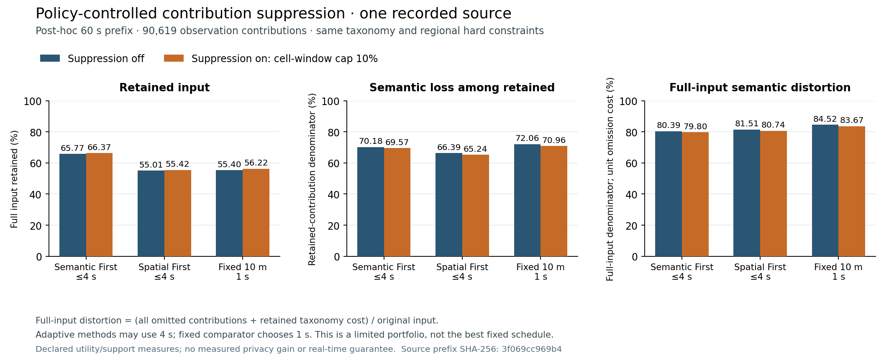

# Policy-controlled selective semantic contribution suppression

Date: 2026-10-24. Status: native core, immutable publication/MongoDB round-trip and independent audit implemented; six same-source sensitivity cases completed and independently verified below.

## Purpose and scope

A rare observed class can force an otherwise well-supported cell-window to use a common semantic ancestor. The optional action implemented here removes the contributions of unsupported terminal classes before accepting that more general representation. For example, twenty adult pedestrians and one cyclist may become twenty adult pedestrians if the policy permits the omission and every requirement still passes on those twenty retained tracks.

This is **cell-window contribution selection**. It does not delete a physical person from the simulation, alter a trajectory, fabricate a different road-user type, or promise to suppress that track in later windows. All observations of a removed terminal class in the candidate's owned cell-window are omitted together. No arbitrary subset of identities is searched. Repeated observations of one track remain one distinct contributor; classification aliases share a terminal domain.

The protected unit and the meaning of privacy are unchanged. Distinct observed tracks and category support are operational release requirements, not a demonstrated trajectory k-anonymity guarantee or a measured reduction in attack success. Selective omission can itself create bias and temporal disclosure patterns. A recipient observing another sensor or other released windows may obtain complementary information. Composition and differencing need a separate privacy evaluation.

## Policy configuration

The new upper-bound requirement is:

```yaml
aggregation:
  policy_tree:
    root:
      semantic_suppression_fraction: {max: 0.10}
```

The native replay configuration uses `policy_tree.root` directly, without the outer `aggregation` wrapper. Other required support, semantic, geometry and timing bounds remain present.

- Omitted requirement: disabled, preserving the historical output serialization.
- `max: 0`: explicitly disabled; the metric is recorded as zero.
- `max: 0.10`: at most ten percent of the candidate's original observation contributions may be selectively omitted.

The denominator is **observations in this cell-window**, not distinct people, the entire run or the number of taxonomy classes. A person contributing many samples can consume more of this budget than a briefly observed person.

Permission is inherited conservatively. A region may reduce the root cap, including prohibiting the action with zero. Every positive-area overlapping region contributes its bound; the smallest cap wins. If only a region mentions the option and the root does not grant permission, an implicit root cap of zero prevents local enabling. A larger footprint crossing a prohibiting region inherits that prohibition. This does not replace any existing strongest-bound rule.

## Acceptance objective

Let the original candidate contain observation multiset \(O\), with \(N=|O|\). Let \(S\subset O\) be omitted and \(R=O\setminus S\) be retained. The approved semantic cut consists of disjoint taxonomy bins \(b\), with declared taxonomy costs \(\ell_b\in[0,1]\) and retained observation counts \(n_b\).

The conditional semantic loss remains:

\[
L_{\mathrm{sem}\mid R}=\frac{\sum_b n_b\ell_b}{|R|}.
\]

The selective suppression fraction is:

\[
L_{\mathrm{sel}}=\frac{|S|}{N}.
\]

A second experimental utility score includes the omitted observations with unit penalty:

\[
J(O,R)=\frac{|S|+\sum_b n_b\ell_b}{N}
      =L_{\mathrm{sel}}+(1-L_{\mathrm{sel}})L_{\mathrm{sem}\mid R}.
\]

The ordinary full-data generalization supplies \(J_0=L_{\mathrm{sem}\mid O}\). An alternative is accepted only if:

1. Its omission fraction is within the strict effective policy cap.
2. Every configured metric constraint passes on the **retained** union, including total distinct-track support, category support, occupancy, semantic costs, geometry, timing and complete sampling coverage.
3. It improves the full-input score strictly: \(J<J_0-10^{-12}\).

Among passing alternatives, the implementation minimizes \(J\), then worst semantic cost, then mean semantic cost, then prefers more retained observations. The declared unit omission penalty is a transparent experimental utility convention. It is not an empirical traffic-task cost or a privacy metric. A later study can vary the penalty explicitly; it must not silently change between methods.

Examples:

- Twenty adult pedestrians plus one cyclist, support five: full generalization to `road_user` has loss one. Keeping the twenty exact adult-pedestrian contributions and omitting the cyclist gives \(J=1/21\), if the cap allows it.
- Nineteen adult pedestrians, one child pedestrian and one cyclist, cap five percent: removing both rare leaves would exceed the cap. Keeping the twenty pedestrians as their family and omitting only the cyclist gives \(J=(1+20\times0.5)/21\).
- Forty exact pedestrians plus two adult and two child cyclists, category support four: the truthful cyclist family costs \(2/44\). Omitting all four cyclists would cost \(4/44\); the supposedly better conditional semantic loss is rejected because it loses more full-input information.

The gate is local to a given candidate. It does not prove that the resulting online release schedule is globally optimal. Selecting a different spatial/temporal candidate can still change overall coverage, latency and the final full-run score.

## Bounded candidate construction

The taxonomy is already bounded to 256 nodes, depth 32 and 4,096 raw labels. Candidate generation visits the distinct declared semantic cost tiers below the ordinary representation's maximum cost, beginning at zero. It preserves supported descendants, generalizes a subtree only within the current tier, and omits unsupported terminal domains when that tier cannot otherwise represent them.

The method generates at most the number of distinct taxonomy cost tiers, deduplicates identical terminal masks, and checks all retained requirements for every budget-eligible alternative. It does not enumerate \(2^n\) subsets of people. Exact retained node evidence is rebuilt from the validated stable-terminal partition; removed identities cannot remain in an ancestor's support count.

This is a deliberately bounded proposal family. It does not claim to find the best possible partial classification cut, arbitrary individual suppression set or globally optimal release schedule.

## Ownership, publication and recovery

The original `AggregationCandidate` is unchanged. Its counts describe all privately owned input, including selectively omitted observations. `CellMetricAssessment.retainedCounts` holds the approved retained counts only when the action is accepted.

The publication coordinator independently re-evaluates the original candidate at sealing and delivery. The recipient receives the retained scalar total and the matching approved semantic categories. It receives neither the original total nor the omitted category mask/count. Thus twenty published pedestrians are accompanied by total twenty, never total twenty-one from which a residual cyclist can be reconstructed.

The entire original cell-window is reserved and retired after acknowledgement. Selectively omitted support is not left behind for a later duplicate release. A failed acknowledgement preserves the same immutable snapshot and full original interval. The existing recipient and journal schemas are unchanged; their round-trip still contains only approved retained counts and semantic bins.

A common-window Semantic First decision distinguishes **accounted original support** from **retained released support**. A fully resolved ownership cut may release immediately under `policy_satisfied` even when it uses approved selective suppression. It does not wait until the maximum aggregation deadline merely because some observations were intentionally omitted.

The mapped native-capture exporter historically assumes that all observations of a selected footprint are retained. Its default-off captures remain supported. Filtered native-capture re-export requires the explicit retained-source audit adapter; it must not bypass or weaken that full-source check. The separate offline suppression-study path implemented here performs that independent audit and labels its products accordingly.

## Metrics and private diagnostics

Both the overall retention fraction and per-source-type retention are evaluated against the **full original input**. Results separate:

- whole-footprint suppression;
- additional selective semantic contribution suppression;
- conditional semantic loss on retained contributions;
- full-input semantic distortion, charging every omitted contribution one;
- retained cell size, aggregation window and observation-to-release delay;
- per-type and nonexclusive original-position region retention;
- bounded evaluated-candidate counts and measured process/core timing.

For a complete run, the full-input distortion is:

\[
J_{\mathrm{run}}=\frac{N_{\mathrm{whole\ loss}}+N_{\mathrm{selective\ loss}}+
\sum_{\mathrm{released}\ b}n_b\ell_b}{N_{\mathrm{input}}}.
\]

A prettier conditional semantic average alone is insufficient evidence of success. Rare classes may disappear disproportionately, so their retention must remain visible in the results.

Private per-cell `semantic_suppression` uses schema `ump.semantic-suppression.v1` and records exact input/retained/omitted observation and distinct-track counts, suppressed raw-type observation counts, suppressed terminal categories, fraction, ordinary/full-input semantic loss and evaluated-candidate count. `retained_counts` is present only for an applied action. These diagnostics are not a recipient channel.

Nanosecond measurements remain runtime telemetry, excluded from deterministic logical JSON/BSON payloads. Repeated logical replays must reproduce decisions, masks, counts and metrics; timing naturally varies.

A replay variant with a positive root cap is globally labelled `contribution_selection: policy_filtered`, even if no omission happens in a particular cell. An absent semantic bin is a zero only for the **retained population**. It is not automatically an exact zero for original GT. The first study intentionally does not run the original-source exact-query evaluator for filtered products.

## Verification

Native `SemanticSuppressionTests` covers eight groups: default-off/explicit-zero compatibility; inclusive contribution budgets; total retained support and unrelated hard bounds; intermediate semantic families and the unit-removal counterexample; aliases/repeated identities; strict overlapping region permission; immutable retries/full retirement; immediate common/local release; and invalid bounds.

The focused eleven-group native suite passes, including existing metric, policy, configuration, publication and semantic regressions. The MongoDB semantic-store integration passes a real observation/history/evaluator/coordinator/store pipeline: 21 tracks produce 63 input observations, 20 tracks/60 observations are released, the prepared intent round-trips, a lost acknowledgement is reconciled without payload mutation, and the full original interval retires. Existing legacy v1/v2 byte-compatibility checks remain in that test.

The independent Python audit reconstructs retained data from original observations and the exact terminal mask. It verifies raw full-interval retirement separately from actual retained count/semantic/strict-policy checks. Tests reject altered recipient counts, private masks/type maps/losses/metrics and retirement totals. Six audit tests and three study/protocol tests pass, including an actual six-case bounded native fixture.

No formal attack resistance, temporal composition protection, statistical generalization or hard real-time guarantee follows from these tests.

## Same-source sensitivity study

The study is explicitly post-hoc. It reuses a frozen original recording and derives a declared sampling-aligned prefix without regenerating movement. Full-source, original-config, derived-input, per-case configuration and binary hashes are frozen before execution.

The six-case matrix is:

| Method | Suppression disabled | Suppression cap 0.10 |
|---|---|---|
| Semantic First, existing secondary order | yes | yes |
| Spatial First | yes | yes |
| Fixed 10 m, 1 s | yes | yes |

All hard regional metric requirements and taxonomy costs remain equal across the matrix; only execution order, explicit omission permission and stream/policy identities differ. Giving the fixed baseline the same option prevents crediting adaptation for an action unavailable to its comparator.

The study reports single-run timing with equal output mode. These timings include the existing private diagnostic construction/serialization scope and are not isolated nanosecond costs of the new proposal search. A single on/off pair cannot establish a statistically reliable speedup or slowdown. The paced benchmark separately checks processing/queue deadlines.

Command, with a native replay configuration:

```sh
python3 tools/evaluation/run_suppression_study.py \
  --input results/urban-traffic-2026-10-24-256/replay/observations.json \
  --config results/urban-traffic-2026-10-24-256-policy-comparison/original_adaptive_immediate-policy.json \
  --output results/semantic-suppression-2026-10-24-60s \
  --duration-ms 60000 --cap 0.10
```

Raw observations, full results, masks and replay artifacts remain local under ignored `results/`. Only aggregate summary/evidence belongs in Git. Results are appended after execution; a favorable outcome is not assumed.

## Recorded 60-second study results
All six cases completed and passed the independent raw-ownership/retained-policy audit. The original four-minute source SHA-256 is `f43a28abaa253816e34732f29f07f63b953ecc40f57aae884c349329c6b9a1a1`; the unchanged-row `[0, 60000)` prefix SHA-256 is `3f069cc969b49406138fc2322edcd80798fc440f7c79257f45ec8df8fe246cc9`. The prefix contains **90,619 observation contributions**. The copied native binary SHA-256 is `fa82c62bfd589f764671545579ab1ae5c1739722bd67a33e7d18d53d7dfa03b9`.
This is the historical accepted urban recording, reused without the new subway/crossing behavior. It does not evaluate the newer source model. The first attempted timing run was aborted before its first case completed because a build could have overlapped; all results below come from the fresh, exclusive serial `60s-v2` run.
| Method | Cap | Retained input | Conditional semantic loss | Full-input distortion | Extra selective omissions | Mean side | Mean / p95 delay |
|---|---:|---:|---:|---:|---:|---:|---:|
| Semantic First | 0 | 65.77% | 70.18% | 80.39% | 0 | 9.35 m | 396.6 / 1400 ms |
| Semantic First | .10 | 66.37% | 69.57% | 79.80% | 50 | 9.47 m | 392.1 / 1400 ms |
| Spatial First | 0 | 55.01% | 66.39% | 81.51% | 0 | 8.29 m | 1933.9 / 3800 ms |
| Spatial First | .10 | 55.42% | 65.24% | 80.74% | 53 | 8.33 m | 1929.1 / 3800 ms |
| Fixed 10 m / 1 s | 0 | 55.40% | 72.06% | 84.52% | 0 | 10.00 m | 548.5 / 1000 ms |
| Fixed 10 m / 1 s | .10 | 56.22% | 70.96% | 83.67% | 65 | 10.00 m | 548.6 / 1000 ms |

The action helps all three methods modestly in this source. For Semantic First it retains 550 additional contributions overall while selectively omitting 50; full-input distortion falls by 0.59 percentage points. Its retained mean cell side nevertheless rises from 9.35 to 9.47 m because the retained populations and selected cell-windows change. This is a measured tradeoff, not a guaranteed improvement of every conditional mean.
Semantic First with filtering retains 66.37% versus 56.22% for the equally permitted fixed baseline, and its full-input distortion is 79.80% versus 83.67%, a 3.87 percentage-point reduction. Spatial First preserves finer mean space, but retains fewer contributions and has much longer logical release delays. These scores measure the declared utility/support contract; they are not measured privacy gains. The fixed comparator chooses 1 s while the adaptive methods may use up to 4 s under the common hard policy. This six-case portfolio does not establish the best fixed schedule or isolate adaptation from access to longer windows; its main question is the paired on/off effect within each method. The earlier fixed maximum-window sensitivity remains a separate experiment.
The selective fractions are only 0.055%, 0.058% and 0.072% of the full input for Semantic First, Spatial First and Fixed respectively. A ten-percent **per-cell-window cap** does not mean that ten percent of the whole run is discarded. The small number of useful admissible removals explains why this option alone does not eliminate high semantic generalization.
### Runtime scope
| Method | Off core / process wall | On core / process wall | Core change | Candidate checks in published cells, on |
|---|---:|---:|---:|---:|
| Semantic First | 63.844 / 65.792 s | 67.062 / 69.058 s | +5.04% | 20 |
| Spatial First | 57.827 / 59.705 s | 59.781 / 61.657 s | +3.38% | 9 |
| Fixed 10 m / 1 s | 0.374 / 1.961 s | 0.485 / 1.960 s | +29.73% | 13 |

Core time includes causal replay and in-memory research-result serialization, excluding input validation and file I/O. Process wall includes those surrounding costs. The small fixed-core absolute increase is about 111 ms over the whole 60-second input; its nearly equal process wall illustrates why relative percentages alone can mislead. Candidate counts above refer only to final published-cell diagnostics, **not all internal evaluator calls or a measured global search bound**. The implementation itself bounds each search by taxonomy tiers. These are single serial pairs, without timing repetitions or a hard real-time claim.
### Minority-type retention
| Original type | Input observations | Semantic First off / on retention | Additional selective omissions, on |
|---|---:|---:|---:|
| Adult Cyclist | 4773 | 80.54% / 80.41% | 9 |
| Adult E-Scooter Driver | 4616 | 84.88% / 84.36% | 26 |
| Adult Pedestrian | 17000 | 55.68% / 56.65% | 0 |
| Child Pedestrian | 15253 | 64.30% / 64.80% | 4 |
| Pedestrian With Mobility Aid | 15176 | 65.93% / 66.47% | 0 |
| Pedestrian With Stroller | 16503 | 67.74% / 68.48% | 0 |
| Senior Cyclist | 4634 | 81.68% / 81.59% | 11 |
| Senior Pedestrian | 12664 | 59.97% / 61.04% | 0 |

Overall retention improves, but cyclist and scooter retention falls slightly: the additional omissions are not evenly distributed. This is why source-type retention remains a required reported result rather than hiding rare classes behind the better conditional semantic mean. No entire source class disappears globally in this study.
Aggregate evidence: [verification/semantic-suppression-2026-10-24.json](verification/semantic-suppression-2026-10-24.json). Local replay: `results/semantic-suppression-2026-10-24-60s-v2/bundle.json`. The map image and building-access metadata hashes match the frozen source exactly. Filtered variants explicitly identify counts as retained-population counts; no original-GT exact-query workload was run.

### Replay boundary and presentation figure

The actual six-variant study bundle passes `tools/replay_viewer/serve.py --check`. The viewer now compares filtered recipient counts against approved `retained_counts` while preserving the original raw ownership record. It rejects inconsistent input/retained conservation, occupancy denominators, semantic-bin totals, omitted-type masks/fractions, cap checks and full-input benefit metadata. The 68-test viewer suite passes; this structural boundary remains distinct from the independent original-source policy audit.



[Vector figure](figures/semantic-suppression-2026-10-24.svg). All three panels retain the full 0–100% scale; the conditional and full-input denominators are explicit. Labels identify the adaptive four-second allowance and fixed one-second choice. No privacy-gain claim is made.

Reproduce in an environment with Matplotlib, using a fresh output prefix:

```sh
python3 tools/evaluation/plot_semantic_suppression.py \
  --summary docs/verification/semantic-suppression-2026-10-24.json \
  --output-prefix /tmp/semantic-suppression-figure
```
