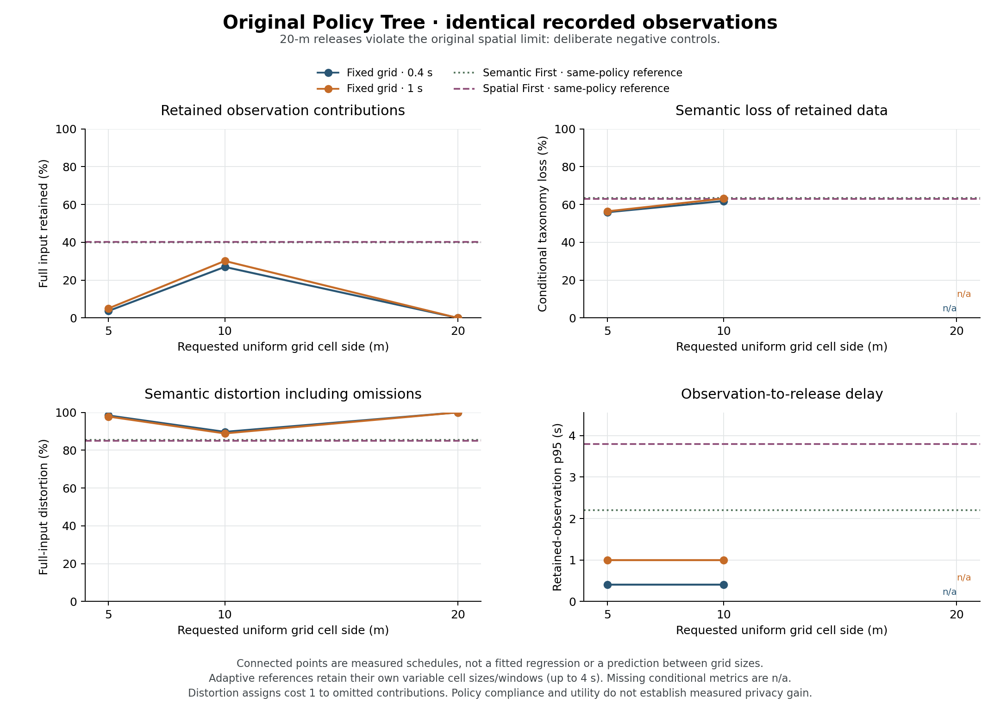
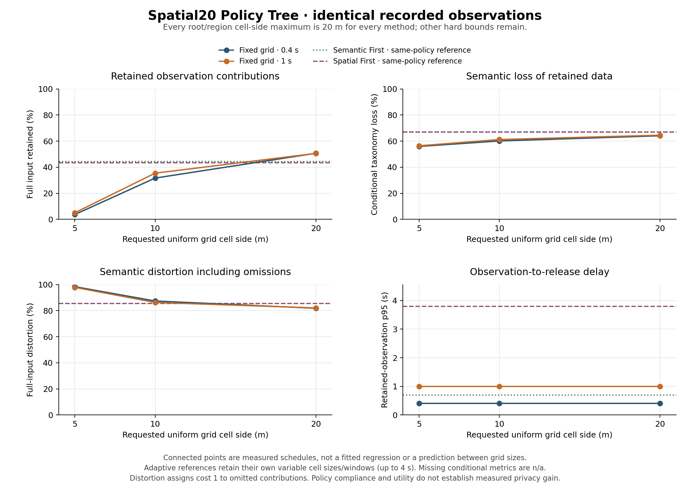
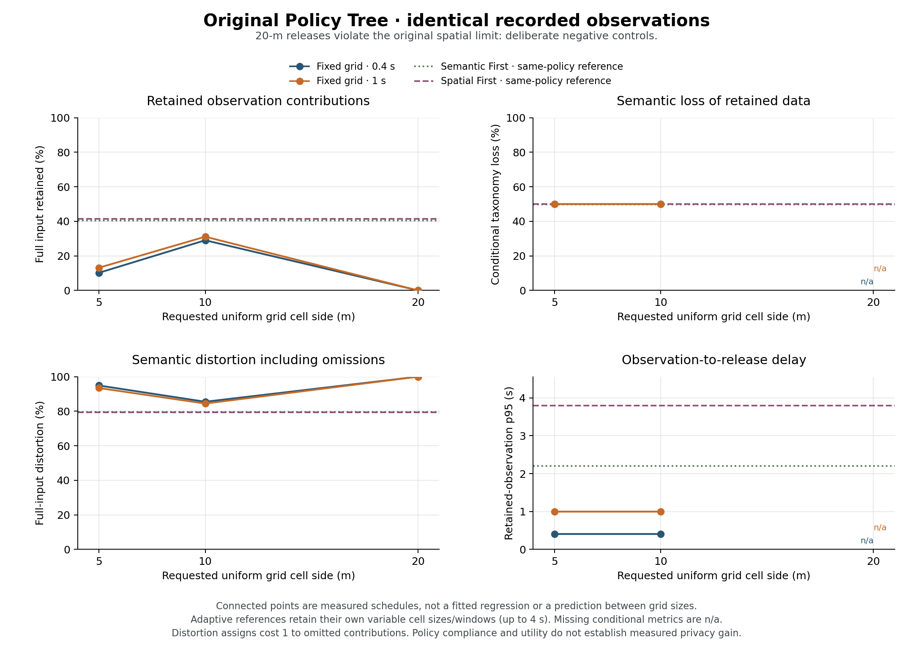
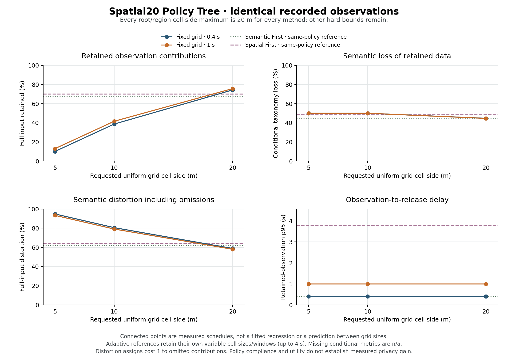

# Spatial baseline portfolio — results and interpretation, 24 October 2026

## Outcome

All 32 declared fixed/adaptive executions completed on two corrected native observation streams. Every published cell passed independent source/count/semantic/regional-policy/ownership/retirement checks. Four original-policy fixed-20 m cases correctly publish no data: zero violations there are vacuous compliance, not successful coverage.

The comparison does **not** establish a universal adaptive advantage. Adaptive methods retain more than the tested fixed grids under the original 10/5 m contract. Under the Spatial20 contract, fixed 20 m retains more in both sources and has lower full-input semantic distortion. These findings are retained without retuning the scene or thresholds after seeing them.

Read the [declared protocol](SPATIAL_PORTFOLIO_PROTOCOL_2026-10-24.md) and [source/visual/test report](EXPANDED_ACCESS_TEST_REPORT_2026-10-24.md).

## Source pair and common protocol

| Source | Cohort | Completed/observed tracks | Peak simultaneously observed | Contributions | Horizon |
| --- | ---: | ---: | ---: | ---: | ---: |
| mixed | 128 | 171 / 171 | 126 | 82,033 | 300 s |
| pedestrians | 128 | 183 / 183 | 127 | 90,045 | 300 s |

Both sources use the maintained C++ Simulator, seed `20261024`, 80 × 80 m geometry, D6 leaves (1.25 m), 50 ms numerical steps, 100 ms measurements, six shops and A1/A2. All scheduled episodes finish and appear at sensor cadence. The independent physical audits pass 6,571,276 and 7,587,213 static/swept pair checks respectively. The pedestrian-only source regenerates the entire 128-person cohort with five pedestrian profiles, rather than deleting recorded riders. Its routes, shop visits and collision interactions differ; it is not an identical-motion type ablation.

Within each source, every method reads the identical frozen observation file. Both contracts use the same candidate minimum depth 2; original numeric spatial maxima remain 10 m and locally 5 m, while Spatial20 changes all existing maxima to 20 m for every method. Support, semantics, time bounds and region geometry stay unchanged. Selective contribution suppression is disabled.

Each contract compares Semantic First (configured secondary strategy: Temporal First), Spatial First, and fixed 5/10/20 m at 0.4/1 s. “First” names the dimension to preserve. Adaptive local windows may reach 4 s wherever the policy permits; fixed baselines here use 0.4/1 s. Thus the original-contract retention benefit does not isolate adaptation from access to longer windows. A matched-window control is still needed for that claim.

## Measures

For input contribution count $N$, retained count $N_r$, and released semantic bins with sizes $n_b$ and declared taxonomy losses $\ell_b$:

$$R=N_r/N,\qquad L_{\mathrm{ret}}=\frac{\sum_b n_b\ell_b}{N_r},\qquad D=\frac{N-N_r+\sum_b n_b\ell_b}{N}.$$

Loss is 0 for exact input subtypes, 0.5 for their immediate traffic family and 1 for road user. These are declared taxonomy utility costs, not measured privacy risks. `D` assigns unit cost to omitted contributions, preventing retained-only loss from rewarding near-total suppression. If nothing is released, conditional metrics and delays are n/a; retention is 0 and D is 1.

Cell side is contribution-weighted over retained output. Delay is actual logical observation timestamp to sealing time; p95 is contribution-weighted. It excludes CPU, transport and perception. Core processing time is the native offline aggregation measurement, separate from the Python audit/query pipeline; neither a total speedup nor an average establishes a per-step real-time guarantee.

## All measured cases

Percent columns use the full input or retained denominator stated in their labels. Original 20 m rows are rejection controls.

### Mixed

| Contract / method | Retained % | Retained semantic loss % | Full-input distortion % | Exact subtype / input % | Mean side m | Delay p95 s | Core s |
| --- | ---: | ---: | ---: | ---: | ---: | ---: | ---: |
| Original / Semantic First | 39.94 | 63.37 | 85.37 | 0.07 | 9.69 | 2.20 | 58.83 |
| Original / Spatial First | 40.27 | 62.94 | 85.07 | 0.00 | 9.49 | 3.80 | 52.95 |
| Original / Fixed 5m 400ms | 3.64 | 55.89 | 98.39 | 0.00 | 5.00 | 0.40 | 0.95 |
| Original / Fixed 5m 1000ms | 4.98 | 56.38 | 97.83 | 0.00 | 5.00 | 1.00 | 0.55 |
| Original / Fixed 10m 400ms | 26.97 | 61.86 | 89.71 | 0.07 | 10.00 | 0.40 | 0.73 |
| Original / Fixed 10m 1000ms | 30.13 | 63.16 | 88.90 | 0.06 | 10.00 | 1.00 | 0.41 |
| Original / Fixed 20m 400ms | 0.00 | n/a | 100.00 | 0.00 | n/a | n/a | 0.50 |
| Original / Fixed 20m 1000ms | 0.00 | n/a | 100.00 | 0.00 | n/a | n/a | 0.31 |
| Spatial20 / Semantic First | 44.30 | 67.01 | 85.39 | 0.00 | 19.07 | 0.70 | 58.05 |
| Spatial20 / Spatial First | 43.42 | 66.80 | 85.58 | 0.00 | 17.61 | 3.80 | 59.69 |
| Spatial20 / Fixed 5m 400ms | 3.64 | 55.89 | 98.39 | 0.00 | 5.00 | 0.40 | 0.96 |
| Spatial20 / Fixed 5m 1000ms | 4.98 | 56.38 | 97.83 | 0.00 | 5.00 | 1.00 | 0.52 |
| Spatial20 / Fixed 10m 400ms | 31.63 | 60.11 | 87.38 | 0.07 | 10.00 | 0.40 | 0.71 |
| Spatial20 / Fixed 10m 1000ms | 35.39 | 61.20 | 86.27 | 0.06 | 10.00 | 1.00 | 0.40 |
| Spatial20 / Fixed 20m 400ms | 50.66 | 64.08 | 81.80 | 0.00 | 20.00 | 0.40 | 0.52 |
| Spatial20 / Fixed 20m 1000ms | 50.57 | 64.52 | 82.06 | 0.00 | 20.00 | 1.00 | 0.31 |

[Complete per-type/region/query report](verification/spatial-portfolio-2026-10-24/mixed/report.md) · [Unchanged verified summary](verification/spatial-portfolio-2026-10-24/mixed/summary.json)





### Pedestrians

| Contract / method | Retained % | Retained semantic loss % | Full-input distortion % | Exact subtype / input % | Mean side m | Delay p95 s | Core s |
| --- | ---: | ---: | ---: | ---: | ---: | ---: | ---: |
| Original / Semantic First | 40.50 | 49.87 | 79.70 | 0.11 | 9.45 | 2.20 | 66.09 |
| Original / Spatial First | 41.44 | 50.00 | 79.28 | 0.00 | 8.67 | 3.80 | 49.64 |
| Original / Fixed 5m 400ms | 10.17 | 50.00 | 94.91 | 0.00 | 5.00 | 0.40 | 0.99 |
| Original / Fixed 5m 1000ms | 13.11 | 50.00 | 93.44 | 0.00 | 5.00 | 1.00 | 0.54 |
| Original / Fixed 10m 400ms | 29.02 | 50.00 | 85.49 | 0.00 | 10.00 | 0.40 | 0.75 |
| Original / Fixed 10m 1000ms | 31.09 | 50.00 | 84.45 | 0.00 | 10.00 | 1.00 | 0.42 |
| Original / Fixed 20m 400ms | 0.00 | n/a | 100.00 | 0.00 | n/a | n/a | 0.52 |
| Original / Fixed 20m 1000ms | 0.00 | n/a | 100.00 | 0.00 | n/a | n/a | 0.32 |
| Spatial20 / Semantic First | 67.88 | 44.13 | 62.08 | 7.97 | 19.64 | 0.40 | 42.62 |
| Spatial20 / Spatial First | 70.10 | 48.27 | 63.74 | 2.43 | 17.81 | 3.80 | 47.48 |
| Spatial20 / Fixed 5m 400ms | 10.17 | 50.00 | 94.91 | 0.00 | 5.00 | 0.40 | 0.99 |
| Spatial20 / Fixed 5m 1000ms | 13.11 | 50.00 | 93.44 | 0.00 | 5.00 | 1.00 | 0.54 |
| Spatial20 / Fixed 10m 400ms | 38.72 | 50.00 | 80.64 | 0.00 | 10.00 | 0.40 | 0.74 |
| Spatial20 / Fixed 10m 1000ms | 41.65 | 50.00 | 79.17 | 0.00 | 10.00 | 1.00 | 0.41 |
| Spatial20 / Fixed 20m 400ms | 74.31 | 44.73 | 58.93 | 7.83 | 20.00 | 0.40 | 0.54 |
| Spatial20 / Fixed 20m 1000ms | 75.69 | 44.64 | 58.10 | 8.11 | 20.00 | 1.00 | 0.33 |

[Complete per-type/region/query report](verification/spatial-portfolio-2026-10-24/pedestrians/report.md) · [Unchanged verified summary](verification/spatial-portfolio-2026-10-24/pedestrians/summary.json)





## What the comparisons establish

Under the original tree, the best tested fixed schedule is 10 m / 1 s: retention is 30.13% mixed and 31.09% pedestrian-only, compared with 40.27% and 41.44% for adaptive Spatial First. The full-input distortion also improves. This is useful policy-conditioned evidence within this tested portfolio; the adaptive schedules have a larger allowed temporal search range.

Under Spatial20, mixed fixed 20 m / 0.4 s retains 50.66% versus Semantic First 44.30%; its distortion is 81.80% versus 85.39%. In pedestrian-only data, fixed 20 m / 1 s retains 75.69% versus Semantic First 67.88% and Spatial First 70.10%. Semantic First has slightly lower retained-only semantic loss than this fixed baseline (44.13% versus 44.64%), but worse full-input distortion (62.08% versus 58.10%). The omission penalty changes the conclusion. Spatial First preserves more spatial detail at the expense of latency; these are several objectives, not one universal ranking.

The broader tree allows adaptive cells to approach the fixed 20 m side. Their smaller mean size alone does not compensate automatically for lost contributions, semantic error, deadline misses or CPU cost. The controller is a causal policy-satisfying heuristic, not a proof of optimal retention or utility. Early irreversible releases, local ownership and candidate ordering are plausible causes of missed later opportunities; this matrix does not causally separate them. The correct next analysis is a controlled decision/coordination trace with matched-window baselines, rather than adjusting thresholds merely to force an adaptive win.

Removing riders changes the semantic task: all source observations can be represented by the pedestrian family without road-user-level coarsening. It also changes demand and motion. The improved Spatial20 pedestrian utility cannot be attributed exclusively to taxonomy or exclusively to density from this source pair.

## Recipient queries: useful information is task-dependent

Every case answers the same aligned 10 m × 1 s queries for the root and immediate families at lags 0/1 s (153,600 queries total). Exact decoding and uniform spatial/temporal estimates are scored separately; absence is unknown, never zero. Headline figures below use positive-reference interior queries with 1 s lag, avoiding a known-zero majority.

| Source / contract / method | Exact query coverage % | Exact-or-estimated coverage % | Answered exact-or-estimated occupancy MAE |
| --- | ---: | ---: | ---: |
| mixed / original_adaptive_immediate | 0.05 | 10.49 | 0.1121 |
| mixed / original_fixed_10m_1000ms | 9.28 | 9.28 | 0.0000 |
| mixed / spatial20_adaptive_immediate | 0.00 | 24.01 | 1.2435 |
| mixed / spatial20_fixed_10m_1000ms | 11.18 | 11.18 | 0.0000 |
| mixed / spatial20_fixed_20m_1000ms | 0.00 | 32.63 | 1.2713 |
| pedestrians / original_adaptive_immediate | 0.00 | 10.96 | 0.1170 |
| pedestrians / original_fixed_10m_1000ms | 10.04 | 10.04 | 0.0000 |
| pedestrians / spatial20_adaptive_immediate | 0.00 | 48.19 | 1.5936 |
| pedestrians / spatial20_fixed_10m_1000ms | 13.99 | 13.99 | 0.0000 |
| pedestrians / spatial20_fixed_20m_1000ms | 0.00 | 54.63 | 1.6980 |

Occupancy MAE is measured over answered positive-reference queries, in mean road users per query sample, and includes exact answers with zero error. Coverage and MAE must be read together; they are not measured on identical answered subsets across methods.

The fixed 10 m / 1 s schedule is aligned with these queries and can answer more of them exactly despite retaining less overall input. A 20 m aggregate cannot identify its separate 10 m child counts; its estimates require a declared uniformity assumption and measured error. Adaptive local time windows are also generally misaligned with fixed 1 s query intervals. This query bank favors a particular application requirement, not every possible downstream task. Full known-zero, boundary, category and error denominators remain in each verified summary/report.

## Failure handling, tests and inference limits

The initial mixed portfolio is preserved under `results/expanded-access-mixed-2026-10-24-v1-portfolio`. It stops after eight verified original-tree cases; its first Spatial20 native execution produced 473,197 private windows and 984 releases, exceeding the old 200,000-record offline guard. That attempt has no verified complete summary. Fresh v2 portfolios predeclare a one-million-record capacity without changing native logic, policies or check semantics. A regression audits 200,004 legitimate retirements and detects a corruption beyond the old boundary. The full 32 cases were rerun under the new capacity.

The source/visual/audit work passed 343 focused checks with four explicitly skipped optional native fixtures; both new CTest registrations pass separately without double counting their included tests. The previous 95-group full CTest checkpoint remains historical, not a new full-suite claim. No native Simulator or AggregationReplay rebuild occurred. The native AggregationReplay SHA-256 remains `fa82c62bfd589f764671545579ab1ae5c1739722bd67a33e7d18d53d7dfa03b9`.

This is one seed and one cohort setting per source, with no statistical replications or confidence intervals. Connected 5/10/20 m points are measured discrete schedules, not regression fits or predictions at intermediate sizes. The policies are illustrative declared constraints. Operational distinct-track support is not automatically classical trajectory k-anonymity, and no membership/linkage experiment or formal privacy guarantee is measured here.

## Reproduction and repository boundary

Source generation, source gates and the exact matrix are documented in the linked access report/protocol. Full native results, observations, GT and private diagnostics remain locally under the ignored `results/` paths. Complete derived replay views preserve every empty retirement and all nonempty diagnostics while trimming unused empty-window metadata. They are presentation packages, not new scientific results.

```sh
python tools/replay_viewer/serve.py --bundle results/expanded-access-mixed-2026-10-24-v2-viewer --port 8793
python tools/replay_viewer/serve.py --bundle results/expanded-access-pedestrians-2026-10-24-v2-viewer --port 8794
```

The checked-in aggregate package contains 52 files and 5,130,585 bytes before Git compression. It contains full aggregate summaries, exact executed policies, compact source/physical proofs and PNG/SVG figures; no generated movement data or native diagnostic output. [Package hashes](verification/spatial-portfolio-2026-10-24/package.json) bind every included artifact.

Both live derived viewers passed browser method-switching and private end-of-run clearing checks. Their substantial size and private-seek latency are disclosed in the source/test report; compact packaging is not a browser-memory or frame-rate guarantee.

SVG line-end whitespace is normalized for clean repository diffs; plotted coordinates, summaries and PNG figures are unchanged.
