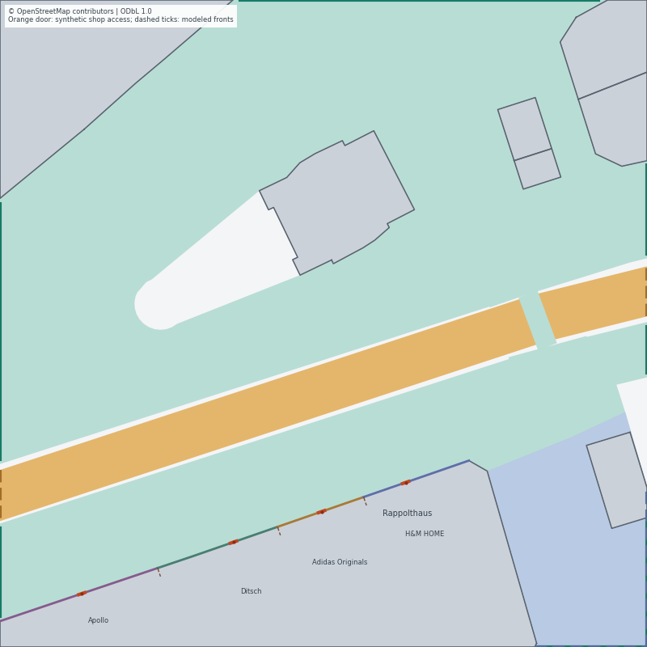

# Storefront and native navigation test report — 2026-10-24

## Outcome and scope

The new `storefronts` source runs through the maintained C++ Simulator, MongoDB,
AGBS, aggregation and verified local replay. It preserves the old integration,
corridor and two-building sources. Native, independent runtime and browser acceptance pass for the reported sources.

Read the [implementation contract](STOREFRONT_NAVIGATION_2026-10-24.md),
[acceptance protocol](STOREFRONT_NAVIGATION_PROTOCOL_2026-10-24.md) and
[compact evidence with hashes](STOREFRONT_NAVIGATION_RESULTS_2026-10-24.json).
This checkpoint improves the experimental motion source; it is not a new privacy
result, a baseline comparison or a calibrated pedestrian-behavior study.



## Source and geometry

The frozen 80 × 80-m OSM-derived scene retains eight physical building footprints.
Apollo, Ditsch, Adidas Originals and H&M HOME share the original Rappolthaus
footprint. Each now has its own synthetic original-facade projection, destination,
1.2-m opening and perpendicular public approach. Colored frontage polylines and
three short inward ticks model tenant-front divisions; they do not invent known
structural building separations or indoor walls. Original crop edges cannot become
entrances. Source-hash-bound manual corrections remain explicitly synthetic.

Seven body-safe walking intervals meet the sensing boundary. Continuous seeded
points on these intervals are both origins and sinks; four additional road/cycling
intervals remain context without unsupported traffic actors. The 64-person source
has 64 unique boundary origins, 64 unique final boundary targets and 96 distinct
guidance-route geometries, using all seven walking intervals. Half the cohort
requests one shop visit: eight visits per destination.

The five existing profiles are 16 Adult Pedestrians and 12 each Child, Senior,
Stroller and Mobility Aid pedestrians. Individual preferred speeds are sampled
within 1.1–1.5 m/s independently of type; maximum body radius is 0.45 m. The new
source does not add the proposed age/equipment modifier taxonomy or measured
shop demand. Routes are generated with a 0.5-m navigation grid; the aggregation
quadtree remains D6 with 1.25-m leaves. Navigation and aggregation cells are separate.

## Motion correctness and the recovered failure

The native source chooses deterministic two-dimensional velocity candidates,
checks exact center-space segment containment and conservative swept-body
reservations, and uses bounded A* around current bodies when progress fails.
Each door has intentional FIFO entry/exit coordination and distributed waiting
goals. Position and velocity are actual accepted motion, without route snapping.
Entry occurs only at the exact target; return follows realized entry plus its
8/10-s hidden gap and receives a fresh observation-track ID. Private person links
never enter the sensor or aggregation boundary.

An early real crossflow test drained safely only after 540.150 s, with 1,548
replans and 1,545 failed searches. Two implementation causes were identified:
mandatory return to stale intermediate guidance points after waiting, and an
extra replan-start clearance margin that excluded physically legal close queues.
Later visible guidance points now provide lookahead while exact normal door
approaches remain mandatory; replanning uses the actual configured body margin.
On unchanged source geometry/requests, completion fell to 186.900 s, with 16
replans and 13 failures. Dedicated stale-guide and queued-return regressions cover
this behavior. Routes or difficult participants were not removed to obtain it.

The source/capture contract requires the same 50-ms outer and motion step. Raw
fractional or larger/smaller capture steps are rejected before database setup;
otherwise substep events and last-substep velocities could be misrepresented.
Historical source modes keep their prior behavior. AGBS independently samples at
100 ms. A complete 180-s clock would censor this source even without congestion:
its nominal latest guidance completion is 185.235 s. The recorded run uses 240 s.

## Tests and bounded finite drainage

- Full configured Release build succeeds; **86/86 CTest suites pass**, 180.82 s.
- The generator executes 27 methods. The three native drain methods have separate
  serial CTest budgets; the geometry/config suite passes in 55.02 s under the
  full run. Genuine shifted manual overrides and wrong hashes/walls are covered.
- **21 native motion groups and 48 YAML/configuration rejection cases pass
  ASan/UBSan**. Leak detection is unavailable on this macOS runtime and disabled;
  this is not a leak-free claim.
- **14 independent audit methods pass**. They cover exact arrival/return, missing
  frames, speed/velocity, thin holes, collisions between stored frames, terminal
  half-open steps, incompatible boundary points, another shop's entrance and
  finite doorway width. A stationary point is checked as a point: a repeated
  coordinate LineString is invalid in GEOS and can falsely fail containment in
  nonrectangular geometry. That reproduced audit regression has its own test.
- After this audit-only correction, its targeted CTest passes in 0.12 s. The native
  binary and recorded motion were unchanged; the full suite was not rerun without
  a relevant production change.
- Viewer/export/comparison validation passes in the configured suite; standalone
  checks cover strict v1/v2 schemas, public/native geometry agreement, private-field
  exclusion and byte-preserving comparison geometry. After final layout/label
  changes, both affected viewer CTests pass in 1.97 s; 62 Python viewer methods
  pass. These were UI-only changes, preserving captured artifacts.

| Pure finite source | 64 people | 128 people |
|---|---:|---:|
| Seed / request spacing | 20261023 / 1,000 ms | 20261024 / 500 ms |
| Scheduled / started / completed episodes | 96 / 96 / 96 | 192 / 192 / 192 |
| Last realized completion | 186.900 s | 344.200 s |
| Active / pending / stalled at 600-s gate | 0 / 0 / 0 | 0 / 0 / 0 |
| Reported physical overlaps | 0 | 0 |
| Maximum consecutive zero-motion stop | 0.250 s | 25.500 s |
| Replans / failed replans | 16 / 13 | 758 / 460 |

The dense-source stop tail is a material limitation, not evidence of general
network liveness or empirically realistic queues. A final empty scene does not
mean that no earlier delay occurred. An independent trace of all 96 normal-source
episodes finds median duration/guidance-time ratio 1.006, p95 1.166 and maximum
1.296. Shortcuts may make ratios below one; guidance length is a reference, not a
lower bound. This evaluation trace uses native `frameAt` and realized lifecycle events keyed
by opaque track tokens; it does not use private person linkage. It is not a
recipient-only analysis.

## Actual native capture and independent audit

Retained locally: `results/storefront-navigation-2026-10-24-64/{scene,replay}`.
Its complete `mapped_scene` matches the frozen 64-person drain fixture exactly.
Only the observation horizon and fresh owned database/configuration context differ.
Normal export independently checks event/GT coverage, GT versus raw AGBS positions,
counts, categories, regional constraints, recipient releases and committed journals.

| Recorded quantity | Result |
|---|---:|
| Horizon / source step / AGBS cadence | 240 s / 50 ms / 100 ms |
| People / visible episodes / lifecycle events | 64 / 96 / 192 |
| Exact shop entries / returns | 32 / 32, eight at every shop |
| GT rows / motion segments including final steps | 85,207 / 85,207 |
| Independently checked terminal steps | 96 |
| Body pairs / continuous relative-motion pairs | 1,431,041 / 1,431,041 |
| Minimum measured body-plus-clearance margin | +0.00001737 m |
| Verified displacement velocities / maximum error | 85,111 / 0.00020565 m/s |
| Compatible realized boundary endpoint checks | 128 |
| Positions more than 2 cm from original guidance | 74,001 |
| Maximum distance from original guidance | 5.1621 m |
| Sensor batches / measured-empty batches | 2,399 / 531 |
| Input observation contributions / raw cell rows | 42,574 / 41,881 |
| Published cell-windows / distinct spatial IDs | 346 / 13 |
| Published / total observation contributions | 11,875 / 42,574 (27.893%) |
| Private retirements / empty retirements | 44,561 / 44,215 |
| Published track/person support inflation under declared gap | 0 cells |

All recorded centers and swept bodies remain within allowed source geometry;
finite rectangular facade exceptions apply only to the track's own declared shop.
The audit includes the final last-GT-to-endpoint step without inventing a GT row.
Body pairs that coexist over a source step are checked continuously, including
ending tracks; a newly admitted half-open episode is not falsely treated as
present during the preceding step. The configured numerical tolerances are in the
auditor; the table reports measured margins rather than universal guarantees.

Whole native execution took 50.434 wall seconds for 240 simulation seconds,
approximately **4.76× throughput**, including startup, motion, aggregation and DB
I/O. Generation, export and audit are separate. This is one whole-run measurement,
not a p99 service time, paced receipt test or hard 50-ms deadline guarantee.

## Policies and interpretation

The existing illustrative Region → PolicyTree adapter is unchanged. Root bounds
are support ≥5, per-released-category support ≥5, cell side 1.25–10 m, window
400–4,000 ms, age ≤4,000 ms and semantic loss ≤1. The entrance region requires
support ≥10; west/east footway regions cap side at 5 m, window/age at 1,000 ms and
semantic loss at 0.5; the central through region also caps semantic loss at 0.5.
The retained four rectangular policy regions are not inferred tenant boundaries.
Strategy remains `semantic_first`, secondary `temporal_first`, trigger
`policy_satisfied`, with private-final-snapshot publication.

These are operational support/utility conditions, not a measured re-identification
or attribute-inference guarantee. All actual releases pass their declared bounds.
This replay has one actual native result: choosing it in A and B shows the same
output, not two algorithms. This checkpoint does not establish adaptive advantage
against a baseline. Only 27.893% of input observation contributions are released
under these retained illustrative bounds; this loss must remain visible rather
than interpreting completion as successful utility. Matched baseline/privacy
studies and reviewed demand/policies remain next.

## Legacy compatibility

A fresh 180-s legacy corridor run matches the frozen reference completely after
normalizing only fresh raw BSON `_id`, run UUID and cursor row order:

| Output | Equal rows |
|---|---:|
| GT/source documents | 95,605 |
| Sensor documents | 42,852 |
| Recipient releases | 509 |
| Private journals, including empty retirements | 47,106 |

Historical integration/corridor/buildings generated configurations are unchanged;
the historical building background PNG is byte-identical. Their native drain
regressions also pass in the full suite.

## Replay and remaining work

Final visual acceptance passes in Chrome: aligned maps, decluttered map names,
separate storefront/door labels and all seven eligible boundary intervals;
play/pause, seek, rewind, inventory and selected-cell reference focus work. At
50 s the source panel shows 40 tracks at 40 distinct coordinates. Rewinding to
zero removes prior samples/releases; the 240-s tail shows zero current tracks
while preserving the explicitly historical 346 release events. Both comparison
panels select the same actual native result in this one-variant bundle.

Highlight controls add overlays to the frozen map context; they do not erase
features already drawn into its background. Their labels and helper now say so.
Verbose source provenance sits below the reference details so it cannot push the
reference map out of alignment. Moving map text in screen space retains its
geographic anchor and never moves a road user. The local proof screenshot is
`/private/tmp/ump-storefront-replay-20261024.jpg` and is excluded from Git.
The verified local replay is served at http://127.0.0.1:8787/. Reopen it without
rerunning the simulation or MongoDB:

```sh
python3 -B tools/replay_viewer/serve.py \
  --bundle results/storefront-navigation-2026-10-24-64/replay --port 8787
```

Full GT, movement, observations and replay remain ignored and local. This report,
compact aggregate evidence, source/tests and the public geometry figure belong in
Git. Next work is a declared privacy experiment on matched streams/baselines and
reviewed policies; later source work includes calibrated demand, surveyed doors,
modifier taxonomy, additional traffic modes and stronger dense-crowd coordination.
