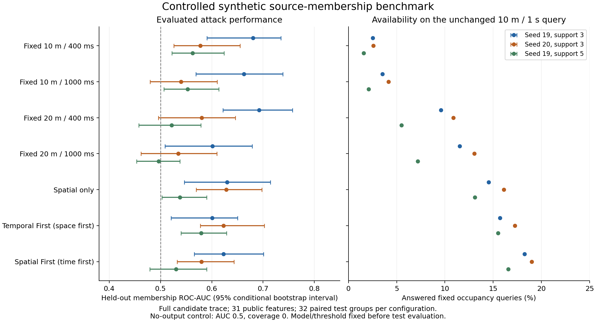

# Test report — independent validation and empirical privacy milestone

Date: 2026-10-19. Repository: `/Users/maxdemu/Developer/UMP-Simulator`.

**Outcome:** the first controlled end-to-end evaluation implementation is complete. All
23 CTest suites and 126 Python test methods pass. The independent oracle accepted all
3,360 policy-mechanism replay results, covering 46,901 released cells across the three
predeclared configurations. The experiment does not establish general privacy protection,
real-world effectiveness, algorithm optimality or independently scheduled local windows.

## Implemented change

- Independent raw-observation/policy compliance checks and bounded tiny-tree feasibility.
- Seeded source-population generation, exact whole-horizon IN/OUT neighbours, partial
  candidate knowledge, grouped splits and identity-normalized clone/provenance checks.
- Strict recipient export and fixed public-only count/availability/geometry/time features.
- Deterministic training-only-scaled logistic classifier, separate calibration, held-out
  ROC-AUC and operating-point metrics, scenario-stratified paired-group bootstrap.
- Seven actual C++ aggregation modes, prior-only/no-output/exact-count controls, fixed
  occupancy utility, private machine-readable evidence and a static scientific figure.

The production aggregation algorithm and live environment were not changed. Existing
user edits to `simulator/config.yaml`, `UMP-Simulator.code-workspace` and
`simulator/src/AgentBasedSensor.cpp` were preserved. The new generator does not repair or
claim to seed the live simulator's wall-clock-dependent motion.

Implementation and reproduction: [EMPIRICAL_PRIVACY_IMPLEMENTATION.md](EMPIRICAL_PRIVACY_IMPLEMENTATION.md).
Canonical definitions: [TERMINOLOGY_AND_NOTATION.md](TERMINOLOGY_AND_NOTATION.md#18-empirical-source-contribution-membership).

## Executed verification

| Check | Actual result | What it establishes |
|---|---|---|
| Release build | Passed | Existing simulator, replay and test targets build in this checkout |
| Complete CTest collection | 23/23 passed, 6.54 s | Existing C++/transport/sensor/publication regressions and registered Python suites |
| Complete Python discovery | 126/126 passed, 6.837 s | Existing utility/privacy/capture checks plus new oracle/dataset/attack/study tests |
| Oracle suite | 31 methods; includes 162 exhaustive depth-2 patterns | Supported bounds, reference classes, mutation detection, CLI and actual seven-mode replay |
| Dataset suite | 15 methods | Reproducibility, variation, neighbour invariants, split/clone/hash/path and overwrite rules |
| Empirical attack suite | 27 methods | Public allowlist, missingness, features, learning, calibration, hand-checked AUC and controls |
| Study suite | 9 methods | Exact/no-output controls, denominator pooling, paired bootstrap, path rejection and actual end-to-end repeated study |
| Three larger configurations | All completed with 36 attack comparisons each | 108 fitted/calibrated held-out model comparisons, all fitted models converged |
| Independent large-case audits | 3,360 valid; 46,901 released cells | Recomputed supported compliance; not search completeness or privacy |
| Scientific replay determinism | Repeated executions agree apart from declared runtime | Fixed inputs yield repeatable scientific outputs |
| Provenance checks | All recorded Python source/report hashes match; threshold variants share identical paired input bytes | Evidence corresponds to the frozen implementation and paired policy comparison |
| Figure export | PNG/SVG generated and visually inspected | Readable separate attack/coverage panels |
| Documentation/notation | Local links and whitespace checks passed; generated LaTeX passed `pdflatex -draftmode` | Reusable canonical formulas and consistent artifact links |

Python discovery and CTest overlap; these counts must not be added as independent test
runs. CTest uses its configured Homebrew Python 3.13 interpreter; the explicit discovery
command also passed with the shell's Python 3.9 interpreter. Timing is local verification
runtime, not a benchmark of end-to-end real-time simulation.

The full CTest configuration includes MongoDB regressions with owned temporary UUID-named
databases. The new oracle, datasets, empirical studies and replay never open MongoDB.
The normal simulator configuration and `Simulation` reference database were not used for
these experiment runs.

```bash
cmake -S simulator -B simulator/build -DCMAKE_BUILD_TYPE=Release \
  -DUMP_BUILD_SENSOR_REGRESSION_TESTS=ON -DUMP_BUILD_PUBLICATION_STORE_TESTS=ON
cmake --build simulator/build -j 4
ctest --test-dir simulator/build --output-on-failure -j 4
PYTHONDONTWRITEBYTECODE=1 python3 -B -m unittest discover -s tools/evaluation -p 'test_*.py' -v
```

## Independent tiny-case findings

Eleven hand-worked production cases were independently compliant. They cover sufficient
and impossible support, handover, a failed sibling, strict regional crossing, missing input,
size/age boundaries and no scheduled samples. The complete artifact is saved separately.

Two cases, `failed_sibling_size_cap` and `strict_regional_crossing`, have **nine input contributions**.
The current production/whole-sibling model retains **zero**; the relaxed partial-child-rescue
reference can retain **six**. This demonstrates an A07 coordination-model limitation.
It is not a violation of the current model and is not a general optimality result. No
production algorithm defect was found by these checks. Full data-depth enumeration,
resource-budget optimality and arbitrary temporal schedules remain out of scope.

A no-release result is not reported as 100% useful or private. Unsupported independent
metric requirements fail explicitly rather than borrowing production pass flags.

## Predeclared empirical protocol

| Setting | Value |
|---|---|
| Presets | Seed 20261019/support 3; seed 20261020/support 3; seed 20261019/support 5 |
| Source realizations | 80 per configuration: 32 training, 16 calibration, 32 test |
| Unique realizations | 160 across two seeds; support 5 intentionally reuses seed-19 observations |
| Paired worlds | Both IN and OUT per group, unchanged background/sampling metadata |
| Scenarios | Equal sparse/dense/handover/heterogeneous strata within each split |
| Horizon / sampling / area | 4 s / 100 ms / 80 m square, finest depth 6 |
| Secret | Whole-horizon source-contribution membership, not physical presence |
| Auxiliary knowledge | Exact candidate points, predeclared fractions 0.25 and 1.0 |
| Prior | Balanced 0.5; no hidden population size or membership labels in features |
| Mechanisms | Four fixed space/time combinations, spatial-only, Temporal First, Spatial First |
| Features | 18 count/availability or 31 count/availability/geometry/time values |
| Model | Independent deterministic L2 logistic model per mechanism/knowledge/feature set |
| Operating point | Calibration empirical FPR cap 0.1; no test tuning |
| Uncertainty | 200 scenario-stratified paired-source-group percentile resamples; frozen models/thresholds |
| Utility query | Fixed 10-m cells / 1-s intervals; included-source sampled occupancy |

There are 240 group/configuration pairs, not 240 independent realizations. Policy-threshold
variants and the seven mechanisms are paired measurements of the same source inputs.
Thirty-two test groups supply 32 positive and 32 negative labels per comparison; windows
and cells do not increase that independent sample count. Each scenario-specific test slice
contains only eight groups, so those outcomes are exploratory.

Sixteen calibration negatives resolve empirical FPR in steps of 1/16. Across all 108 fits,
the largest calibration FPR is 0.0625, whereas the largest held-out FPR is 0.28125. The
nominal cap is therefore explicitly not described as a held-out guarantee. Bootstrap
intervals condition on the fitted classifier and threshold and omit training uncertainty.

## Observed results

The following is the prespecified seed-19/support-3 configuration with full candidate
knowledge and 31 public features. AUC is an evaluated attack outcome; lower values do
not prove protection against other attacks. MAE is conditional on answered queries.

| Mechanism | Held-out AUC [95% interval] | Test TPR / FPR | Query coverage | Conditional MAE (road users) | Mean release age (ms) |
|---|---|---|---|---|---|
| Fixed 10 m / 400 ms | 0.680 [0.590, 0.735] | 0.281 / 0.031 | 2.52% | 0.0361 | 400.0 |
| Fixed 10 m / 1000 ms | 0.663 [0.569, 0.738] | 0.188 / 0.000 | 3.52% | 0.0000 | 1000.0 |
| Fixed 20 m / 400 ms | 0.692 [0.622, 0.757] | 0.125 / 0.031 | 9.59% | 2.5002 | 400.0 |
| Fixed 20 m / 1000 ms | 0.602 [0.509, 0.679] | 0.312 / 0.156 | 11.52% | 2.1828 | 1000.0 |
| Spatial only | 0.630 [0.546, 0.714] | 0.188 / 0.094 | 14.54% | 0.6970 | 400.0 |
| Temporal First (space first) | 0.601 [0.521, 0.650] | 0.281 / 0.125 | 15.71% | 0.6750 | 477.9 |
| Spatial First (time first) | 0.623 [0.566, 0.701] | 0.188 / 0.094 | 18.26% | 0.6252 | 1000.0 |



The figure adds the independent second seed and the paired higher-support policy. Dashed
AUC 0.5 is the random-ranking reference. Its intervals are conditional synthetic sampling
intervals, not formal privacy bounds. SVG: [vector export](figures/privacy_benchmark_2026-10-19.svg).

Findings supported by these runs:

- No universal privacy/utility winner appears. Ordering changes with seed and policy;
  adaptation can preserve more answered queries while leaving detectable membership signal.
- A higher support requirement changes both attack outcomes and utility. Reduced attack
  success must be read alongside changed coverage/error; it is not a standalone success.
- Conditional near-zero MAE for fixed 10-m/1-s output applies to a small answered subset.
  It does not mean that the whole fixed query domain was reconstructed accurately.
- The no-output control has AUC 0.5 and zero coverage in every evaluated setting. The
  unprotected complete-grid control has full coverage and zero occupancy MAE. Its learned
  attack AUC need not exceed every threshold/adaptive variant: the feature-limited attacker
  does not recover every fact available in a richer transcript.
- Per-scenario results, both knowledge levels, both feature sets, calibrated operating
  points, paired AUC differences and frozen predictions are retained in machine-readable
  reports. The table is not a post-hoc choice of the strongest-looking configuration.

## Evidence and reproducibility artifacts

Only the completed `privacy-evidence` bundles below are counted. Preliminary/interrupted
`privacy-milestone` directories are excluded and preserved separately; retries used new paths.

- `results/evaluation/2026-10-19/privacy-evidence/protocol.json`
- `results/evaluation/2026-10-19/privacy-evidence/ep01-hand-cases.json`
- `results/evaluation/2026-10-19/privacy-evidence/verification-logs/`
- `results/evaluation/2026-10-19/privacy-evidence/seed19_support3/{dataset,study}/`
- `results/evaluation/2026-10-19/privacy-evidence/seed20_support3/{dataset,study}/`
- `results/evaluation/2026-10-19/privacy-evidence/seed19_support5/{dataset,study}/`

Each study preserves a complete manifest, input/binary/source/report hashes, commands,
raw replay outputs, strict public exports, independent audit details, models, private
feature/prediction tables, utility summaries and CSV/JSON attack results. These research
bundles include private labels/raw data and remain ignored by Git. The implementation,
tests, definitions, this report and its figure are tracked. The bundle records the previous
Git HEAD plus dirty state and exact source/binary hashes because execution preceded the
final implementation commit. Reproduction uses the recorded hashes rather than assuming
that HEAD alone identified an unmodified checkout.

## Remaining limits and priorities

1. Use the measured A07 model gap to specify partial-child rescue, and add cell-local
   coordination before claiming independent local temporal adaptation.
2. Extend fixed application queries to justified functional-region masks and run the
   planned heterogeneous regional-policy study. The present corridor paths are controlled
   fixtures, not a complete street/shop environment or arbitrary-polygon compiler.
3. Broaden independent realizations, attacker models and auxiliary-knowledge uncertainty;
   include training-set variability before making population-level comparative claims.
4. Add sensitive visit/attribute/linking studies only after their own secret/QI/reference
   contracts; formal k/l/t and any DP mechanism remain separate decisions.
5. Real maps, destinations/shop activity, global/local navigation and collision avoidance
   remain lower-priority simulation extensions. The live seed/wall-clock issue is unchanged.

Operational support compliance, independent release correctness and measured attack outcomes
are separate evidence. Completing this milestone establishes an executable research path.
It does not establish that all policy-compliant releases are anonymous.
