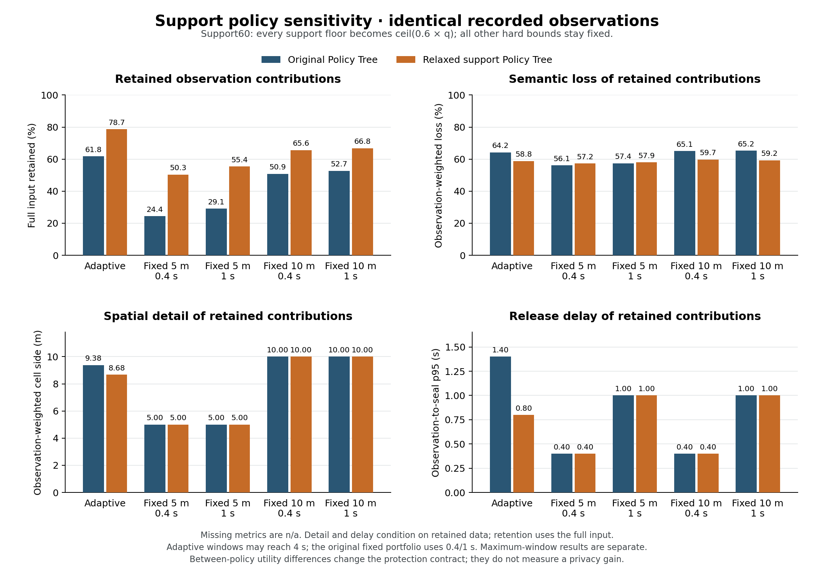

# Urban mixed-mode scenario: Policy Tree and baseline results

Date: 2026-10-24. Status: all ten predeclared cases completed and independently verified on one frozen recording, followed by four separately classified post-hoc maximum-window cases. The adaptive mechanism retains more source observations than every tested fixed setting, while the fixed 10-m/1-s setting answers the predeclared aligned occupancy queries more effectively. These are different utility outcomes; this experiment does not establish empirical privacy gain or a real-time guarantee.

The figure shows the original ten-case matrix only. Adaptive windows may extend to 4 s; its fixed bars use 0.4/1 s. The separate four-second sensitivity below narrows the retention advantage and preserves the fixed methods’ counterexamples.

The complete aggregate tables are in the [generated report](verification/urban-policy-comparison-2026-10-24/report.md), with [machine-readable summary](verification/urban-policy-comparison-2026-10-24/summary.json), [frozen protocol](verification/urban-policy-comparison-2026-10-24/protocol.json) and [artifact digests](verification/urban-policy-comparison-2026-10-24/evidence-manifest.json). Full observations, trajectories, per-case results and the replay stay local under ignored `results/urban-traffic-2026-10-24-256-policy-comparison/`. The design and interpretation contract is documented in the [support-sensitivity protocol](SUPPORT_POLICY_SENSITIVITY_PROTOCOL_2026-10-24.md).

## 1. The source and the actual protection requirements

The 80 × 80-m Mönckebergstraße crop uses a D6 observation quadtree (1.25-m finest cells). One 240-s recording, sampled every 100 ms from a 50-ms native source, contains **187,745 observation contributions**. These are repeated sensor observations, not 187,745 different people. The cohort has 256 people and 360 visible episodes, with peak concurrency 224. All 360 episodes start and end within the recorded horizon, with no active/pending episodes or recorded body-overlap violations at its end. The 100-ms sensor stream contains 357 distinct observed track tokens, whereas 360 is the GT lifecycle episode count; three completed episodes do not appear in a recorded sensor sample. Subsequent source inspection identifies two zero-displacement 50-ms episodes starting in their own boundary sink, plus one 1200-ms episode tangent to the maximum-x boundary, which the sensor's half-open coverage excludes (12 potential 100-ms samples). These are source/sink and coverage defects, not simply ordinary cadence aliasing. They remain limitations of this frozen recording; generator corrections and their native acceptance gate are separate, and the fourteen case results are not silently regenerated. The 187,745-contribution denominator describes the actual aggregator input, not all idealized GT visibility. The same source observations and replay binary are used in all ten cases; the observations digest is `f43a28abaa253816e34732f29f07f63b953ecc40f57aae884c349329c6b9a1a1`.

There are 205 pedestrians across five profiles (46 adult, 41 child, 35 senior, 42 with stroller and 41 with mobility aid), plus 17 adult cyclists, 17 senior cyclists and 17 adult E-scooter drivers. Motion, type mix and visit schedules do not change between policies or methods. The semantic release catalog has truthful pedestrian, cyclist and E-scooter families at loss 0.5, exact source labels at loss 0, and a common road-user root at loss 1.

The original root requires at least five distinct observed tracks per candidate and per released semantic bin, cell sides between 1.25 and 10 m, window duration between 400 and 4000 ms, and age at evaluation no greater than 4000 ms. The entrance patch increases total support to ten. The west/east patches additionally restrict output to at most 5 m, at most 1000 ms and semantic loss at most 0.5. A central through-footway patch also limits semantic loss to 0.5. A release footprint inherits the strictest bounds from every positively intersected patch, including empty parts of the footprint.

The second tree changes **only support floors**: root total/category support 5 → 3 and entrance total support 10 → 6. All geometry, timing, semantic ceilings, source and action preferences remain unchanged. This is a weaker protection contract, so its utility gains cannot be called privacy improvements.

The adaptive controller uses independent local windows, Semantic First with the captured Temporal First secondary preference, and `policy_satisfied` immediate release. Four fixed references use 5/10-m grids crossed with 400/1000-ms windows, with the same truthful semantic-cut evaluator, taxonomy/caps and hard policy checks. They can semantically generalize and suppress noncompliant candidates; they are not raw unprotected GBS output. They form a declared bounded portfolio, not the best possible uniform schedule. Every actual release passes the independent geometry/retirement, exact identity-union, semantic-cut and effective-policy audits. The [native/offline agreement check](verification/urban-policy-comparison-2026-10-24/native-offline-agreement.json) additionally confirms that the original adaptive replay reproduces the recorded native release multiset, including seal times and semantic/count values; delivery order and adapter IDs are excluded.

## 2. Observation retention and representation detail

Let \(N_{\mathrm{in}}\) denote all input observation contributions and \(N_{\mathrm{pub}}\) the contributions represented by released records. Retention is \(\rho=N_{\mathrm{pub}}/N_{\mathrm{in}}\). Semantic mean loss is contribution-weighted over retained data; it must be read with retention, since suppressing difficult observations could otherwise appear to improve quality.

| Policy | Method | Retained input | Mean semantic loss | Mean cell side | Mean interval | Mean observation-to-seal delay | p95 delay |
| --- | --- | ---: | ---: | ---: | ---: | ---: | ---: |
| Original | Adaptive | **61.77%** | 0.642 | 9.38 m | 678 ms | 391 ms | 1400 ms |
| Original | Fixed 5 m / 0.4 s | 24.37% | 0.561 | 5 m | 400 ms | 250 ms | 400 ms |
| Original | Fixed 5 m / 1 s | 29.10% | 0.574 | 5 m | 1000 ms | 550 ms | 1000 ms |
| Original | Fixed 10 m / 0.4 s | 50.89% | 0.651 | 10 m | 400 ms | 250 ms | 400 ms |
| Original | Fixed 10 m / 1 s | 52.68% | 0.652 | 10 m | 1000 ms | 550 ms | 1000 ms |
| Support60 | Adaptive | **78.70%** | 0.588 | 8.68 m | 563 ms | 332 ms | 800 ms |
| Support60 | Fixed 5 m / 0.4 s | 50.34% | 0.572 | 5 m | 400 ms | 250 ms | 400 ms |
| Support60 | Fixed 5 m / 1 s | 55.40% | 0.579 | 5 m | 1000 ms | 550 ms | 1000 ms |
| Support60 | Fixed 10 m / 0.4 s | 65.64% | 0.597 | 10 m | 400 ms | 250 ms | 400 ms |
| Support60 | Fixed 10 m / 1 s | 66.85% | 0.592 | 10 m | 1000 ms | 550 ms | 1000 ms |

Within the original policy the adaptive retention advantage is **9.09 percentage points** over the highest-retention tested fixed reference (17.25% relative). Within Support60 it is **11.85 percentage points** (17.73% relative). This demonstrates a useful retention trade-off under the same declared requirements; it does not demonstrate that every downstream task benefits. **The adaptive controller can use windows up to 4 s, while this predeclared fixed portfolio tests only 0.4/1 s. Its retention advantage therefore does not isolate adaptation from access to longer permitted windows.** The maximum-window sensitivity below is a separately labeled post-hoc check, not a replacement of the original protocol or an exhaustive uniform optimum.

The original adaptive result publishes 3199 cell-windows across 84 different spatial IDs. Most windows use 10-m cells (2691), with 504 at 5 m and four at 2.5 m. Support60 publishes 6536 cell-windows across 243 spatial IDs: 4173 at 10 m, 2108 at 5 m, 234 at 2.5 m and 21 at 1.25 m. These are counts over time, not simultaneous quadtree leaves. A lower mean output side than the 10-m reference shows some local precision, but the result is still predominantly coarse. Higher concurrency does not by itself provide enough distinct local tracks for fine support constraints everywhere.

The adaptive mean interval remains well below the 4-s maximum: the controller does not always wait until the deadline. Its original p99 observation delay is 2800 ms and maximum 4000 ms; Support60 p99 is 2500 ms and maximum 4000 ms. Thus the original controller has a lower mean delay than a fixed 1-s window but a worse tail. Observation delay here is \(\delta(o)=t_{\mathrm{seal}}-t_o\), not merely the age of the start of its aggregation window.

## 3. Quantitative operational support and semantic costs

| Policy/method | Cell support min / p50 / observation-weighted mean | Category support min / p50 / category-weighted mean |
| --- | ---: | ---: |
| Original adaptive | 5 / 7 / 10.32 | 5 / 7 / 10.32 |
| Original fixed 10 m / 1 s | 5 / 8 / 12.29 | 5 / 8 / 12.29 |
| Support60 adaptive | 3 / 4 / 8.21 | 3 / 4 / 7.50 |
| Support60 fixed 10 m / 1 s | 3 / 5 / 10.49 | 3 / 5 / 9.36 |

Both p50 statistics use unweighted nearest rank. Repeated samples do not manufacture distinct-track support: the evaluator and audit use identity unions across space, time and semantic descendants. The observed minima satisfy each tree's floors; stricter local floors are also checked on each actual footprint. Mean support is descriptive, not a replacement for those local minimum checks. It cannot be translated into a probability of identification without a threat model.

Semantic loss is not uniformly 100%: 28.50% of retained original-adaptive contributions are represented only as `road_user`; most others are represented as `pedestrian`. However, exact subtypes retain only **0.0304% of the entire input** under the original adaptive policy. No original-adaptive cyclist or E-scooter family bins are published. Their source contributions can survive in the root count while their mode information disappears.

Support60 reduces road-user-root representation to 21.86% of adaptive retained contributions and preserves exact labels for 3.388% of the whole input. Its cyclist-family/exact-cyclist output represents 900 contributions, and exact E-scooter output 506 contributions. This remains a small part of those input modes. Fixed 10 m / 1 s under Support60 preserves **3.837%** of the full input at exact subtype level, exceeding adaptive's 3.388%; the adaptive method is not superior on every detail metric.

Source-type retention must therefore not be confused with retention of the source label. Original adaptive retains 80.33% of adult-cyclist, 83.27% of senior-cyclist and 84.23% of E-scooter contributions, compared with 70.96%, 72.32% and 74.52% for fixed 10 m / 1 s. Many of those retained riders are represented only as undifferentiated road users. Per-type input denominators remain in the compact report, so rare groups do not disappear from the analysis after generalization.

## 4. Where local policies help and where they still hurt

These percentages count retained observations whose original position lies in the stated policy patch. They describe source-point memberships, not the full-footprint rule used for compliance; overlapping memberships are nonexclusive.

| Source-point patch | Original adaptive | Original fixed 10 m / 1 s | Support60 adaptive | Support60 fixed 10 m / 1 s |
| --- | ---: | ---: | ---: | ---: |
| Central through-footway | 93.52% | 89.93% | 96.74% | 95.03% |
| East fresh-footway | 11.55% | 0% | 27.26% | 0% |
| West fresh-footway | 15.28% | 0% | 47.38% | 0% |
| Entrance vicinity | 40.62% | **44.20%** | 85.19% | 82.17% |
| Outside selected patches | 60.92% | 50.53% | 79.73% | 68.80% |

The fixed 10-m grid cannot satisfy the 5-m maximum in the west/east patches. Adaptive local refinement retains some data there while coarser releases remain possible elsewhere. A fixed 5-m grid recovers some patch data but loses much more globally: original fixed 5 m / 1 s retains 29.10% overall, and actually exceeds adaptive in these individual west/east patches (18.03%/12.52% versus 15.28%/11.55%). The value is therefore the ability to make a local compromise, not an automatic win in every local patch.

The original entrance patch is also a counterexample: fixed 10 m / 1 s retains 44.20%, while adaptive retains 40.62%. It is not justified to blame this gap on one coordination rule without an ablation. The existing final-output experiment establishes the gap, not its causal decomposition. Under Support60 the adaptive entrance retention rises to 85.19%, but both policies and both methods must remain visible in the report.

## 5. Why the aligned fixed reference wins the recipient task

The predeclared recipient bank asks total/family occupancy over 64 fixed 10-m cells and 1-s intervals, at lags 0 and 1000 ms. There are 122,880 declared queries in total; **11,826 positive-reference interior queries per lag** provide the nonempty primary denominator. Known-zero and boundary-window results remain separate in the evidence. Exact answers require complete public support for the requested footprint, time interval and category. Estimates apply the declared uniform spatial/time allocation only where semantic/support requirements permit it; missing releases are not zero.

| Policy/method | Positive exact coverage, lag 1 s | Positive estimate coverage, lag 1 s | Conditional estimated occupancy MAE |
| --- | ---: | ---: | ---: |
| Original adaptive | 0.0085% (1 query) | 16.37% | 0.0904 |
| Original fixed 10 m / 0.4 s | 0% | 13.47% | 0.0382 |
| Original fixed 10 m / 1 s | **16.46%** | **16.46%** | 0 |
| Support60 adaptive | 0.0169% (2 queries) | 24.07% | 0.0550 |
| Support60 fixed 10 m / 0.4 s | 0% | 25.68% | 0.0285 |
| Support60 fixed 10 m / 1 s | **30.67%** | **30.67%** | 0 |

The 1-s fixed publication intervals align with the 1-s queries, so its supported answers can be exact. The adaptive local window endpoints typically cross query boundaries. In the Support60 adaptive result, 2845 positive queries have temporal crossing as their only diagnosed representation obstacle; another 1203 combine temporal crossing with semantic ambiguity. Original adaptive has 1935 temporal-only crossings. None of these aggregate diagnostics establishes why the producer withheld every missing subarea, but they directly explain why a retained observation does not automatically yield an exact aligned query answer.

At lag 0 the adaptive estimate coverage is only 3.44% original and 6.82% Support60; later availability raises these to 16.37% and 24.07%. Fixed 10 m / 1 s already answers its aligned supported queries at the zero-lag deadline. Conditional errors are computed over each method's answered set, which differs across methods; a lower conditional MAE alone is not a paired error result or a reason to hide lower coverage. The present application contract therefore favors the aligned fixed reference despite the adaptive retention advantage.

## 6. Runtime and what this experiment does not time

The serial replay reports core processing plus in-memory result serialization, excluding input validation and file I/O. Its process wall time includes those excluded native costs. The full pipeline additionally includes Python audits and recipient-query evaluation. The table includes every case; these are single measurements without confidence intervals.

| Policy | Method | Core | Native process wall | Complete comparison pipeline |
| --- | --- | ---: | ---: | ---: |
| Original | Adaptive | 124.20 s | 127.65 s | 156.33 s |
| Original | Fixed 5 m / 0.4 s | 1.84 s | 4.84 s | 12.69 s |
| Original | Fixed 5 m / 1 s | 0.96 s | 3.68 s | 9.49 s |
| Original | Fixed 10 m / 0.4 s | 1.27 s | 4.11 s | 10.89 s |
| Original | Fixed 10 m / 1 s | 0.76 s | 3.50 s | 8.83 s |
| Support60 | Adaptive | 111.00 s | 114.02 s | 143.58 s |
| Support60 | Fixed 5 m / 0.4 s | 1.85 s | 4.84 s | 13.91 s |
| Support60 | Fixed 5 m / 1 s | 1.00 s | 3.82 s | 11.26 s |
| Support60 | Fixed 10 m / 0.4 s | 1.37 s | 4.23 s | 11.87 s |
| Support60 | Fixed 10 m / 1 s | 0.76 s | 3.90 s | 9.73 s |

Adaptive replay processes the 240-s source in 124.20/111.00 core seconds, an aggregate throughput above simulated time, but this is **not a per-step deadline or live delivery guarantee**. The replay has no per-event service p95/p99/max telemetry in this unpaced run; none can be inferred from the total. Its private diagnostic serialization also differs from production sink cost. The fixed reference is much cheaper computationally. These data motivate profiling the aggregation controller on this exact source before parallelizing or changing its decisions.

Separately, the recorded integrated native run takes 217.57 s wall time including startup, source, aggregation and MongoDB I/O. Other validation jobs overlapped that capture, so this is not an isolated end-to-end benchmark. The [accepted source-only profile](verification/urban-traffic-accepted-profile-2026-10-24.json) isolates movement: optimized mean 15.32 ms, p95 46.06 ms, p99 115.38 ms and maximum 226.25 ms, with 183 of 4076 steps above the 50-ms source step. Those source-only tails cannot be called aggregator tails or an integrated real-time result. The three timing scopes must not be subtracted or added as though they were a synchronized component trace.

## 7. Separate post-hoc check: give fixed references the full 4-s allowance

After seeing the ten-case results, four additional cases test fixed 5/10-m grids at 4000 ms under each policy, on the same unchanged source and binary. This is explicitly **post-hoc sensitivity**, not a predeclared fourteen-case experiment. The [separate frozen protocol](verification/urban-max-window-sensitivity-2026-10-24/protocol.json), [summary](verification/urban-max-window-sensitivity-2026-10-24/summary.json) and [full aggregate report](verification/urban-max-window-sensitivity-2026-10-24/report.md) preserve this distinction. The original ten-case manifest, source and protocol are untouched.

| Policy/method | Retained input | Exact subtype / full input | Mean semantic loss | Mean observation delay | p95 delay | Core |
| --- | ---: | ---: | ---: | ---: | ---: | ---: |
| Original fixed 5 m / 4 s | 44.31% | 0.059% | 0.618 | 2048 ms | 3800 ms | 0.523 s |
| Original fixed 10 m / 4 s | **58.73%** | 0.535% | 0.656 | 2050 ms | 3800 ms | 0.452 s |
| Support60 fixed 5 m / 4 s | 63.50% | 0.956% | 0.591 | 2042 ms | 3800 ms | 0.550 s |
| Support60 fixed 10 m / 4 s | **70.54%** | **7.815%** | **0.554** | 2049 ms | 3800 ms | 0.462 s |

All four cases pass their independent audits with zero publication-policy violations. A 4-s candidate remains illegal in the west/east patches with a 1-s hard ceiling, so both fixed4s grids suppress those patches. This is part of the unchanged heterogeneous application contract, not a relaxed exception for a baseline.

The adaptive retention advantage persists over the best **six** tested uniform grid/window settings per tree, but narrows to **3.04 percentage points original** (61.77% versus 58.73%) and **8.15 points Support60** (78.70% versus 70.54%). The larger original ten-case gains therefore include an important window-availability effect. These six settings are still a bounded portfolio; this sensitivity does not establish the exhaustive uniform optimum or isolate every action/coordination mechanism.

The fixed4s reference also wins meaningful details: Support60 fixed 10 m / 4 s preserves 7.815% of all input at exact subtype resolution, compared with adaptive 3.388%, and has lower conditional mean semantic loss (0.554 versus 0.588). Original fixed 10 m / 4 s retains 59.01% of entrance-vicinity contributions, compared with adaptive 40.62%. The adaptive method has much lower logical observation delay: original mean/p95 391/1400 ms versus fixed4s 2050/3800 ms, and Support60 332/800 ms versus 2049/3800 ms. This remains a multi-criteria trade-off rather than universal dominance.

For the unchanged positive 1-s recipient queries at lag 1 s, fixed 10 m / 4 s answers zero exactly. Its estimates cover 11.25% original and 20.14% Support60, with conditional occupancy MAE 0.7324 and 0.6020 respectively. Adaptive estimates cover 16.37%/24.07% with conditional MAE 0.0904/0.0550; the answered sets differ, so this is not a paired-error claim. Fixed 10 m / 1 s remains the strongest tested aligned-query reference (16.46%/30.67% exact). Longer fixed windows improve retained detail while increasing latency and temporal inference error for these particular 1-s queries.

The four new native processes take about 3.04–3.26 s each and their complete audit/query pipelines 7.50–8.48 s. No repeated timing or per-step tail result is claimed. All raw results and the additional replay remain local in `results/urban-traffic-2026-10-24-256-max-window-sensitivity/`.

## 8. Defensible findings and next controlled questions

The supported finding is: **on this synthetic mixed-mode source, the adaptive controller satisfies the declared local support/resolution/timing/semantic constraints and retains more source observations than the bounded fixed portfolio, including the separately labeled 4-s sensitivity, while paying substantially more computation and producing less directly usable aligned occupancy output.** Relaxing support improves coverage for both sides and allows more fine output, with a correspondingly weaker protection requirement. There is no empirical attack-risk result here.

The immediate algorithmic question is which application utility the controller should optimize: retained observations, spatial detail, timely total occupancy, or mode-resolved occupancy. A controller intended for the current fixed 1-s occupancy queries needs to address public interval compatibility, not merely retain more observations. That is a separately declared design/ablation, not a post-hoc change to this experiment. The rare-mode information loss also needs an explicit decision about permitted semantic ceilings and minimum category support before any claim about cycling/scooter utility.

A further study should keep this source as a frozen control, predeclare any changed query-aware release/coordination rule, measure its tails with a paced/live contract, and repeat on independent seeds/density profiles. Membership/linkage attacks and a defined protected unit remain a subsequent privacy-evaluation gate. One source and one timing run establish an inspectable mechanism result and clear limitations, not general superiority or privacy guarantees.
