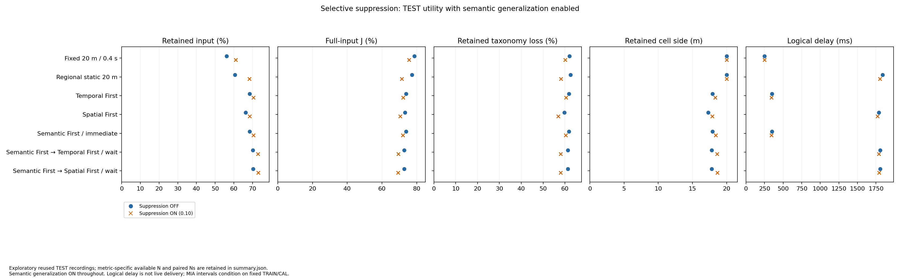
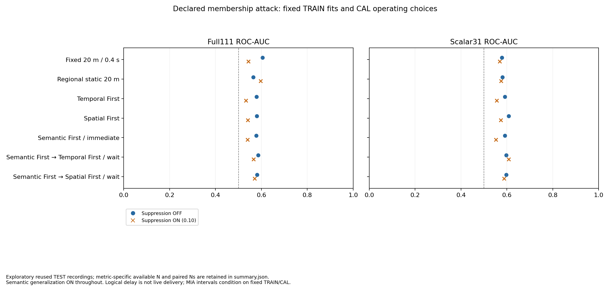
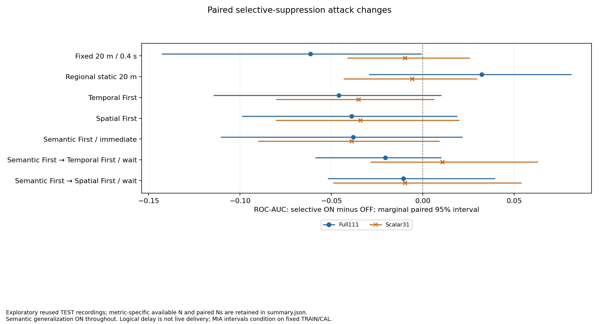

# Selective suppression: completed utility and MIA study

Seven paired methods use the same 72 recordings and unchanged hard policies. Semantic generalization remains enabled; only selective contribution suppression changes from OFF to a 0.10 per-candidate input-contribution cap. All 1,296 native executions and 144 regional compositions verify.

Read the [full result tables](report.md), [aggregate data](summary.json), [complete verification](complete-verification.json) and [separate bootstrap verification](paired-bootstrap-verification.json). Raw movement, individual features/scores, masks, fitted arrays and thresholds remain local.

## Main comparison

Retention and J are equal-recording TEST IN means. Each MIA uses 32 matched TEST recordings (64 IN/OUT examples). Lower J is better; lower AUC indicates weaker measured discrimination by this particular attack.

| Method | Retention OFF → ON (%) | J OFF → ON (%) | Full111 AUC OFF → ON | Scalar31 AUC OFF → ON |
|---|---:|---:|---:|---:|
| Fixed 20 m / 0.4 s | 56.16 → 61.07 | 78.67 → 75.62 | 0.6050 → 0.5435 | 0.5786 → 0.5688 |
| Regional static 20 m | 60.60 → 68.39 | 77.25 → 71.38 | 0.5649 → 0.5972 | 0.5806 → 0.5747 |
| Temporal First | 68.53 → 70.48 | 73.81 → 72.14 | 0.5786 → 0.5327 | 0.5913 → 0.5562 |
| Spatial First | 66.30 → 68.46 | 73.31 → 70.51 | 0.5796 → 0.5405 | 0.6079 → 0.5737 |
| Semantic First / immediate | 68.53 → 70.44 | 73.80 → 72.05 | 0.5776 → 0.5396 | 0.5913 → 0.5522 |
| Semantic First / wait / Temporal secondary | 70.21 → 72.95 | 72.82 → 69.34 | 0.5864 → 0.5659 | 0.5972 → 0.6079 |
| Semantic First / wait / Spatial secondary | 70.33 → 73.11 | 72.78 → 69.28 | 0.5815 → 0.5708 | 0.5972 → 0.5874 |

All seven methods improve retained input and reduce J and conditional taxonomy loss. The two baselines benefit too: regional static retention rises by 7.79 percentage points, compared with 2.78 pp for Semantic First → Spatial First / wait. This narrows the adaptive retention margin; it does not eliminate it.

The largest retained-input point estimate is Semantic First → Spatial First / wait at 73.11%, versus regional static20 at 68.39%. Its own OFF-to-ON retention improvement is 2.783 pp, marginal paired 95% interval [2.454,3.102] pp. Its J falls from 72.78% to 69.28%. Its conditional mean cell side becomes coarser, from 17.84 to 18.63 m, as the retained population changes. Temporal First and immediate Semantic First instead preserve short logical delay (about 0.34 s rather than 1.79 s). There is no single winner across all metrics.

## Privacy interpretation

All negative and positive controls pass. All seven historical attack families, all controls and the original primary comparison are exactly preserved.

Full111 AUC decreases for six of seven methods, but the regional static point estimate increases. Only Fixed 20 m / 0.4 s with Full111 has a marginal paired ON-minus-OFF interval entirely below zero: difference −0.06152, 95% interval [−0.14258,−0.000952]. The other 13 same-method intervals and all ten adaptive-versus-regional-ON intervals include zero. In particular, the Spatial First/Full111 versus regional upper endpoint is positive (+0.00004883); rounding must not turn it into a below-zero claim.

This is an exploratory signal for one baseline, not a broad additional privacy guarantee or established adaptive privacy dominance. The results do not prove equal privacy either. New TEST FPR ranges from 6.25% to 34.38% across methods/representations; the CAL 10% operating target is not a TEST guarantee. Full111 versus Scalar31 changes several information sources and does not isolate semantic leakage.

## Cost and scope

The selective omission itself is about 0.29–0.67% of total input contributions, while avoiding larger whole-cell losses. However, original-type effects differ. Adult E-Scooter Driver selective omission reaches 11.60% of its own input for regional static20 and 10.63% for wait/Spatial; its total omission increases by about 4.0 and 5.9 pp respectively. The cap divides by all candidate observations, not by each original type or by distinct persons.

J combines omitted input and retained taxonomy loss, excluding spatial/time distortion. It is neither a privacy metric nor complete application utility. Filtered outputs cannot exactly answer original-GT population queries; count proxies are separately labelled and scored. Logical delay is not measured live delivery.

The protected unit is all observed contributions of one operational track in [0,300 s), not a physical person across visits. TRAIN/CAL/TEST are 24/16/32 recordings. Models and CAL choices are locked before new TEST scores, but TEST recordings were exposed in prior work: all comparisons are exploratory reused-source evidence. The 1,000-resample intervals are marginal, conditional on fixed fits and thresholds, and not adjusted for the family of comparisons.

## Verification and provenance

The native six-worker batch takes 7,260.164 s (2 h 1 min). The excluded short DEV pilot showed 5.51× throughput versus one worker; this is not a measured full-study speedup or a real-time guarantee. The 632-test affected suite passes, followed by 23 focused auditor tests including nine new regressions. A separate independent bootstrap checker passes nine synthetic checks and exactly reproduces all 24 AUC plus 42 utility intervals (maximum arithmetic difference 0.0).

The independent score auditor recomputes locked logistic scores and fixed-threshold metrics. Its own scope excludes bootstrap reexecution; the separate checker linked above supplies that additional evidence. Neither independent check reruns the physical simulation or refits models. All four actual PNGs were reviewed, with SVG exports retained.

Two corrections are explicit: the [source-type prose count](../utility-outcome/source-type-count-correction.md) (eight source types, seven method pairs), and the [source-order verification addendum](../../../URBAN_SELECTIVE_SUPPRESSION_AUDIT_ORDER_ADDENDUM_2026-10-28.md). The original failed audit is preserved; the successful additive audit changes only metadata order. All frozen scientific inputs, source roles, models and results remain unchanged.

The utility packet was published at `2748d12`, the audit correction at `436ff33`, and the model lock at `2098b53` before new TEST scoring. The [model lock](../model-lock/README.md) and [execution/test report](../../../URBAN_SELECTIVE_SUPPRESSION_TEST_REPORT_2026-10-28.md) record the boundaries.

Numeric omission annotations are measured values. Near-zero values can appear gray in the diverging scale; unavailable values would be explicitly labelled NA.

