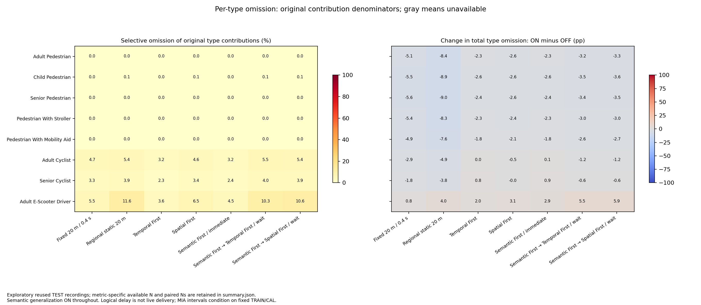

# Selective suppression: verified utility outcome

All 72 recordings, 1,296 native cases and 144 regional compositions verify. The
complete comparison has 2,016 headline rows and 432 auxiliary rows. The independent
utility audit passes 38,880 arithmetic checks and authenticates source/public
bindings while preserving all 1,008 historical rows.

Read [the result tables](report.md), [aggregate data](summary.json) and
[independent verification](independent-verification.json). Semantic generalization
is ON in both conditions. Only selective contribution selection changes.

The action improves retained input and the declared J/taxonomy measures across
all seven methods. Baselines benefit too. Spatial means remain conditional on
retained observations, and the adaptive means become coarser in this series.
Per-type omission must be read alongside total retention: E-Scooter contributions
are omitted more often overall in several methods. A 0.10 per-cell input cap is
not a 10% cap for each original class or for all omitted data.

In the omission figure, numerical annotations give the actual measured changes.
The right-hand diverging scale can appear gray around small valid changes; missing
values would be explicitly marked NA. No source type is missing in this matrix.

See the [explicit source-type count correction](source-type-count-correction.md):
there are eight source types, while seven is the number of method pairs.

This packet is published before new MIA fitting. It establishes no new privacy
benefit. New TRAIN/CAL locks and TEST scores follow only after their separate
verification/publication gates. Raw motion, masks, models and individual rows
remain local.
